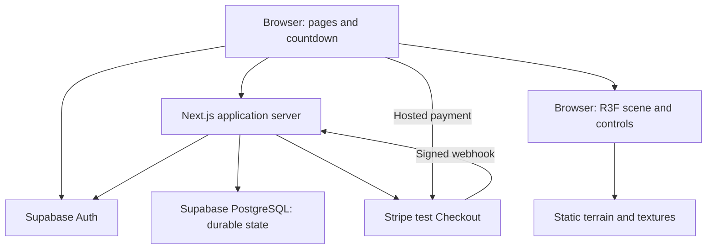
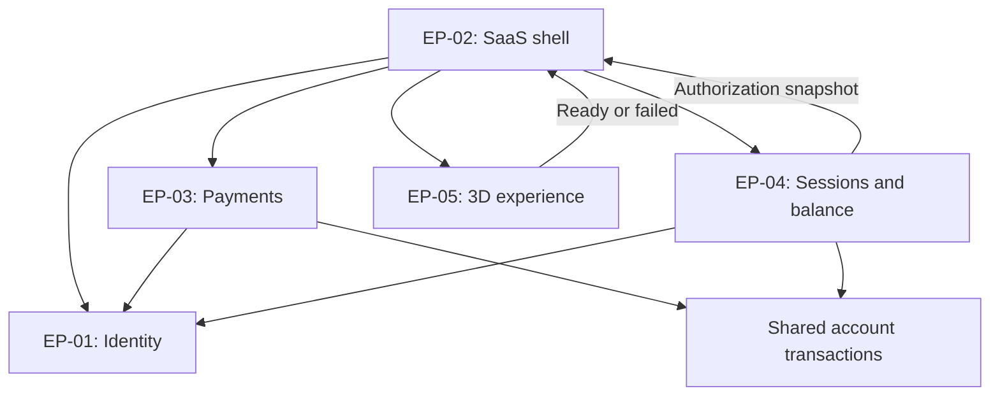
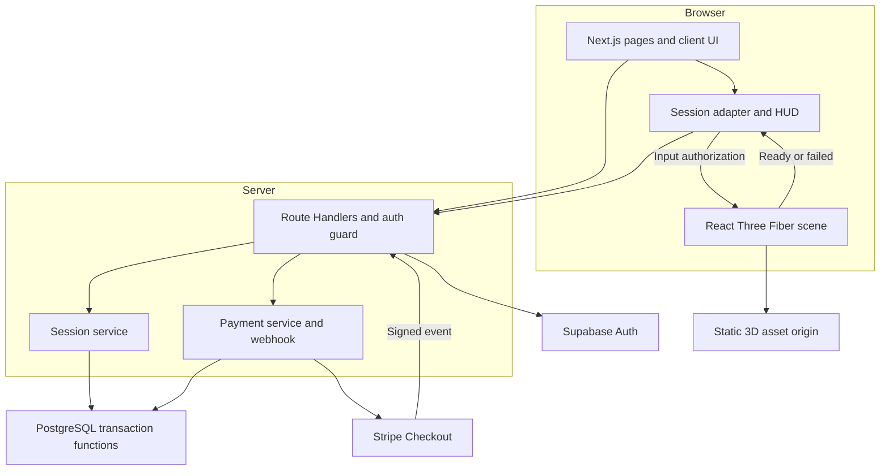
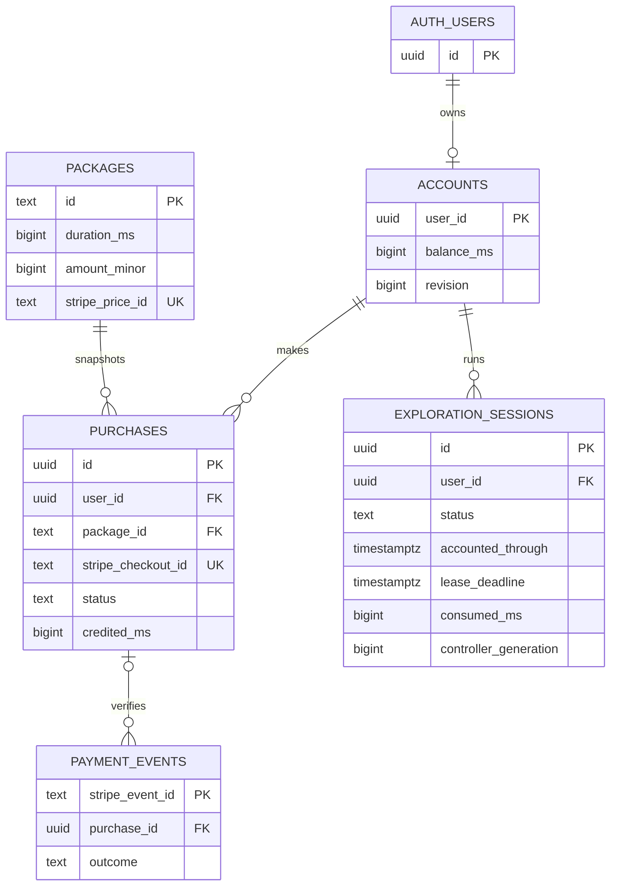
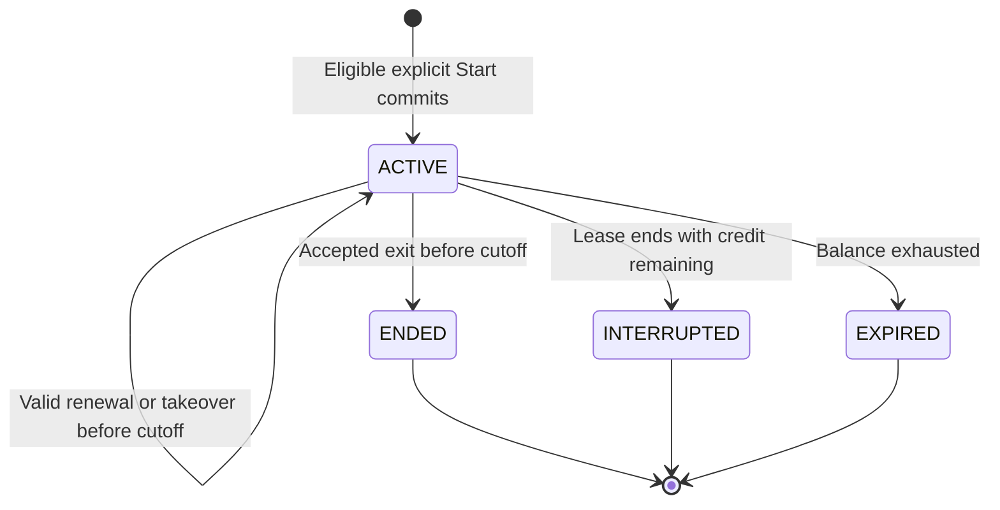
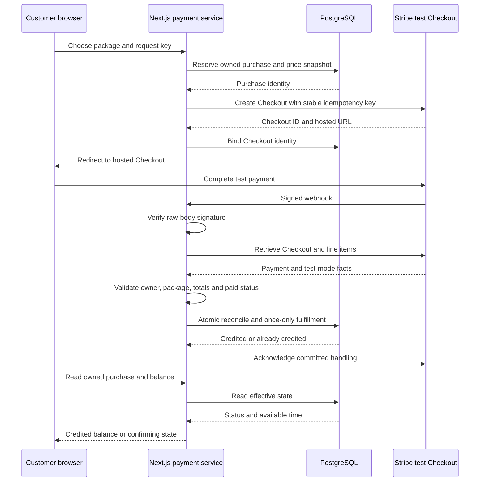

# LUNARA — Software Requirements Specification and Technical Architecture

Version 1.0 · 25 October 2026 · Implementation blueprint; recommendations pending team confirmation

**Product:** LUNARA — Explore Beyond Earth · **Project:** Lumen 2.0 · **Delivery constraint:** five developers, nine hours.

**Baseline:** `PRODUCT.md`, version 1.0, dated 25 October 2026, and the full architecture brief in `Texte collé(4).txt`. The PRD is labeled “Draft for product approval”; this document does not silently promote its proposals to approved requirements. Its confirmed decisions govern; its proposed defaults are adopted provisionally below. All software behavior, tests, and performance figures are specifications, not claims of completed implementation or measured results. No application code is included.

**Reading convention:** Confirmed = explicit product decision; Recommended = architectural choice; Proposed = product policy or target still requiring confirmation; Unverified = dependency not inspected; Future = excluded from this MVP. SRS identifiers such as `FR-TIME-001` are new technical refinements; `FR-01`, `US-01`, `UC-01`, and `C-01` refer to actual PRD identifiers.

# 1. Software Requirements Specification Overview

## Purpose, scope, audience, and boundaries

This document specifies an implementable SaaS demonstration: registration, authentication, test purchases of exploration time, durable balances, one authorized exploration session per account, and first-person navigation on one imported simulated Mars landscape. It guides the five developers, their Claude Code sessions, the integration owner, and acceptance reviewers. `PRODUCT.md` owns product intent; this SRS specifies enforcement, interfaces, data, deployment, and verification. Later `API_CONTRACT.md`, `TASKS.md`, and `CLAUDE.md` must refine this design without changing its invariants.

**Confirmed boundaries:** one playable Mars destination; one selected asset; W/S translation, A/D turning, mouse look; continuous billing while active even when stationary; Stripe test Checkout; backend authority; expiry and repurchase. No real payments, live Mars transmission, physical robot, visible rover, phone controller, advanced physics, second map, multiplayer, subscription, or admin dashboard. Optional signal decoration must never delay controls or change accounting.

**Recommended architecture:** one Next.js TypeScript application on Vercel; Supabase Auth and its managed PostgreSQL database; Stripe-hosted test Checkout; client-only Three.js through React Three Fiber/Drei. Supabase and PostgreSQL are not two competing databases: PostgreSQL is the database provided by Supabase. TypeScript handles authentication, validation, orchestration, and presentation; PostgreSQL functions provide atomic state transitions. No WebSocket service, cron requirement, persistent timer process, queue, separate backend language, or microservice.

**Technical objectives:** demonstrate the entire paid-access loop; retain credits across browser/server restarts; prove once-only fulfillment and nonnegative accounting; fail safely on uncertainty; make the actual imported terrain usable on the demo machine; ship a deployed, rehearsed build. Prioritize correctness over optional graphics.

The browser is untrusted for identity assertions, price, balance, elapsed time, and payment outcome. Auth validates identity; the application binds requests to that identity; database transactions protect credits and sessions. Stripe handles payment entry and supplies verified payment facts. The renderer is local presentation, not a payment or entitlement authority. Static assets carry no credentials. The supported client freezes and covers the scene when authorization ends; downloaded assets cannot be made tamper-proof against a modified client.

**Principles:** one source of financial/time truth; explicit start after readiness; atomic per-account changes; repeatable operations; no external network calls inside database transactions; shared types and documented ownership; minimal data collection; observable errors without secrets.

## Decision baseline

| Decision | Status | Implementation interpretation |
|---|---|---|
| Continuous active billing, test Checkout, Mars only, keyboard/mouse | Confirmed | Never trade these away to meet the schedule |
| Five-second renewal; 15-second connection lease; no separate pause | Proposed, PRD OD-01 | Implement configurable defaults; disclose before Start |
| Millisecond accounting, preserved unused time, fixed safe spawn | Recommended precision; proposed product policy OD-08 | Integer milliseconds avoid rounding loss across short sessions |
| 1/5/15-minute packages at EUR 1/4/10 | Proposed, OD-02 | Fixtures only; approved catalog and Stripe Price IDs must agree |
| Proposed stack and module ownership | Recommended, OD-05/07 | Confirm available credentials and skills at kickoff |
| Exact terrain, license, scale, safe route | Unverified, OD-03 | Release blocker; no fabricated filename or provenance |
| Real robotic command/video gateway, scheduling, organizational accounts | Future | Requires separate architecture and operational safeguards |

# 2. Modules / Epics

Roles retain the PRD's allocation: T1 frontend/UX; T2 3D; T3 authentication/payments; T4 accounting; T5 integration/QA/deployment. These are proposed assignments, not named team commitments.

| Target Release | Epic | Document Owner | Designer | Developers | QA |
|---|---|---|---|---|---|
| Hackathon MVP | EP-01 Identity and owned account access | T3 | T1 account UX | T3 | T3 auth checks; T5 cross-account tests |
| Hackathon MVP | EP-02 SaaS shell, catalog, dashboard, destinations | T1 | T1 | T1; T3 catalog source | T1 keyboard/UI; T5 journey |
| Hackathon MVP | EP-03 Test payments and once-only fulfillment | T3 | T1 payment states | T3; T4 transaction review | T3 provider tests; T4 race review |
| Hackathon MVP | EP-04 Balance, session lifecycle, expiry, recovery | T4 | T1 HUD/recovery | T4; T1 integration | T4 invariant tests; T5 adversarial flow |
| Hackathon MVP | EP-05 Terrain rendering and first-person navigation | T2 | T2 scene; T1 HUD | T2 | T2 device/route; T5 deployment checks |

Operational deployment and QA are cross-cutting responsibilities, not additional customer features. History and low-time warnings are SHOULD work within these epics; signal decoration is COULD work, not a delivery dependency.

## 2.1 Background and Strategic Fit

| Epic | Problem and business contribution | PRD stories | Interaction and nine-hour fit |
|---|---|---|---|
| EP-01 | Customers need ownership of durable purchased time | US-02, US-03, US-19, US-20 | Supabase handles credentials; application verifies identity per operation; avoids custom password storage |
| EP-02 | Explain what is sold, show available allowance, and guide customers to Mars | US-01, US-04, US-05, US-09, US-20, US-23 | One shared layout and catalog; reads EP-04 balance and EP-03 purchase status; no CMS or custom administration |
| EP-03 | Test purchase must become usable time once, independently of redirects | US-06, US-07, US-08, US-18, US-21 | Server-created purchase, Stripe Checkout, one shared fulfillment path into EP-04; no payment form or subscription engine |
| EP-04 | Time is the prepaid entitlement; reloads, network loss, and tabs must not corrupt it | US-04, US-11, US-13–US-19, US-21, US-22 | SQL transactions and finite leases work across serverless invocations; no background tick worker |
| EP-05 | Customers need a convincing view of simulated exploration | US-10, US-12, US-19, US-20, US-24, US-25 | Import the chosen map, use a bounded safe area and lightweight ground detection; scene only consumes authorization from EP-04 |

No renderer import belongs in payment/accounting modules. T2 can develop navigation using a local mock authorization adapter, but that adapter must not exist in the released entitlement path. T3 and T4 must agree account locking and purchase snapshots before implementing either credit or debit.

# 3. Functional Requirements

## 3.1 Business Rules — Main User Flow

1. Visitors may view landing, pricing, and account forms. Registration uses Supabase email/password; verification behavior must match provider configuration. Show a confirmation-required state if applicable; never treat signup alone as authenticated. A successfully authenticated account gets a zero-balance row, created idempotently on first protected request.
2. Public prices come from the same enabled package catalog used for Checkout. Duration, currency, price, test mode, simulation, and active billing are visible. No client-supplied amount, duration, user ID, or success flag is authoritative.
3. An authenticated customer selects an enabled package. Normal Checkout initiation requires no effectively active session; otherwise offer End Session first. A checkout response timeout retries the same purchase intent.
4. Successful browser return is only a navigation event. Only server-verified paid status may invoke atomic fulfillment. Unpaid/failed/expired outcomes grant nothing; canceled return cannot invalidate a later genuine paid event.
5. Dashboard displays effective remaining time and effective session status, including unsettled consumption. Unavailable data displays an error, never a fabricated zero.
6. Only `mars` is startable. Positive balance permits preparation; unsupported graphics or failed asset loading must not start billing. Preload the map and establish valid spawn/ground before enabling Start.
7. Explicit Start is accepted atomically with positive time and no effective active session. Billing begins at database acceptance, including a lost HTTP response. Recovery must retrieve that same start, not create another session.
8. Stationary time, Escape, and pointer-lock loss do not pause an active session. Exit is the stop-spending action. Hidden pages freeze controls, stop renewal, and attempt exit. Lost connectivity disables interaction immediately when detected; the bounded lease determines the maximum billing tail.
9. One active session and one current controller are allowed per account. Another tab can inspect balance, explicitly take over, or explicitly end the session. It cannot silently renew the old controller's lease.
10. Exhaustion closes entitlement at zero. New credit does not reactivate a terminal session. Repurchase followed by explicit Start creates a new session at the fixed spawn.

**Client states:** `AUTH_REQUIRED`, `DASHBOARD`, `LOADING`, `READY`, `STARTING`, `ACTIVE`, `RECOVERING`, `CONNECTION_LOST`, `ENDING`, `ENDED`, `EXPIRED`, `ERROR`. These are UI states, not additional database session states. Input is enabled only when ACTIVE, visible, scene-ready, pointer-locked, and within a current authorization deadline. A “success” return URL, cached balance, or READY state alone never enables navigation.

**Invalid combinations:** negative balance; two ACTIVE rows for one account; a credited purchase with no corresponding committed balance change; an ACTIVE session with a terminal timestamp; a closed session accepting a new heartbeat; a controller from another account; non-Mars start; loading counted as a new active interval. Transactions/constraints and client integration checks reject these combinations.

## 3.2 Administrative Functions — Access and Permissions

| Actor/state | Allowed | Disallowed |
|---|---|---|
| Visitor | Public content/catalog, signup/login | Account reads, purchases, session operations |
| Authenticated, zero balance | Own dashboard/status, Checkout, purchase history if implemented | Starting exploration |
| Authenticated, positive balance | Above plus Mars preparation and eligible Start | Editing own balance, catalog, payment outcomes |
| Active controller | Own session heartbeat, stop, read status, navigate within deadline | Renewing another session/account or changing time |
| Other tab of owner | Read status; explicit takeover; account-level End Session | Silent renewal/start of overlapping session |
| Expired/interrupted customer | Read retained balance, buy time, explicitly start anew | Reopen terminal session ID |
| Operator | Provider consoles, restricted logs, reviewed migrations | Public admin route or client-side service secret |
| Verified Stripe handler | Process allowed test events using shared fulfillment service | Arbitrary user-specified credit or browser success assertions |

**API controls:** protected page rendering redirects unauthenticated visitors to login with an allowlisted internal return path. Every Route Handler independently verifies identity, derives the account UUID from verified identity, and checks ownership. Page guards alone are insufficient. Return 401 for invalid authentication; 404 for inaccessible/unknown owned-resource identifiers; 409 for active-controller/conflicting-state operations; 422 for malformed domain input; 503 for unavailable dependencies. Never expose another account's existence through detailed errors.

**Database controls:** enable RLS on all application tables. No `anon` or `authenticated` table writes or function execution for account mutations. Recommended MVP routes all application reads through Next.js too; revoke direct table access for these roles rather than exposing a second balance-read path. Supabase Auth remains directly usable by its supported client. Server-only privileged client invokes tightly scoped functions. Because privileged access bypasses RLS, ownership must be enforced in the service and again against the stored row inside each function. Do not describe RLS as protecting against a leaked service credential.

Restrict function EXECUTE to the backend role; revoke default PUBLIC/anon/authenticated access. Prefer security-invoker functions under the server role. If a security-definer bootstrap function is needed, set an empty/fixed search path, schema-qualify references, constrain inputs and grants, and review separately. No arbitrary SQL or generic “adjust balance” HTTP endpoint.

Cookie-authenticated state changes require same-origin POST requests and a CSRF token verified against the session; validate Origin against configured application origin. Auth callback uses the provider flow and an allowlisted destination. The webhook is exempt from browser CSRF and instead requires Stripe signature verification. All account responses use private/no-store caching.

## 3.3 Data Management — Storage, Retrieval, and Persistence

**Recommended minimum:** Supabase-managed `auth.users` plus five application tables: `accounts`, `packages`, `purchases`, `payment_events`, `exploration_sessions`. No separate profile table: no profile data beyond identity is needed. No destination table: a typed, versioned server manifest for a single immutable destination is sufficient. No general ledger table: immutable purchase credit snapshots and accumulated session debits provide the MVP audit trail.

All timestamps are `timestamptz` normalized to UTC with millisecond precision. Monetary values use integer currency minor units. Purchased durations and billed durations use `bigint` milliseconds internally; API conversion must enforce safe integer bounds or serialize bigints explicitly. Do not round each request to whole seconds. Reject configured values outside supported bounds; suggested maximum balance is 31,536,000,000 ms (one year), a technical guard, not a purchased-time calendar expiry.

### Entity field specification

| Entity | Fields and types | Keys, relationships, validation |
|---|---|---|
| `auth.users` | Provider-managed UUID `id`, email, credential/auth metadata | Provider owns credentials and lifecycle. Never duplicate password hashes or tokens in application tables |
| `accounts` | `user_id uuid`; `balance_ms bigint default 0`; `revision bigint default 0`; `created_at`, `updated_at timestamptz` | PK/FK user_id → auth.users.id; balance 0..configured maximum; one account per user; revision increments on state mutation |
| `packages` | `id text`; `label text`; `duration_ms bigint`; `amount_minor bigint`; `currency text`; `stripe_price_id text`; `active boolean`; `created_at timestamptz` | PK id; unique test Price ID; duration/amount >0; currency lowercase three letters; immutable sold package economics—create new package ID for changed economics |
| `purchases` | `id uuid`; `user_id uuid`; `package_id text`; `request_key uuid`; `request_fingerprint text`; `stripe_checkout_id text nullable`; `checkout_url text nullable`; `status text`; `expected_price_id text`; `expected_duration_ms bigint`; `expected_amount_minor bigint`; `expected_currency text`; `credited_ms bigint default 0`; `created_at`, `updated_at timestamptz`; `credited_at timestamptz nullable`; `creation_retry_until timestamptz` | PK id; FK account, package; UNIQUE(user_id,request_key); UNIQUE non-null stripe_checkout_id; enum-like status check; nonnegative amounts; credited status requires credited_ms=expected_duration_ms and credited_at; other states credited_ms=0 |
| `payment_events` | `stripe_event_id text`; `event_type text`; `stripe_checkout_id text nullable`; `purchase_id uuid nullable`; `livemode boolean`; `outcome text`; `reason_code text nullable`; `received_at`, `processed_at timestamptz` | PK event ID; FK purchase if resolved; outcome PROCESSED/IGNORED/REJECTED; only committed terminal handling is stored; no raw payment body or card data |
| `exploration_sessions` | `id uuid`; `user_id uuid`; `destination_id text`; `start_request_key uuid`; `start_fingerprint text`; `status text`; `started_at`, `accounted_through`, `lease_deadline timestamptz`; `ended_at timestamptz nullable`; `end_reason text nullable`; `consumed_ms bigint default 0`; `controller_hash text`; `controller_generation bigint`; `last_heartbeat_seq bigint default 0`; `last_takeover_key uuid nullable`; `created_at timestamptz` | PK id; FK account; UNIQUE(user_id,start_request_key); partial UNIQUE(user_id) WHERE status='ACTIVE'; destination='mars'; consumed≥0; generation≥1; seq≥0; terminal state iff ended_at set; accounted_through≥started_at; ended_at≥started_at |

Purchase statuses: `PENDING`, `CREDITED`, `UNPAID`, `CHECKOUT_EXPIRED`. Checkout creation-in-progress is PENDING with no provider ID, not an invented success. UNPAID is an observed unsuccessful attempt, not proof that a later provider-verified success is impossible. CREDITED is terminal for the MVP. Browser cancellation is transient UI information only. A new truly paid Checkout is a new purchase; retries of one purchase remain one identity.

Session statuses: `ACTIVE`, `ENDED`, `INTERRUPTED`, `EXPIRED`. Rows exist only when Start commits; no persisted CREATED state is necessary. A closed session has immutable final accounting. Store controller secrets only as hashes; never return hashes to browsers or log tokens. Send raw controller tokens only over HTTPS in bodies/headers, never URLs.

Destination manifest fields: `id='mars'`, title, simulation disclosure, asset URL/version, license/attribution reference, transform, spawn pose, traversable bounds, ground-mesh selection, camera height and speed. Values dependent on the terrain remain unset until inspection; release validation rejects an incomplete manifest.

### Ownership, retrieval, and lifecycle

Accounts, purchases, and sessions belong to their referenced user. Catalog is server/operator-managed; event records are system-only. Public catalog DTO omits internal fields except those needed for display; session DTO omits hashes. Index purchases by `(user_id,created_at)` and sessions by `(user_id,started_at)`; unique indexes support lookups and concurrency. Status reads use the reconciliation transaction, not a raw stored balance SELECT.

Create the account by an idempotent insert-on-conflict followed by locking it; never grant signup credit. Preserve data across refresh and deployment. Retain purchase/event IDs and start request identities for the entire demo project so old retries cannot be reprocessed after deletion. Do not hard-delete paid rows during normal operations; foreign keys restrict destructive account deletion until an operator performs an intentional project cleanup. Test data should use consenting team accounts and no unnecessary personal data. Set retention/deletion procedures before a real public launch; the prototype claims no production compliance regime.

## 3.4 Transaction Management

All account-affecting functions first ensure/lock the account row, then session, then purchase, then event as needed, in the same order. External Stripe retrieval happens before the transaction. Sample authoritative database time **after acquiring the account lock**, not transaction-start time that may predate a wait. One short SQL function call is one transaction; a chain of Supabase REST updates is not an atomic substitute.

| Boundary | Atomic operation | Failure/retry rule |
|---|---|---|
| Purchase reservation | Reconcile account; reject active session; validate package; insert/reuse purchase and frozen economic snapshot | Same user/request key and fingerprint returns same intent; changed payload is 409 |
| Stripe creation | Outside DB: create Checkout with stable purchase-derived provider idempotency key | Retry exact payload/key on timeout; never create a new intent automatically |
| Checkout binding | Lock account/purchase; bind unique provider ID/URL only if unbound or identical | Different binding is an integrity error; a verified webhook may bind first |
| Fulfillment | Reconcile active consumption at current acceptance time; lock purchase; record verified event if supplied; mark credited and add snapshot duration exactly once | Roll back every mutation on error; retry shares the same purchase guard |
| Session mutation/read | Lock account; settle to legal cutoff; perform start/heartbeat/takeover/stop or return snapshot | Repeated settlement debits zero; terminal sessions cannot reopen |

**Checkout creation:** reserve intent with immutable package price/duration/currency and owner. Stripe receives one quantity of the expected test Price, payment mode, card-only methods, purchase ID in metadata/client reference, and fixed success/cancel URLs. No coupons, adjustable quantities, tax additions, or shipping in this demo. Provider economics must match the configured catalog at setup; verify actual Checkout totals during fulfillment. Do not accept arbitrary redirect URLs from the browser.

If Stripe creation succeeds but binding fails, retry the same creation key and parameters to recover the same Checkout. A webhook arriving first can bind the retrieved Checkout to the reserved intent using matching metadata and snapshots. Set a conservative creation retry window of one hour (proposed) and make it shorter than the provider's documented idempotency retention. After that window, do not reissue an unresolved creation call automatically: reconcile through the provider console before allowing a replacement attempt. This avoids treating an expired provider idempotency key as a permanent duplicate guarantee.

**Payment verification:** raw webhook body plus signing header must validate using the configured endpoint secret before parsing/trusting it. Retrieve the Checkout and line items server-side using the test secret. Require payment mode, paid status, `livemode=false`, expected account/metadata binding, expected Checkout identity, exactly one expected Price at quantity one, expected currency, and exact total. A browser-provided purchase ID merely selects an owned record; it supplies no payment facts. Use `checkout.session.completed` and `checkout.session.expired`; do not enable delayed payment methods. Unexpected completion with unpaid status remains uncredited.

**Two idempotency layers:** event ID uniqueness handles retransmission; purchase CREDITED status under lock handles different events, notification/reconciliation races, and repeated return checks for the same Checkout. Event uniqueness alone is insufficient. A duplicate successfully handled event receives 2xx. Transient provider/DB failures receive 5xx so delivery is retryable; never record a failed transaction as processed. Valid but irrelevant events receive 2xx; permanent mismatches are durably recorded as REJECTED with restricted diagnostics and no credit, then acknowledged. Invalid signatures receive 400.

**Delayed delivery:** purchase screen polls the owned purchase state with bounded backoff (proposed 2, 4, then 8 seconds, stop automatic polling after 60 seconds). An explicit “Check payment” POST retrieves provider state and invokes the exact same verifier/fulfillment path. A pending payment can be rechecked later. If both provider and webhook are unavailable, show pending; do not fabricate a credit. A status GET itself must not call Stripe repeatedly.

**Concurrent credit/debit:** fulfillment settles existing consumption before adding credit. If the old lease or balance cutoff has already passed, it closes the old session first and leaves new credit for explicit restart. If still active, new credit increases balance without renewing the connection lease. The next valid heartbeat returns an updated authorization cutoff. Atomic ordering, not provider event creation timestamps, determines this race. Out-of-order unpaid/expiry events never reverse CREDITED.

## 3.5 Reporting Requirements

Required reporting is the effective balance, current effective session status, final session duration after closing, and current purchase verification status. Restricted logs identify request, purchase, session, operation, outcome, and sanitized error code. Do not log credentials, cookies, controller tokens, raw webhook payloads, or full payment details.

Compact own purchase history (PRD US-23) is SHOULD scope, paginated with a small fixed maximum. Raw stored ACTIVE rows may be logically expired until reconciled; operational diagnostics must label stored versus effective status or invoke reconciliation. No analytics warehouse, revenue dashboard, tracking SDK, or claimed conversion metrics. Sophisticated reporting is Future.

## 3.6 External Interfaces

| Interface | Purpose and data | Auth/configuration | Failure, retry, and security |
|---|---|---|---|
| Supabase Auth | Email/password sign-in, account UUID, auth session, refresh/callback | Public project URL/key and supported SSR cookie integration; redirect allowlist | Invalid/expired auth prompts login; provider outage grants no identity; validate server-side claims or fresh user, never trust cookie user object alone |
| Supabase PostgreSQL | Catalog, owned account state, purchase/session transactional RPC | Server-only privileged secret; migrations; table/RPC grants | Rollback on errors; no partial mutation; bounded retries for transient serialization/deadlock failures using unchanged operation identity |
| Stripe Checkout | Test Price, purchase binding, hosted checkout URL, provider status | Server test secret; catalog test Price IDs; stable idempotency key | Timeout retains pending intent; reuse same key; secrets never sent to browser |
| Stripe webhook | Signed event ID/type/Checkout reference | Public HTTPS endpoint; endpoint-specific signing secret; raw body | Invalid signature 400; transient failures 5xx; duplicate processed events 2xx; no browser auth requirement |
| Asset delivery | GLB/GLTF, textures, optional required decoders | Public static versioned assets or configured storage origin | Missing/corrupt asset blocks Start; retry load without billing; CORS/MIME/license validation; no asset URL from arbitrary user input |
| Browser WebGL and Pointer Lock | Local rendering/input and context/visibility events | Desktop capability check; explicit user gesture for pointer lock | Context loss freezes input and attempts stop; unsupported device gets uncharged fallback; release pointer lock on overlays |
| Vercel hosting | Next.js build, server functions, HTTPS routes and environment | GitHub deployment; server/runtime configuration and secrets | Build failures block release; stable webhook origin; redeploy known working commit with schema compatibility |

## 3.7 Legal and Regulatory Compliance

These are engineering safeguards, not legal advice or a certification claim. Use minimal account information and provider-managed credentials. Describe what account and purchase/session records the demonstration retains; provide an operator contact for test-data removal. Restrict access to provider consoles and redact diagnostics. Stripe-hosted test Checkout avoids handling card entry in LUNARA; it does not establish formal PCI or other compliance.

Before Start, display: “Time runs continuously while your session is active, even when stationary. Escape releases the mouse; it does not pause billing. Use Exit Session to stop. If the connection is lost, billing stops no later than 15 seconds after the last accepted connection check, or when your time runs out.” This wording assumes approval of OD-01. Explicit Start acknowledges the displayed policy; do not imply a formal contract process has been legally assessed.

Disclose that the landscape represents Mars and may derive from terrestrial terrain, that the experience is simulated, and that all payments are tests. Inspect the asset's actual license for redistribution in a downloadable web application, modification, demo use, texture dependencies, and attribution. Retain source/license evidence and display required credits. A license allowing viewing but forbidding redistribution is a release blocker.

Before commercial use, obtain jurisdiction-specific review of privacy notices, retention/deletion, minors/education accounts, terms, refunds, digital-service/consumer obligations, tax, accessibility obligations, and payment scope. Real robotic access additionally needs rights, safety, and operator agreements. None are established by this prototype.

## 3.8 Functional Requirements Matrix

All rows below are mandatory unless explicitly SHOULD/COULD. The PRD mapping supplements the actual story IDs.

| ID | Functional Requirement | Functional Type | Description | Technical Details | User Stories | Acceptance Criteria | Aligned Nonfunctional Requirements |
|---|---|---|---|---|---|---|---|
| FR-UX-001 | Honest public offer | Business rule | Show simulation/test-payment disclosures; PRD FR-01 | Landing, pricing, Mars labels | US-01, US-05 | C-14: no live Mars/real-payment implication | NFR-UX-001 |
| FR-AUTH-001 | Register and sign in | Business rule | Establish owned account; PRD FR-02 | Provider auth; idempotent zero account bootstrap | US-02, US-03 | C-01/C-07: valid login works; invalid identity gets no data | NFR-SEC-001 |
| FR-AUTH-002 | Authorize every protected operation | Permission | Enforce identity and ownership; PRD FR-02/17 | Route checks, restricted DB/RPC, no-store | US-03, US-16, US-21 | C-07: anonymous/cross-account/direct-RPC attempts fail | NFR-SEC-001, NFR-SEC-002 |
| FR-AUTH-003 | Safe logout | Business rule | Stop owned controller if possible before sign-out; PRD FR-13 | Freeze immediately; fallback lease cutoff | US-03, US-15 | C-05/C-09: sign-out cannot reset time or renew indefinitely | NFR-REL-002 |
| FR-CAT-001 | Trusted package display | Data retrieval | Show enabled server catalog; PRD FR-04 | Shared immutable package economics | US-05 | C-03: UI price/duration match test Price and fulfillment snapshot | NFR-REL-001 |
| FR-PAY-001 | Create test Checkout | Transaction | Reserve and create owned purchase; PRD FR-05 | Stable request key; test Price; no active session | US-06 | C-01/C-03: repeated creation yields same intent, tampered price ignored/rejected | NFR-SEC-003, NFR-REL-001 |
| FR-PAY-002 | Verify and credit once | Transaction | Credit only genuine paid test Checkout; PRD FR-06 | Signature, retrieval, full validation, atomic purchase guard | US-07, US-21 | C-03/C-04: duplicates/races yield exactly one credit | NFR-SEC-003, NFR-REL-001 |
| FR-PAY-003 | Pending/failure recovery | Interface | Return URL grants nothing; PRD FR-15 | Owned status read and provider recheck share fulfillment | US-08, US-19 | C-11: delayed/canceled/unpaid stays uncredited until verified | NFR-REL-001, NFR-AVAIL-001 |
| FR-TIME-001 | Durable effective balance | Data/report | Include all unsettled use; PRD FR-03/11 | Reconcile under account lock | US-04, US-13 | C-05: refresh/restart retains exact balance | NFR-REL-001 |
| FR-DEST-001 | Mars selection | Business rule | Only Mars starts; PRD FR-07 | Server allowlist, typed manifest | US-09 | C-01: Mars preparation works; other destination API rejected | NFR-UX-001 |
| FR-3D-001 | Uncharged preparation | Interface | Load and validate scene before Start; PRD FR-08 | Client-only loader and readiness callback | US-10, US-19 | C-02/C-10/C-11: loading/error generates no new billable interval | NFR-PERF-002, NFR-REL-003 |
| FR-TIME-002 | Atomic eligible Start | Transaction | Positive balance, one session; PRD FR-09 | Account lock, unique active index, start key | US-11, US-16 | C-06: concurrent starts yield one session; retries do not restart | NFR-REL-001, NFR-SEC-004 |
| FR-TIME-003 | Continuous accounting | Business rule | Active elapsed time includes stationary viewing; PRD FR-11 | Integer ms, DB time, legal cutoff, incremental settlement | US-13, US-14 | C-02/C-05: 60s minus 20s equals 40s; no repeated rounding/debit | NFR-REL-001 |
| FR-TIME-004 | Renew and recover one controller | Transaction | Refresh/reconnect cannot duplicate or reset; PRD FR-09/13 | Lease, controller hash/generation, monotone sequence, takeover CAS | US-15, US-16 | C-06/C-09: stale/late requests fail; recovery preserves accounting | NFR-SEC-004, NFR-REL-002 |
| FR-TIME-005 | Explicit exit and interruption | Business rule | Preserve unused time; PRD FR-13 | Server accepted stop or prior cutoff; hidden page stops renewal | US-14, US-15 | C-09: lost connection billed at most to lease deadline | NFR-REL-002 |
| FR-TIME-006 | Timer and automatic expiry | Interface | Server-derived countdown, input cutoff; PRD FR-12/14 | Monotonic display clock; fail closed; cover scene | US-13, US-17 | C-08: zero never negative; held keys stop; modified timer grants nothing | NFR-PERF-003, NFR-SEC-004 |
| FR-TIME-007 | Repurchase and restart | Business rule | New credit preserves old usage and needs new Start after closure; PRD FR-14 | Settle before credit, terminal sessions immutable | US-18 | C-01/C-06: expiry/top-up race never silently resurrects | NFR-REL-001 |
| FR-NAV-001 | First-person controls | Interface | W/S move, A/D turn, mouse look, Escape release; PRD FR-10 | Delta-based motion, limited pitch, safe surface/bounds | US-12 | C-10: complete rehearsed route without escape/fall-through | NFR-PERF-002, NFR-PORT-001 |
| FR-ERR-001 | Actionable failure states | Interface | Distinguish unavailable/pending from zero/success; PRD FR-15 | Freeze, stop attempt, safe retry and request ID | US-19 | C-11: each injected provider/network/render failure has safe recovery | NFR-AVAIL-001, NFR-REL-003 |
| FR-UX-002 | Accessible standard UI | Interface | Keyboard forms/exit and uncharged fallback; PRD FR-16 | Labels, focus, text states, major-event announcements | US-20 | C-12: keyboard walkthrough passes without pointer-lock trap | NFR-UX-001, NFR-UX-002 |
| FR-OPS-001 | Restricted diagnostics | Reporting | Record sanitized outcomes; PRD FR-17 | Correlation IDs; restricted provider/server logs | US-21 | C-13: failure traceable without credentials/card data | NFR-SEC-005, NFR-MAINT-001 |
| FR-UX-003 | Low-time warning (SHOULD) | Interface | Once at ≤30s, including short starts; PRD FR-18 | Per-session client warning | US-22 | Cross threshold/re-render without repeated announcements | NFR-UX-002 |
| FR-REPORT-001 | Owned history (SHOULD) | Reporting | Compact purchase/status history | Paginated owned records | US-23 | Shown credits match database; another account's rows absent | NFR-SEC-001 |
| FR-NAV-002 | Restrained motion (SHOULD refinement) | Interface | No head bob/shake by default; optional sensitivity | Reduced-motion-aware decoration | US-24 | Reduced-motion setting disables optional motion effects | NFR-UX-002 |
| FR-3D-002 | Signal decoration (COULD) | Interface | Clearly simulated indicator; PRD FR-19 | Display-only component | US-25 | Toggle has no effect on input, leases, or balance | NFR-MAINT-001 |

# 4. Nonfunctional Requirements

All numerical performance/workload targets are **proposed**, not measured. Confirmed correctness requirements express product guarantees rather than infrastructure SLAs. Record actual results separately with commit, browser/version, OS, hardware, network, dataset, and deployment region.

## 4.1 Performance Requirements

Measure the deployed build on the intended ordinary desktop/laptop with keyboard/mouse, hardware acceleration enabled, 1080p viewport, one warmed application instance where possible, and the recorded demo connection. Separate cold startup/asset-cache misses from repeat visits. Use 20 sequential API measurements for a practical p95 estimate, not a production benchmark. Use a 60-second rehearsed camera route for FPS; measure navigation with browser profiling without claiming untested-device support.

Proposed targets: public page primary content within 2 seconds; login response/dashboard within 3 seconds under healthy providers; Checkout initiation within 3 seconds excluding time in hosted Checkout; session operations p95 ≤1 second excluding forced outages; initial terrain readiness ≤15 seconds; median ≥30 FPS on the rehearsed route. Show useful loading feedback within 500 ms. Do not make billing contingent on meeting a load-time target: loading remains uncharged regardless of duration. Timer aligns to returned snapshots within 1 second under measured normal latency and normal-client input disables within 1 second of predicted authorization expiry. This is not a guarantee of Internet latency or instantaneous revocation on another disconnected tab.

## 4.2 Scalability Requirements

Design for a proposed demo workload of five simultaneous accounts, each with at most one session, and two or more tabs for concurrency tests. Five-second heartbeats imply roughly one renewal per second across five active accounts, plus status and purchase calls. Test two concurrent starts and concurrent credit/settlement for one account. Transactions serialize only the same account; there is no global account lock.

Future scaling starts with measuring DB contention and API latency, adding appropriate indexes, improving asset delivery, and reviewing connection/rate limits. Server-side per-account request throttling must not use a process-local map as a distributed guarantee. MVP security relies on authorization and transaction invariants; provider/WAF limits can additionally bound abusive traffic. A full distributed limiter is Future unless provider configuration is available without new infrastructure.

## 4.3 Portability Requirements

Primary acceptance environment: desktop Chrome on the actual demo laptop, OS/version recorded. Secondary smoke target: Edge or Firefox on an available machine. Windows, macOS, and Linux are intended browser-based environments; do not claim all are tested. Standard pages are responsive; interactive mobile/touch exploration is excluded. Detect unsupported graphics and missing pointer-lock capability before billable Start and present a static, uncharged fallback.

## 4.4 Compatibility Requirements

At kickoff, select mutually compatible stable Next.js, React, React DOM, Three.js, React Three Fiber, Drei, Supabase SSR/client, Stripe SDK, Tailwind, and shadcn dependencies. Follow documented peer dependencies; no guessed version numbers or alpha adoption. Commit one package-manager lockfile and record Node/package-manager versions. React Three Fiber must match the selected React major; check the official installation guide. WebGL/canvas code must load only in a client boundary and must not access browser globals during server rendering.

Verify a clean install, type check, production build, account cookie refresh, webhook signature handling, and a deployed scene. Inspect terrain format, GLTF extensions, compression/decoder requirements, external texture paths, CORS and MIME types. Match decoders to loaders and serve them from known origins. Do not enable a new renderer backend during the hackathon. Document any required Three.js transpilation only if the selected build demonstrates the need.

## 4.5 Reliability Requirements

Every committed balance is nonnegative, every paid Checkout grants its frozen duration once, and every millisecond of a legal active interval is debited at most once. Durable timestamps determine cutoff after process restart. A terminal session cannot be renewed. Start response loss has an idempotent recovery path. Unknown DB/provider outcomes are reported as unknown/pending and retried with the same identity. Terrain failure before acceptance consumes zero; failure after acceptance freezes input and attempts stop, subject to the disclosed lease tail.

No successful mutation response may be returned before commit. If commit succeeds but HTTP response is lost, retries retrieve durable state. Reconciliation on the next request persists logical expiration without needing an always-running server. This preserves entitlement cutoff even when physical status rows lag.

## 4.6 Maintainability Requirements

Keep UI, scene code, identity validation, payment verification, and accounting separate. Use shared validated DTOs, small service functions, and named domain errors. Own migrations under T4 and shared contract changes under T5 review. Use environment variables with startup validation, a safe `.env.example`, and setup instructions. Meaningful automated tests target accounting, fulfillment idempotency, ownership, and races; avoid tests that merely mirror component markup. CI/local release commands must include type checking, critical tests, and production build.

## 4.7 Availability Requirements

No SLA is promised. Before demonstration, run the end-to-end flow against the actual host, Auth project, Stripe sandbox, database, and asset origin. Target a successful uninterrupted 15-minute rehearsal. Provider failures must show a recoverable state without granting unverifiable access. Keep the last known working deployment and a runnable local build; neither permits pretending a failed hosted payment succeeded. No offline entitlement mode.

## 4.8 Security Requirements

The browser countdown is a display derived from a server snapshot; JavaScript, local storage, device clocks, and network payloads are user-controlled. Therefore neither remaining time nor elapsed duration is accepted from the client. Only verified payment facts can grant time; only database time can consume it.

Require verified authentication and owned-resource checks for every operation; RLS and function grants; server-only Supabase privileged and Stripe secrets; webhook signature verification over raw bytes; full payment economics validation; transaction locks and uniqueness; CSRF defense on cookie mutations; input schemas and request-size limits; fixed redirect destinations; no shared caching of private responses. Parameterized queries/RPC arguments replace string-built SQL.

Use controller fencing and heartbeat sequence numbers to reject obsolete requests. HTTPS protects transport. Verify browser bundles and repository history/configuration for secrets before release. Error messages expose domain codes and correlation IDs rather than DB queries, keys, stack traces, or another user's data. Content rendered from metadata must use safe text rendering; no arbitrary HTML from asset descriptions.

A stale controller loses server renewal rights immediately on takeover. Its previously issued client authorization may remain visible until its next heartbeat failure or old deadline, at most the previously granted lease. Instantaneous remote visual revocation would require a push channel and is not promised. This does not create a second server-authorized session or extra credit. A user controlling a modified renderer can continue rendering downloaded geometry; that limitation must remain explicit.

## 4.9 Usability Requirements

Display simulation/test mode, package duration/currency, retained balance, active billing status, and clear Start/Exit controls. Show loading and confirmation states without inventing progress percentages. Expiry transfers focus to an accessible overlay with Buy More and Dashboard. Escape releases pointer lock and displays “Time continues—use Exit Session to stop.” Standard controls require semantic labels, visible keyboard focus, clear error text, and non-color-only states.

Use the PRD's proposed contrast targets (4.5:1 normal text, 3:1 large text/meaningful UI boundaries) and at least 24×24 CSS-pixel targets where applicable; verify actual rendered screens. Announce significant state changes, not every countdown tick. No head bob, camera shake, flashing, or autoplay audio. Respect reduced motion for optional effects. The static fallback is not claimed to provide a screen-reader equivalent of first-person visual exploration.

## 4.10 Nonfunctional Requirements Matrix

| ID | Category | Requirement | Component | Proposed Target | Verification Method | Priority |
|---|---|---|---|---|---|---|
| NFR-PERF-001 | Performance | Responsive standard flow | Pages/Auth/API | Proposed: content ≤2s; auth/dashboard/Checkout initiation ≤3s; session API p95 ≤1s under stated conditions | Browser network timings; 20 API samples; cold/warm noted | SHOULD target |
| NFR-PERF-002 | Performance | Usable scene | Loader/renderer | Proposed: feedback ≤500ms; ready ≤15s; median ≥30 FPS over 60s route on demo hardware | Cold-cache load and frame-time capture | SHOULD target; usable scene MUST |
| NFR-PERF-003 | Performance | Aligned timer and cutoff | HUD/session adapter | Proposed: normal timer error ≤1s; normal-client disable ≤1s after predicted cutoff | Compare server snapshots and recorded UI transitions | MUST acceptance target |
| NFR-SCALE-001 | Scalability | Small concurrent demo | API/DB | Proposed: five users and two-tab account race without invariant failure | Parallel integration suite and manual smoke | MUST correctness |
| NFR-PORT-001 | Portability | Desktop operation/fallback | Pages/scene | Proposed: primary Chrome journey; secondary Edge/Firefox smoke; unsupported devices never start | Record actual browser/OS and forced unsupported path | MUST primary |
| NFR-COMP-001 | Compatibility | Reproducible dependency set | Build/assets | Recommended: clean locked install, type check, production build, deployed asset load pass | CI or recorded clean local build | MUST |
| NFR-REL-001 | Reliability | Exact durable credit/debit | SQL/payment | Confirmed: zero duplicate credits, negative balances, or overlapping ACTIVE rows in prescribed tests | Unit + real DB race/failure tests | MUST |
| NFR-REL-002 | Reliability | Bounded interruption | Session lifecycle | Proposed: 5s heartbeat/15s lease; no debit after earlier exit/exhaustion/cutoff | Deterministic cutoff tests and disconnect rehearsal | MUST policy implementation |
| NFR-REL-003 | Reliability | Safe render failure | Renderer/session adapter | Confirmed: zero new session before readiness; active error freezes controls and attempts stop | Missing file/context loss tests | MUST |
| NFR-MAINT-001 | Maintainability | Reviewable integration | Repository/services | Recommended: one lockfile; owned modules; shared DTOs; critical tests/build pass | PR review and release checklist | MUST |
| NFR-AVAIL-001 | Availability | Honest service degradation | All integrations | Proposed: full 15-minute rehearsal; every tested outage gives recovery UI; no SLA | E2E rehearsal plus injected failures | MUST |
| NFR-SEC-001 | Security | Verified identity/ownership | Auth/API | Confirmed: all tested anonymous/cross-account reads and writes denied | Direct endpoint tests using two accounts | MUST |
| NFR-SEC-002 | Security | Protected database boundary | DB/RPC | Recommended: anon/authenticated cannot mutate or invoke privileged functions; all app tables RLS enabled | Grant inspection and direct SDK attempts | MUST |
| NFR-SEC-003 | Security | Authentic once-only payment | Payment service | Confirmed: invalid/unpaid/live/mismatched data grants zero; repeat genuine purchase grants once | Signed fixtures, provider tests, concurrent replay | MUST |
| NFR-SEC-004 | Security | Server-controlled entitlement | Session service | Confirmed: client time edits and stale/late controllers cannot extend server entitlement | Tampered payload, sequence, cutoff, and takeover tests | MUST |
| NFR-SEC-005 | Security | Secrets and private data protected | Build/API/logs | Confirmed: no secret/token/card data in client/repo/logs; no private shared caching | Bundle/config/log review; response headers | MUST |
| NFR-UX-001 | Usability | Clear and keyboard-operable SaaS | Standard UI/HUD | Confirmed intent; proposed checks: all primary actions keyboard reachable, focus visible, prices/billing/simulation clear | C-12/C-14 walkthrough | MUST |
| NFR-UX-002 | Usability | Readable and restrained feedback | UI/scene | Proposed: PRD contrast/target-size checks; only major-state announcements; no forced decorative motion | Rendered contrast check, keyboard/screen-reader smoke | MUST baseline; refinements SHOULD |

# 5. Technical System Architecture

## 5.1 Architecture Style

Recommended modular monolith: Next.js App Router pages and Route Handlers in one repository/deployment. Choose the Node runtime for payment/database handlers for straightforward SDK support; do not spread security logic across separate edge functions. Frontend client boundaries contain forms, session adapter, HUD, and R3F; server modules contain ownership, payments, and database access. SQL functions enforce atomic invariants and persist state. This is a limited use of stored procedures, not a second application backend.

The proposed stack is appropriate if the team can configure Supabase/Stripe and validate the terrain early. Next.js avoids integrating separate frontend/backend deployments; Supabase avoids building authentication; R3F shares React composition with the rest of the app. Tailwind/shadcn are suitable if already familiar; use only necessary primitives and basic accessible components if customization becomes expensive. No significant stack replacement is justified by the supplied information. The important refinement is moving atomic state changes from independent TypeScript requests into PostgreSQL transactions.

## 5.2 System Component Diagram

The scene receives only readiness/configuration and input-enabled state, not authority to debit or credit. The session adapter serializes renewals, rejects stale responses by session/generation/revision, updates countdown, and reacts to visibility, auth, and graphics failure. Page navigation must use its stop/recover flow, not discard its state silently.

## 5.3 Database Architecture

Full fields/constraints are in §3.3. Partial unique active-session index and per-account locking are both required: the lock makes ordering explicit, and the index provides a final integrity guard. Monetary and duration snapshots on purchases do not change when a catalog row is deactivated. In the zero-opening-balance MVP, after reconciliation, account balance equals total credited purchase milliseconds minus total recorded session consumed milliseconds. A diagnostic check of this identity helps detect bugs. Do not maintain an independent total that can drift.

The API uses dedicated functions conceptually named `account_snapshot`, `reserve_purchase`, `bind_checkout`, `fulfill_purchase`, `start_session`, `renew_session`, `takeover_session`, and `stop_session`. Exact names/DTOs are frozen in the later API contract. Functions accept a server-derived actor ID and validate row ownership; privileged calls are never exposed for direct client use. Set a short DB statement/lock timeout suitable for the API target; return retryable failure instead of holding unbounded requests. SQL migrations and grants are reviewed together.

## 5.4 Exploration Session Lifecycle

A new Start after a terminal state creates a different session ID. No terminal-to-ACTIVE transition exists. UI loading/READY precedes this state machine and is unbilled. A database row can still say ACTIVE after a deadline if there has been no request; it is **effectively terminal** at that deadline. Every session authorization and account read derives this effective state and persists it before doing new work. There is no scheduled worker requirement.

**Boundary ordering:** if exhaustion and lease expiry are equal, classify EXPIRED. If an exit arrives at or after a prior cutoff, preserve the earlier EXPIRED/INTERRUPTED result instead of labeling it an on-time exit. Stop acceptance is measured using database time after acquiring the account lock. No request can submit an earlier exit time for a refund.

**Controllers:** each successful start binds a 256-bit random controller token generated by the client before the request and a server generation starting at 1. Store only its hash. Retain token/start request key in that tab's sessionStorage to recover a lost start response. Token possession alone never grants access: verified account ownership and generation are required. A copied tab might inherit storage; on mount require explicit recovery/takeover before enabling controls. Ordinary background tabs never auto-renew.

A refresh/reconnect fetches the current session without renewal, loads the scene while controls are disabled, then offers explicit recovery if still active. Recovery is a compare-and-swap takeover against the observed generation, with a fresh token and takeover request key. It increments generation and resets heartbeat sequence. Concurrent takeovers with the same expected generation permit one winner. An exact retry with the current token and last takeover key returns current state without incrementing again; an obsolete retry conflicts. Old-generation heartbeat or controller stop cannot renew or stop the replacement controller. The owner dashboard has a separately explicit account-level End Session action, authorized by identity without controller credentials.

If readiness is not reached before the old lease ends, the session becomes interrupted; a new explicit Start is needed. Existing-session reload time remains part of its already-active interval until cutoff, as disclosed in the PRD. The claim “loading is free” refers to preparation before a new Start, not retroactively pausing an accepted session.

## 5.5 Time Accounting Algorithm

### Units, clocks, and persisted anchors

Use integer milliseconds: one package minute adds exactly 60,000 ms. Store DB times truncated consistently to milliseconds. Do not round per heartbeat or per session. `balance_ms` is the settled account balance; `accounted_through` is the session timestamp through which it has already been charged. `lease_deadline` is the raw connectivity deadline from the last accepted new start/renewal/takeover, normally acceptance time +15,000 ms. Store the raw lease rather than only an exhaustion-clamped value, so a valid concurrent top-up can extend available time within that already-issued connection window.

For an ACTIVE session under the account lock, let:

- `B` = settled balance in ms; `A` = accounted_through.
- `N` = authoritative current DB time sampled after lock acquisition, clamped to at least A to avoid a backward-clock negative delta.
- `L` = persisted lease_deadline.
- `E` = A + B milliseconds (balance exhaustion time without a new credit).
- `C` = min(L,E), the old effective entitlement cutoff.
- `T` = min(N,C), and `delta` = max(0,T−A) in integer milliseconds.

Within the same transaction subtract delta from account balance, add it to session consumed_ms, and set accounted_through to T. If N≥C, set ended_at=C and terminal status EXPIRED when E≤L, otherwise INTERRUPTED. Otherwise it stays ACTIVE. Since delta≤B, balance cannot go negative. A second reconciliation at the same timestamp charges zero. Later reconciliation after terminal closure never adds consumption. Wall-clock service anomalies should be logged; no clock correction is accepted from a browser.

### Operation steps

1. **Account snapshot:** authenticate, lock account, reconcile any ACTIVE row, return current balance/status plus serverNow/revision. Does not extend any lease. This means polling dashboard in another tab cannot keep charging indefinitely.
2. **Start:** authenticate/validate Mars, lock account, reconcile prior session. If `(user,start key)` already exists, validate fingerprint and return its present state without creating or renewing; reject reused key with different destination/controller binding. Otherwise reject an effective active session or zero balance. Create ACTIVE at N with accounted_through=N, consumed=0, controller hash/generation, lease=N+15s, and unique start key. Commit before enabling input. The server cannot prove GPU readiness; the supported client must enforce readiness before sending Start. A forged Start can spend the caller's own time but cannot grant free entitlement.
3. **Heartbeat:** authenticate, validate owned session/token/generation, lock account, reconcile. If terminal or N≥old cutoff, reject renewal with terminal snapshot. If sequence is ≤last accepted sequence, return current snapshot without extending the lease. For the next greater sequence, update sequence and set raw lease=N+15s. Recompute authorizedUntil=min(lease,N+current balance). Cap request sequence to the documented safe integer range. Client permits one in-flight renewal and uses the same sequence on retry. Do not use a retry as a second renewal.
4. **Takeover:** require explicit user action, ready scene, owned active session, matching expected generation and a new random token. Reconcile before changing controller. If still live, atomically replace hash, increment generation, store takeover key, reset heartbeat sequence, and renew lease once. Exact retry returns state, without renewal. Old-generation requests cannot overwrite newer state.
5. **Controller exit:** freeze locally first. Server validates the current controller, reconciles under lock, and if still ACTIVE sets ENDED at N. This charges only through N, never to the rest of the lease. Repeated exit returns the terminal state. Stale controller exit is rejected; it must not stop a newer controller. Account-level End Session uses a separate explicit owner action with the same reconciliation/settlement logic.
6. **Credit:** validated fulfillment locks account and reconciles first. Under the purchase guard add expected_duration_ms once and mark CREDITED/event outcome atomically. Do not change an active lease or reopen a terminal session. If credit would exceed the configured balance guard, roll back/flag for operator review rather than silently drop a paid credit.
7. **Lost network/hidden page/context loss:** immediately disable input and stop renewal in the supported client. Attempt controller exit when possible, but do not rely on unload delivery. Server accounting ends at min(last lease, exhaustion). No browser timestamp backdates it. If persistence is unavailable, no successful response or extended lease is issued.
8. **Recovery after process restart:** read the same persisted anchors and perform the same calculation. A request arriving minutes later only settles through old cutoff, never through recovery time. No in-memory timer or user-presence process is a source of truth.

Every mutating result and snapshot includes session ID/status, current balance_ms, serverNow, accountedThrough, leaseDeadline, authorizedUntil (null if closed), controllerGeneration, accountRevision, and endedAt/reason when applicable. Echo heartbeat sequence for response ordering. Do not expose controller secrets through account snapshots.

### Client countdown and enforcement

Use `performance.now()` for elapsed display time rather than the adjustable wall clock. At response arrival, conservatively estimate budget and lease remaining from server snapshot minus the measured request round-trip duration; this can stop the UI slightly early but cannot extend entitlement due to clock skew. Reconcile on each successful response, ignoring obsolete session/generation/revision responses. Countdown displays `ceil(remaining_ms/1000)` while positive; zero at zero. Do not confuse overall balance with the shorter connection-authorization deadline: connection cutoff can occur with retained purchased time.

A render-frame guard and timeout guard both disable input at the local authorization deadline; clear held key state on blur, pointer unlock, hidden page, error, and expiry. Recheck deadline before reenabling after focus. Under normal networking issue a renewal every five seconds; never run overlapping heartbeat requests. If a renewal fails, show uncertainty and freeze input, then require explicit Recover before resuming. No uncontrolled automatic takeover loop.

An in-flight legitimate request can be accepted after the client has lost connectivity; any tail is bounded from the **last server-accepted renewal**, not necessarily the last response the browser saw. Disclose the server acceptance rule. Client-local freeze is not a refund mechanism. Normal UI must show an unconfirmed exit warning rather than promising an exact earlier stop.

### Deterministic examples and invariants

| Scenario | Expected result |
|---|---|
| B=60,000; active t=0..20s, including stationary; accepted exit at 20s | 20,000 consumed; 40,000 retained |
| Renewal at 10s, raw lease at 25s, no further accepted renewal | Close at 25s even if next read is at 200s |
| Starting B=12,000 with 15s lease | EXPIRED at 12s, never negative |
| Reads at 100ms intervals for 1 second | Total 1,000ms consumed, no per-call rounding |
| Exit at 20s delivered twice | Second settlement consumes zero additional time |
| Two concurrent starts with different keys | One ACTIVE; loser receives existing-session conflict |
| Duplicate Start after its session closed | Return original terminal session; never create another |
| Paid credit while still active before exhaustion | Settle old use, add once; raw lease unchanged; next valid snapshot/renewal exposes updated allowance |
| Credit accepted at/after old exhaustion time | Close old session first, then credit; explicit new Start |
| Takeover followed by delayed old heartbeat/stop | Reject stale controller; no lease extension or termination of replacement |

**Invariant set:** one ACTIVE row per account; nonnegative balance; credited purchase immutable; closed session immutable; charge interval never beyond earlier lease/exhaustion/accepted stop; browser clocks never determine ledger state; every state change commits atomically. Heartbeat replay, dashboard polling, or catalog edits must not bypass these invariants.

## 5.6 Stripe Payment Architecture

Webhook may precede or follow return navigation, and may precede Checkout binding after a failed response. The diagram is one ordinary ordering, not a dependency on redirects. Failed attempts remain uncredited; events can repeat or arrive out of order. Provider retrieval and database transaction boundaries in §3.4 apply equally to manual payment recheck. The first valid fulfillment wins; subsequent verified calls report already credited. Only after a successful committed result may the UI claim time was added.

## 5.7 3D Environment Architecture

**Asset inspection gate (T2, first 30–60 minutes):** obtain exact file/source/license and all dependencies; confirm format, compressed extensions, texture sizes, geometry complexity, bounding box, axes, scale, ground surfaces, traversal area, and safe spawn. Record these in the manifest/asset notes. No actual asset was supplied for inspection in this architecture task.

Load using the compatible Drei/Three GLTF loader in a client-only scene boundary with Suspense/error handling. Preload only when approaching the exploration route, avoiding a large 3D download on the landing page. If source is not GLB/GLTF, convert offline only if license permits and validate the output; do not invent a working format. Show indeterminate feedback if total bytes are unknown. Start readiness requires loaded assets/textures, a valid ground/spawn, a rendered scene, and supported controls, not merely a resolved network request.

**Coordinate convention:** normalize the scene into Y-up coordinates with horizontal X/Z motion. Forward at zero yaw is −Z. Derive transformation and scale from inspection; do not assume one source unit is one meter. Recommended starting tuning after normalization: camera height around 1.6 world units, speed around 2 units/s, turn rate around 60°/s, pitch limited near ±80°. These are proposed feel settings, not assertions about terrain dimensions. Ground height plus camera offset determines camera Y. No jumping, free flight, visible robot, or wheel physics.

**Movement:** W/S translate along horizontal yaw; A/D rotate yaw (not strafing); mouse updates yaw/pitch. Apply frame delta with a maximum step/time clamp after stalls. Pointer lock is entered by a user gesture when ready; if it fails after Start, show active-billing status and an immediate Exit/retry action. Escape unlocks without stopping billing. Release held keys on every focus/authorization transition. A fixed safe spawn is used on restart; position persistence is excluded.

**Terrain following:** raycast downward onto a designated ground-only mesh or simplified collision proxy at the candidate horizontal position. Reject movement with no ground, excessive step/slope, forbidden area, or boundary crossing; retain the previous valid pose. Do not raycast against the entire detailed scene each frame if it is expensive. Ground-normal/height thresholds are chosen after inspection, recorded in the manifest, and tested on the route. A downward ray alone does not stop movement through vertical walls; keep the MVP traversable region free of obstacles and add simple blocked rectangles/volumes or a short forward collision check where needed. Stay away from cliffs/overhangs. This bounded safe region is preferable to a rushed general physics engine.

**Performance:** use simple lighting, limited shadows, capped device-pixel ratio (proposed 1–1.5 on demo hardware), compressed/downscaled textures where permitted, and no heavy postprocessing. Use a simplified ground proxy if detailed raycasts cause frame drops. A proposed initial download budget is ≤25 MB; inspection/measurement may demand a smaller asset. This is a performance budget, not a claim about hosting limits. Large assets may be served by public object storage with correct CORS, versioned URLs, and cache headers instead of going through a server function. Verify provider/project limits at deployment.

**Failure:** before Start, loading errors/unsupported graphics produce a static fallback and no billable interval. After Start, context loss, unrecoverable rendering failure, or lost readiness freezes input and requests stop; explain the lease-tail rule. Dispose scene resources and input listeners on unmount. The scene must not restart billing on remount, React development effects, or component retries.

**Asset security:** public download is acceptable for this simulation if the license permits it. Signed URLs would not prevent copying after download and add unnecessary complexity here. Protect the account/session service; do not claim DRM or physical-robot control protection.

## 5.8 Deployment Architecture

Vercel hosts the Next.js application and ordinary static files. Supabase hosts Auth and PostgreSQL; optionally its Storage can host the same licensed terrain if large static delivery needs it. Stripe provides a dedicated test environment. Use a stable demo origin; do not bind the webhook to a disposable preview URL or an authentication-protected deployment page.

| Configuration | Visibility | Purpose/validation |
|---|---|---|
| `NEXT_PUBLIC_SUPABASE_URL` | Public | Correct demo project |
| `NEXT_PUBLIC_SUPABASE_PUBLISHABLE_KEY` | Public | Provider's publishable key; legacy anon key only if project requires it |
| `SUPABASE_SERVICE_ROLE_KEY` or server secret supported by project | Server only | Choose one supported privileged credential; never NEXT_PUBLIC |
| `STRIPE_SECRET_KEY` | Server only | Test environment only; live-mode fulfillment rejected regardless of key naming |
| `STRIPE_WEBHOOK_SECRET` | Server only | Exact deployed endpoint signing secret; local CLI has a separate one |
| `APP_ORIGIN` | Server config | Canonical HTTPS origin, redirects and CSRF origin validation |
| `SESSION_HEARTBEAT_MS=5000`, `SESSION_LEASE_MS=15000` | Authoritative server config | Proposed policy; pass public policy values from server, not separate hard-coded UI copies |
| Asset URL/transform/spawn/bounds/license metadata | Public versioned manifest | Verified chosen terrain; complete before enabling Mars |
| Test Price IDs and package economics | Restricted setup/catalog | Seeded reviewed values; no secrets, but trusted server configuration |

T5 owns environment setup; T3 owns Auth/Stripe callbacks and secrets; T4 owns migrations. Do not put real secret values into docs, chat, commits, or screenshots. Use distinct local and deployed configuration. Keep Stripe API/SDK and webhook event schema versions recorded and compatible; no guessed version numbers.

Deployment sequence: locked install → type check/critical tests → production build → apply reviewed additive DB migrations and grants → seed proposed/approved test catalog → configure Auth redirects/verification → deploy stable origin → register test webhook → verify real signed delivery and effective balance → load assets from the deployed URL → execute full acceptance journey. Deploy an initial skeleton in the first two hours, not at the end.

Private API responses must be no-store; versioned static assets may cache publicly. Authentication callbacks and webhook routes must be reachable under the intended hosting protection settings. Basic logs carry request IDs and domain outcomes only. Validate timeout settings against actual provider plans; do not rely on a function staying alive for a session's duration. No database reset during a demonstration; prepare a fresh user and a short paid test package instead.

## 5.9 Proposed Repository Structure

This is a path/ownership specification, not generated application code.

| Path | Responsibility | Primary owner |
|---|---|---|
| `PRODUCT.md`, `ARCHITECTURE.md` | Product baseline and this design | T5 coordinates review |
| `API_CONTRACT.md`, `TASKS.md`, `CLAUDE.md` | Later contracts, assignments, coding constraints | T5 with T3/T4; not generated here |
| `src/app/page.tsx`, `src/app/pricing/` | Public SaaS pages | T1 |
| `src/app/login/`, `src/app/register/`, `src/app/auth/callback/` | Account UI and provider callback | T3; T1 styling |
| `src/app/dashboard/`, `src/app/purchase-status/` | Owned balance/purchase interface | T1 |
| `src/app/explore/mars/` | Readiness and exploration composition | T1 integrates T2/T4 |
| `src/app/api/checkout/`, `src/app/api/purchases/`, `src/app/api/webhooks/stripe/` | Payment routes | T3 |
| `src/app/api/account/`, `src/app/api/sessions/` | Balance and session routes | T4 |
| `src/components/ui/`, `src/components/saas/` | Accessible shared presentation | T1 |
| `src/components/exploration/` | Canvas, terrain, camera, controls | T2 |
| `src/features/sessions/client/` | Session adapter, countdown, recovery | T4; T1 HUD |
| `src/server/auth/`, `src/server/payments/` | Verified identity and payment orchestration | T3 |
| `src/server/sessions/`, `src/server/db/` | Accounting service and server DB adapter | T4 |
| `src/lib/supabase/` | Browser/SSR/privileged clients with distinct exports | T3 |
| `src/shared/contracts/` | DTOs, validation, state/error enums | T5 approves; owners propose |
| `src/config/destinations.ts` | Mars manifest | T2 |
| `supabase/migrations/`, `supabase/seed.sql` | Schema/functions/grants/catalog | T4; T3 reviews credit |
| `public/assets/mars/`, `docs/assets.md` | Licensed assets or origin references and provenance | T2 |
| `tests/unit/`, `tests/integration/`, `tests/e2e/` | Critical verification | T4/T3/T5 respectively |
| `docs/demo.md`, `.env.example`, lockfile, CI/build config | Reproducible setup, rehearsal, release | T5 |

Server modules must not be imported into client components. Store no provider credentials or raw customer records under public paths. Shared layout, package manifest, lockfile, and migrations require explicit owner coordination before concurrent edits.

# 6. Requirements Traceability

All US/UC/C identifiers below exist in the supplied PRD. SRS FR/NFR and EP identifiers are introduced by this document. This is design traceability, not evidence that tests passed. C-01–C-14 retain the PRD's acceptance-gate meanings; AT identifiers are defined in §9.

| Epic ID | User Story ID | Use Case ID | FR ID | NFR ID | Component | Verification |
|---|---|---|---|---|---|---|
| EP-02 | US-01 | UC-03 | FR-UX-001 | NFR-UX-001 | Landing/pricing | C-14; AT-14 |
| EP-01 | US-02 | UC-01 | FR-AUTH-001 | NFR-SEC-001 | Auth/bootstrap | C-01/C-07; AT-01 |
| EP-01 | US-03 | UC-02, UC-13 | FR-AUTH-001, FR-AUTH-002, FR-AUTH-003 | NFR-SEC-001, NFR-REL-002 | Auth/logout | C-05/C-07; AT-01/09 |
| EP-02, EP-04 | US-04 | UC-02, UC-09 | FR-TIME-001 | NFR-REL-001 | Account snapshot/dashboard | C-05; AT-05/09 |
| EP-02 | US-05 | UC-03 | FR-CAT-001 | NFR-REL-001 | Catalog | C-03/C-14; AT-02/14 |
| EP-03 | US-06 | UC-04 | FR-PAY-001 | NFR-SEC-003 | Purchase reservation/Stripe | C-01/C-03; AT-02 |
| EP-03 | US-07 | UC-05 | FR-PAY-002 | NFR-REL-001, NFR-SEC-003 | Shared fulfillment/SQL | C-03/C-04; AT-03/04 |
| EP-03 | US-08 | UC-04, UC-05, UC-13 | FR-PAY-003 | NFR-AVAIL-001 | Purchase status/recheck | C-11; AT-04/11 |
| EP-02 | US-09 | UC-06 | FR-DEST-001 | NFR-UX-001 | Mars route/allowlist | C-01; AT-06 |
| EP-05 | US-10 | UC-07, UC-13 | FR-3D-001 | NFR-REL-003 | Loader/readiness | C-02/C-10; AT-10/11 |
| EP-04 | US-11 | UC-07, UC-14 | FR-TIME-002 | NFR-REL-001, NFR-SEC-004 | Start transaction | C-06/C-07; AT-06/07 |
| EP-05 | US-12 | UC-08 | FR-NAV-001 | NFR-PERF-002, NFR-PORT-001 | Camera/navigation | C-10; AT-10 |
| EP-04 | US-13 | UC-09 | FR-TIME-001, FR-TIME-003, FR-TIME-006 | NFR-REL-001, NFR-PERF-003 | Accounting/HUD | C-02/C-08; AT-05/08 |
| EP-04 | US-14 | UC-10 | FR-TIME-003, FR-TIME-005 | NFR-REL-002 | Stop transaction | C-09; AT-05/09 |
| EP-04 | US-15 | UC-10, UC-13 | FR-TIME-004, FR-TIME-005 | NFR-REL-002 | Recovery/leases | C-05/C-09; AT-07/09 |
| EP-01, EP-04 | US-16 | UC-14 | FR-AUTH-002, FR-TIME-002, FR-TIME-004 | NFR-SEC-001, NFR-SEC-004 | Ownership/controller fencing | C-06/C-07; AT-01/07 |
| EP-04 | US-17 | UC-11 | FR-TIME-006 | NFR-PERF-003, NFR-SEC-004 | Effective expiry/client cutoff | C-08; AT-08 |
| EP-03, EP-04 | US-18 | UC-12 | FR-TIME-007 | NFR-REL-001 | Fulfillment/restart | C-01/C-06; AT-04/15 |
| All | US-19 | UC-13 | FR-ERR-001, FR-PAY-003, FR-3D-001 | NFR-AVAIL-001, NFR-REL-003 | Error boundaries/services | C-11; AT-11 |
| EP-01, EP-02, EP-05 | US-20 | UC-01, UC-02, UC-03, UC-04, UC-10, UC-13 | FR-UX-002 | NFR-UX-001, NFR-UX-002 | Forms/modals/fallback | C-12; AT-12 |
| EP-03, EP-04 | US-21 | UC-05, UC-13, UC-14 | FR-OPS-001 | NFR-SEC-005, NFR-MAINT-001 | Restricted logs/config | C-13; AT-13 |
| EP-04 | US-22 | UC-09 | FR-UX-003 | NFR-UX-002 | Low-time warning | SHOULD check in AT-08 |
| EP-02, EP-03 | US-23 | UC-02, UC-05 | FR-REPORT-001 | NFR-SEC-001 | Owned purchase list | SHOULD check in AT-01/04 |
| EP-05 | US-24 | UC-08 | FR-NAV-002 | NFR-UX-002 | Camera/decoration | SHOULD refinement in AT-10/12 |
| EP-05 | US-25 | UC-08 | FR-3D-002 | NFR-MAINT-001 | Optional signal indicator | COULD check in AT-10; no effect on time/input |

PRD FR coverage: FR-01→FR-UX-001; FR-02→FR-AUTH-001/002; FR-03→FR-TIME-001; FR-04→FR-CAT-001; FR-05→FR-PAY-001; FR-06→FR-PAY-002; FR-07→FR-DEST-001; FR-08→FR-3D-001; FR-09→FR-TIME-002/004; FR-10→FR-NAV-001; FR-11→FR-TIME-003; FR-12→FR-TIME-006; FR-13→FR-TIME-004/005 and FR-AUTH-003; FR-14→FR-TIME-006/007; FR-15→FR-ERR-001/FR-PAY-003; FR-16→FR-UX-002; FR-17→FR-AUTH-002/FR-OPS-001; FR-18→FR-UX-003; FR-19→FR-3D-002.

# 7. Architecture Decisions and Trade-offs

All ADRs are recommendations unless they implement a confirmed product decision.

| ADR | Decision | Alternatives considered | Reason | Trade-off and risk |
|---|---|---|---|---|
| ADR-01 | Next.js modular monolith | Separate Node API; separate backend language | One deployment, shared types and auth context | Route/runtime boundaries still require discipline; hosted function constraints |
| ADR-02 | Supabase Auth plus its PostgreSQL | Custom auth/database service; unrelated auth and DB providers | Less credential work; relational transactions and managed setup | RLS/grant/service-role mistakes can expose data; provider dependency |
| ADR-03 | SQL atomic functions under server orchestration | Multiple REST writes; in-memory TypeScript balance | Short transactions serialize purchases and elapsed use | T4 must understand SQL locking; test functions against real DB |
| ADR-04 | R3F/Drei over Three.js | Direct Three.js; Unity/Godot web export | React integration and component ownership fit the app | Peer-version and client-rendering compatibility must be verified |
| ADR-05 | Imported selected terrain, bounded traversal | Procedural planet; custom art; physics engine | Preserves chosen scope and reduces build work | Unknown geometry/license/performance is the largest visual dependency |
| ADR-06 | Stripe hosted test Checkout | Real-money payments; fake client credit button | Confirmed product decision; real provider verification without real charges | External setup and delivery can fail; no fake-credit fallback in released flow |
| ADR-07 | Server-derived elapsed time in integer ms | Browser countdown authority; per-tick second rounding | Prevents client minting and short-session rounding abuse | More care required in settlement, response ordering, and DB time |
| ADR-08 | Persisted leases, lazy settlement | Persistent timer service; WebSockets; cron debit loop | Serverless-friendly, bounded disconnection cost, no resident process | Stored rows can lag effective state; disclosure of up-to-15-second tail required |
| ADR-09 | Single controller with generation fencing | Multiple sessions; silent shared-tab control | Clear accounting and refresh behavior | Explicit recovery UX; old normal UI can display until its previous lease is invalidated locally |
| ADR-10 | Server-only app DB access and restrictive RLS/grants | Direct client writes; broad customer RPC grants | One audited authorization/transaction entry path | Privileged-key handling critical; RLS alone cannot protect server-role misuse |
| ADR-11 | Public licensed static terrain | Signed URLs/DRM-like controls | Asset already runs locally; keeps integration small | Copy prevention is not enforceable; server entitlement remains protected |
| ADR-12 | Polling and explicit recheck for purchase status | Realtime subscription; job queue | Bounded, understandable recovery with existing provider/DB | Slight status delay; recheck must share idempotent fulfillment |

Technical documentation checked for this design (25 October 2026) supports the integration choices below; the domain rules and timing algorithm above are LUNARA recommendations, not vendor guarantees:

- [Supabase database overview](https://supabase.com/docs/guides/database/overview): Supabase supplies a full PostgreSQL database.
- [Supabase SSR client setup](https://supabase.com/docs/guides/auth/server-side/creating-a-client): distinguish verified identity from unverified session storage.
- [Supabase database functions](https://supabase.com/docs/guides/database/functions) and [RLS](https://supabase.com/docs/guides/database/postgres/row-level-security): function privileges/search paths and service-role security need explicit handling.
- [Stripe webhook documentation](https://docs.stripe.com/webhooks) and [idempotent requests](https://docs.stripe.com/api/idempotent_requests): verify signed deliveries and safely retry provider operations; application fulfillment still needs its own durable idempotency.
- [Next.js authentication guide](https://nextjs.org/docs/app/guides/authentication): distinguish authentication from authorization and protect server entry points.
- [React Three Fiber installation](https://r3f.docs.pmnd.rs/getting-started/installation): select compatible React/renderer versions.
- [Three.js Raycaster](https://threejs.org/docs/pages/Raycaster.html): intersection behavior supports the proposed lightweight terrain sampling; validate mesh orientation and ground selection.

Recheck selected versions, provider limits, and actual project settings during implementation. Source checks are not evidence of a successful build or deployed integration.

# 8. Integration and Team Coordination

| Role | Owns independently | Needs first | Acceptance responsibility |
|---|---|---|---|
| T1 Frontend/UX | SaaS pages, forms styling, dashboard, pricing, HUD, overlays | Shared DTO/state/error vocabulary; mock adapter fixtures | Keyboard journey, billing copy, honest pending/error state |
| T2 3D | Asset inspection/license notes, manifest, canvas, ground/bounds, controls | Actual asset; scene readiness/input interface | Asset gate, safe route, measured device performance |
| T3 Auth/payments | Auth/SSR integration, catalog purchase flow, webhook/verifier | Auth/Stripe access; T4 purchase/account function contract | Identity and payment failure/idempotency tests |
| T4 Accounting | Schema/RPC, time algorithm, session endpoints/client adapter | Agreed policy and DTOs; T3 identity guard | Exact arithmetic, account locking, multi-tab/credit races |
| T5 Integration/QA/deployment | Scaffold/build/CI, stable hosting, contract coordination, E2E evidence | Provider access and agreed branch/file ownership | Cross-module integration, release gates, timed demo |

**Shared files:** root package configuration/lockfile, app layout, global styles, shared contracts, `.env.example`, middleware/proxy auth wiring, migrations, and setup docs. Assign one editor per shared file at a time; package changes go through T5, SQL through T4, auth infrastructure through T3. Feature branches use short, reviewed merges; do not defer all integration until hour eight. Each Claude Code session must receive this architecture and the frozen contracts; humans review security and test evidence.

**First interfaces to freeze:** verified actor identity; public package DTO; purchase intent/status; effective balance/session snapshot; errors; start/renew/takeover/stop semantics; renderer readiness/error events and input-enabled prop. T4 owns session adapter behavior; T2 does not start network heartbeats from scene components. This avoids duplicate renewals when React mounts twice.

**Parallel work:** T1 mocked pages, T2 asset/controls, T3 auth/Checkout, T4 SQL/tests, and T5 early hosting can proceed together after a short contract agreement. Actual payment credit blocks on schema/fulfillment; protected pages block on auth; integrated movement blocks on readiness and authorization adapter. T3/T4 jointly review the credit/debit transaction before integration.

**Checkpoints:** 30 minutes—decisions, roles, interfaces; hour 2—deployed skeleton plus authenticated account and asset viability; hour 4—verified test credit plus independent usable scene and accounting tests; hour 6—integrated start/consume/expire loop; hour 7.5—mandatory failure/race gates and feature freeze; hour 8.5—rehearsed release candidate; hour 9—delivery. T5 may advance feature freeze if mandatory gates remain red. No final task prompts are included here.

# 9. Verification and Testing Strategy

This is a proposed test plan. **No application tests have been run for this architecture deliverable.** Unit tests cover deterministic accounting math; integration tests exercise the real SQL functions and database constraints; manual/browser tests establish actual rendering and hosted payment behavior. Passing a TypeScript mock cannot prove PostgreSQL concurrency.

| Test | Setup and actions | Required outcome | Owner / PRD gates |
|---|---|---|---|
| AT-01 Identity/ownership | Register A/B; invalid login; A requests B's IDs; anonymous API and direct anon/authenticated DB/RPC calls; logout | Zero initial balance; no cross-account access or mutation; safe logout | T3/T5; C-01/C-07 |
| AT-02 Checkout reservation | Same key submitted twice and concurrently; altered package/duration/amount/redirect; provider timeout before response | Same owned intent/Checkout; no trusted client economics; pending recovery | T3; C-03 |
| AT-03 Payment validation | Correct signed test event; invalid signature; unpaid; live mode; wrong price/quantity/currency/total/owner | Only correct paid purchase credits its exact duration | T3; C-03 |
| AT-04 Fulfillment idempotency/races | Repeat event; different events for same Checkout; webhook and recheck together; DB failure before commit; credit vs debit/expiry | Exactly one credit; rollback has no partial effects; terminal session never reopens | T3/T4; C-04/C-06 |
| AT-05 Accounting unit cases | Fixed times for 60−20; stationary; 100ms reads; lease at 25s; 12s exhaustion; duplicate settlement; backward time clamp | Exact integers, no negatives/double debit, bounded cutoff, conservation identity | T4; C-02/C-05 |
| AT-06 Session eligibility | Zero balance; wrong destination; duplicate Start after lost response/after terminal state; failed start commit | No unauthorized session; original request identity remains stable | T4; C-06/C-07 |
| AT-07 Controller/concurrency | Concurrent starts; two explicit takeovers of one generation; old/duplicate/reordered heartbeat; delayed old controller stop | One active row/controller; generation fences; no renewed lease on replay; owner End works | T4/T5; C-06/C-09 |
| AT-08 Expiration/timer | Short genuine test package; stationary use; hold W at zero; edit JS/display/device wall clock; background then return | Server denies late renewal, normal scene covered, timer never negative, no free server time | T4/T1; C-02/C-08 |
| AT-09 Recovery/interruption | Reload before/after cutoff; dropped start/stop responses; hidden tab; terminate backend instance; late status read | Same durable balance/session; no reset; cutoff tail only; explicit restart after closure | T4/T5; C-05/C-09 |
| AT-10 Terrain/navigation | Deployed selected asset; W/S/A/D/mouse/Escape; boundary/steep edge; 60s route; missing ground | Correct controls and near-ground movement; reject unsafe steps; record load/FPS | T2; C-10 |
| AT-11 Failure states | Missing model/texture, unsupported WebGL, context loss, Auth/Stripe/DB/network unavailable | No pre-start billing; active input freezes and exit attempted; no fabricated success | T5 with owners; C-11 |
| AT-12 Accessibility | Keyboard all standard pages/overlays; focus after Escape/expiry; labels, contrast, reduced motion | Reachable Exit, visible focus, clear text feedback, uncharged fallback | T1; C-12 |
| AT-13 Operations | Clean install/build, migrations/grants, deployed webhook, secret/bundle/log/header review | Reproducible deploy; no leaked secrets/private cache; diagnostic IDs usable | T5; C-13 |
| AT-14 Product truth | Inspect landing/pricing/Mars and attribution | Simulation/test disclosure and license obligations satisfied | T1/T2/T5; C-14 |
| AT-15 Complete journey | Execute sequence below on deployed release candidate | One genuine complete loop plus repurchase/restart; record evidence | T5; C-01 |

For deterministic tests, use a private pure-function model and isolated database fixtures; never add a public “set time” endpoint or a client-controllable database clock. Integration fixtures can insert controlled records through a test-only setup under privileged credentials. Do not use fixture grants as evidence that actual Checkout works. Test a real provider purchase separately and restore isolation before the live demo.

### Reproducible end-to-end demonstration

1. Record deployed commit, browser/device, configured test project, and policy. Confirm license/asset and a one-minute test package whose Stripe Price matches its snapshot.
2. Use a fresh consenting demo account with zero balance. **Register → Login** through the actual configured verification behavior; complete email confirmation if required.
3. **Buy Minutes** through Stripe test Checkout using provider-documented test credentials. Return to Confirming; wait for committed paid credit. Verify 60 seconds for the proposed Demo Pass and no second credit on refresh.
4. **Choose Mars.** Wait for actual terrain readiness. Confirm no session has started and balance is unchanged during preparation.
5. **Explore in First Person.** Explicitly Start; demonstrate W/S, A/D turning, mouse, and safe bounds. Remain stationary briefly to show that the **Countdown** continues.
6. **Expire.** Allow the real 60-second allowance to exhaust without accelerating time. Keep a movement key held across the deadline: normal interaction must stop and the expiry CTA appear. Verify server renewal denial.
7. **Buy More → Resume.** Complete another genuine test purchase. Confirm old session stays terminal; explicitly Start a new session and show new allowance at the safe spawn.
8. Exit and confirm retained time. Save actual observed results and any failure with commit/request IDs. Do not claim completion until all mandatory gates pass.

**Recovery rehearsal:** retain a known working deployed commit, alternate network if available, and a preverified spare account whose initial state is documented. Delayed webhook uses authenticated recheck; unresolved provider outage remains a disclosed outage. A local build or clearly labeled recording may support explanation but does not substitute for the required working hosted journey. Never credit a user manually and present it as a successful Stripe demonstration. If email verification is slow, use a preverified account for the pitch only after separately passing the fresh-user acceptance test.

# 10. Risks, Dependencies, and Fallbacks

Likelihood and impact are qualitative planning judgments, not measured probabilities. Prioritize release blockers and accounting integrity before decoration.

| Risk | Probability | Impact | Mitigation | Fallback | Responsible role |
|---|---|---|---|---|---|
| Selected model incompatible or license unclear | High uncertainty | Critical | Inspect actual bytes/license immediately | Convert/simplify same asset if permitted; alternative licensed terrain requires explicit scope decision; no false completion | T2 |
| Oversized textures/geometry | Medium–high | High | Cold-load/FPS test early; smaller textures, simple lighting | Smaller permitted version, reduced visual settings, static object storage | T2/T5 |
| Camera falls/clips through map | Medium | High | Ground-only proxy, safe bounds, fixed spawn, rehearsed route | Restrict explorable region of same map; no physics engine | T2 |
| Stripe keys/Price IDs/webhook origin wrong | Medium | Critical | First paid smoke by hour 4, stable HTTPS endpoint | Correct configuration/redeploy known working version; no fake payment credit | T3/T5 |
| Webhook late/repeated/unavailable | Medium | High | Idempotent fulfillment, signature checks, committed acknowledgment | Owned provider recheck through identical verifier; retain pending if unreachable | T3 |
| Supabase Auth/RLS/function grants wrong | Medium | Critical | Early two-account tests, direct RPC denial, grant review | Fix provider/schema configuration; never weaken ownership for demo | T3/T4 |
| Balance arithmetic/race bug | Medium | Critical | Integer ms, account lock, invariants, real DB race tests | Freeze changes, repair implementation and rerun; do not ship unsafe accounting | T4 |
| Client timer treated as authority | Medium | Critical | Endpoint/SQL enforcement; tampered client tests | Remove offending bypass; no frontend-only fallback | T4 |
| Concurrent tab/controller races | Medium | High | Unique active index, generation fencing, sequence replay protection | Keep explicit takeover UI simple; always fail closed on conflict | T4/T1 |
| Cold server/API latency exceeds lease tolerance | Medium | High | Measure early, nearby hosting/database regions, bounded short transactions | Tune proposed lease only with revised disclosure/tests; do not silently change billing policy | T4/T5 |
| Auth verification/delivery delays | Medium | High | Confirm email configuration at kickoff and fresh signup test | Preverified pitch account after documented fresh-user test; no fabricated registration | T3 |
| Deployment/build/version incompatibility | Medium | High | Locked compatible dependencies, early skeleton deploy | Last known working commit; avoid late package upgrades | T5 |
| Merge conflicts and DTO drift | Medium–high | High | Named file owners, contract freeze, frequent integration | T5 resolves shared files; pause parallel changes at integration checkpoint | All/T5 |
| Limited time with unproven asset/credentials | High uncertainty | Critical | Cut optional work at hour 6 or earlier | One package, one safe region, minimal dashboard; preserve real paid-access loop | T5/team |
| Copied local scene appears usable beyond expiry | Inherent | Medium for demo claims | Explain renderer boundary; verify server denies renewal | Honest limitation; real access gateway is future architecture | T4/presenter |
| External outage during judging | Medium | High | Rehearse actual network and provider status | Disclosed local/recorded explanation; do not call it a successful live run | T5 |

# 11. Nine-Hour Implementation Feasibility

**Assessment:** feasible but tight for five developers familiar with React/TypeScript and at least one comfortable with PostgreSQL transactions, conditional on immediate provider access and a viable licensed terrain. Five people do not supply nine hours of perfectly independent work: contracts, credit/debit integration, security review, and deployment are serial dependencies. This document is detailed to reduce integration ambiguity, not to imply delivery is assured.

**Critical path:** provider/project setup and contract freeze → account/schema/identity → verified purchase credit → authoritative Start/renew/stop/expiry → renderer authorization integration → deployed failure/concurrency tests → timed demonstration. In parallel, terrain viability must be proven before it blocks final integration.

| Build time | Deliverable checkpoint | Parallel focus | Decision if behind |
|---|---|---|---|
| 0:00–0:30 | Confirm policy/catalog/owners; start asset and provider checks | T5 scaffold; T2 inspect; T3 credentials; T4 model; T1 states | Treat missing asset/license/credentials as explicit blocker |
| 0:30–2:00 | Deployed skeleton, auth/account row, locked contracts | UI scaffolding, scene prototype, SQL/functions/tests | Reduce styling; resolve setup before adding features |
| 2:00–4:00 | Real test Checkout credits once; safe terrain route; account invariants | T3 payment; T4 sessions; T2 controls; T1 adapters | Cut history and decorative work |
| 4:00–6:00 | Integrated paid Start → consume → exit/expire | T5 hosted E2E; owners fix interfaces | Keep one test package and safe region; remove all optional work |
| 6:00–7:30 | Mandatory auth/payment/race/interruption tests pass | Focused owner fixes and essential UX | No new features; unresolved correctness blocks completion |
| 7:30–8:30 | Feature freeze, hosted rehearsal and evidence | Fix only release blockers | Revert risky late changes; retain last verified build |
| 8:30–9:00 | Release freeze, source/setup/demo handoff | Presenter walkthrough and final configuration check | Report remaining limits honestly |

Cut in this order: signal indicator/extra destination cards; elaborate visuals/postprocessing; purchase history; sensitivity customization; collision refinement outside the safe region; extra package variety; cosmetic animations. Retain basic no-head-bob behavior, readable labels, safe bounds, explicit exit, access guards, signature verification, idempotency, atomic accounting, interruption cutoff, and real repurchase.

**Minimum viable demo:** truthful landing; registration/login; one verified Stripe test package; persistent account balance; Mars preparation with actual licensed terrain; keyboard/mouse first-person movement; explicit start/exit; active stationary countdown; server expiry; repurchase/restart; safe error feedback; deployed end-to-end evidence. A fake payment button, client-only timer, or unlicensed placeholder scene does not satisfy it.

If general terrain navigation threatens the project, restrict the same terrain to a small validated traversable region and use a simplified ground proxy. If transaction correctness threatens delivery, prioritize and repair it rather than substituting browser accounting. If provider access or asset rights cannot be obtained, identify the missing mandatory dependency and present an incomplete prototype honestly.

# 12. Handoff to API_CONTRACT.md and TASKS.md

### API Contract Handoff

The following inventory defines responsibilities, not the complete HTTP contract. Freeze exact schemas, status codes, examples, validation limits, idempotency retention, and retry behavior in `API_CONTRACT.md` before parallel implementation.

| Interface | Proposed transport/path | Must specify |
|---|---|---|
| Registration/login/verification | Supabase supported Auth SDK plus `/auth/callback` | Provider flow, cookie refresh, verified identity, confirmation-required state, return-path allowlist |
| Logout | Account UI/auth service with session stop before sign-out | Current controller stop attempt, failure warning, no renewed lease after sign-out |
| Public catalog | `GET /api/packages` or server-rendered equivalent | Shared canonical Package DTO, active selection, test labels, economics |
| Effective account/balance | `GET /api/account` | Reconciliation, no lease renewal, server timing, no-store, unknown vs zero |
| Checkout creation | `POST /api/checkout` | Package ID/request key only, auth/CSRF, frozen intent, active-session conflict, pending retry |
| Purchase status | `GET /api/purchases/{id}` | Owner checks, durable status, no arbitrary client Checkout trust |
| Payment recheck | `POST /api/purchases/{id}/reconcile` | Auth/CSRF, owned provider lookup, common verifier/fulfillment, bounded retries |
| Stripe notification | `POST /api/webhooks/stripe` | Raw body/signature, accepted event types, test verification, ack/rollback behavior |
| Optional purchase history | `GET /api/purchases` | Owned pagination and status projection; SHOULD scope |
| Session Start | `POST /api/sessions` | Mars ID, request key, controller token, unique session, replay outcome, timing snapshot |
| Owned session status | `GET /api/sessions/{id}` | Effective reconciliation, no renewal, no controller secret exposure |
| Heartbeat | `POST /api/sessions/{id}/heartbeat` | Token/generation/sequence, cutoff validation, replay without extension |
| Explicit takeover | `POST /api/sessions/{id}/takeover` | Expected generation, new token, request key, atomic CAS and exact-retry behavior |
| Controller stop | `POST /api/sessions/{id}/stop` | Controller fencing, idempotent terminal return, server acceptance time |
| Account-level End Session | `POST /api/sessions/{id}/end` | Explicit owner action, identity/CSRF, no stale-controller auto-use |
| Protected exploration route | `/explore/mars` plus scene adapter | Auth guard, readiness, eligibility, explicit Start, no offline entitlement |
| Scene integration | Client component interface | Manifest, onReady/onError, inputEnabled, context-loss and disposal behavior; no balance authority |
| SQL RPC boundary | Server-only functions in §5.3 | Lock order, actor ownership, timestamps after lock, error codes, grants, snapshot serialization |

Shared TypeScript concepts: `Package`, `PurchaseStatus`, `PurchaseSummary`, `AccountSnapshot`, `SessionStatus`, `SessionSnapshot`, `ControllerCredentials`, `StartSessionInput`, `HeartbeatInput`, `TakeoverInput`, `SessionErrorCode`, `ApiError`, `DestinationManifest`, `SceneReadiness`, and `ExplorationUiState`. SessionStatus values are ACTIVE/ENDED/INTERRUPTED/EXPIRED; purchase values are PENDING/CREDITED/UNPAID/CHECKOUT_EXPIRED. Define duration units and nullable timestamps explicitly, serialize bigints consistently, and include request ID/serverNow/revision where relevant. Types do not replace runtime input validation.

### Development Task Handoff

Five workstreams follow the PRD roles: T1 SaaS UX and state presentation; T2 licensed scene/navigation; T3 Auth/Stripe; T4 database/session accounting and client adapter; T5 contracts/integration/hosting/testing. Each task must declare owned files, prerequisites, affected FR/NFR IDs, and the acceptance test that proves completion. Payment credit and session debit share a reviewed DB boundary; neither is “done” before its concurrent tests pass. Scene work is done only on the deployed target asset/browser; UI work is done only with real API state and failure behavior. T5 records the integrated release result rather than assuming independently passing modules compose correctly.

Future `CLAUDE.md` should require reading PRODUCT/ARCHITECTURE/API_CONTRACT, prohibit client-authoritative credits/time and service secrets in client imports, preserve file ownership, require review of migrations/grants, and forbid fake success or scope expansion. Final task prompts and application code are intentionally not generated in this deliverable.

### Open Technical Decisions

**Blocking before the affected implementation/release:**

| Reference | Pending decision/verification | Working default | Impact and owner |
|---|---|---|---|
| OD-01 | Confirm interruption/takeover policy | 5s heartbeat, 15s raw lease, no pause, explicit recovery | API, SQL, billing notice, and tests depend on it; team/T4 before contract freeze |
| OD-02 | Approve catalog fixtures and configure matching test Prices | 1/5/15 minutes; EUR 1/4/10; card-only | Checkout/verification/demo length; T3 before paid smoke |
| OD-03 | Actual terrain filename/format/license/geometry/scale | GLB/GLTF assumption, one safe region | Can block the entire scene; T2 first hour; mandatory before release |
| OD-04 | Auth verification behavior and available test payment setup | Supabase email/password with provider-configured confirmation | Fresh signup demo and callback flow; T3 kickoff |
| OD-05 | Confirm provider credentials, stable origin, dependency versions and secret ownership | Proposed stack, compatible stable versions, one lockfile | Deployment/security; T3/T4/T5 first two hours |
| OD-06 | Actual demo hardware/browser and tuned navigation | Chrome desktop, proposed performance targets | Asset budget and controls; T2 before integration |
| OD-07 | Assign actual people to T1–T5 and shared-file ownership | PRD roles | Parallel feasibility; team kickoff |
| OD-08 | Confirm preserved non-expiring unused time and fixed spawn | Retain balance; safe spawn on restart | Storage/UX expectations; team before release |

**Optional improvements, never blockers:** low-time warning, purchase history, configurable sensitivity, signal decoration, secondary-browser breadth beyond available testing, and more polished collision within the chosen scene. Signed asset URLs, realtime status subscriptions, subscriptions billing, analytics, or physical-robot integrations are not needed for this MVP.

**Architecture review:** the proposed stack is coherent for a small SaaS demonstration. Its central guarantee is the combination of verified once-only test payment credit, per-account PostgreSQL transactions, and persisted session deadlines. The largest risks are the uninspected terrain, SQL/controller race correctness, provider setup, and the short integration window. Proceed with the stated provisional policies, but resolve the blocking decisions and record actual test evidence before describing the implementation as complete.
