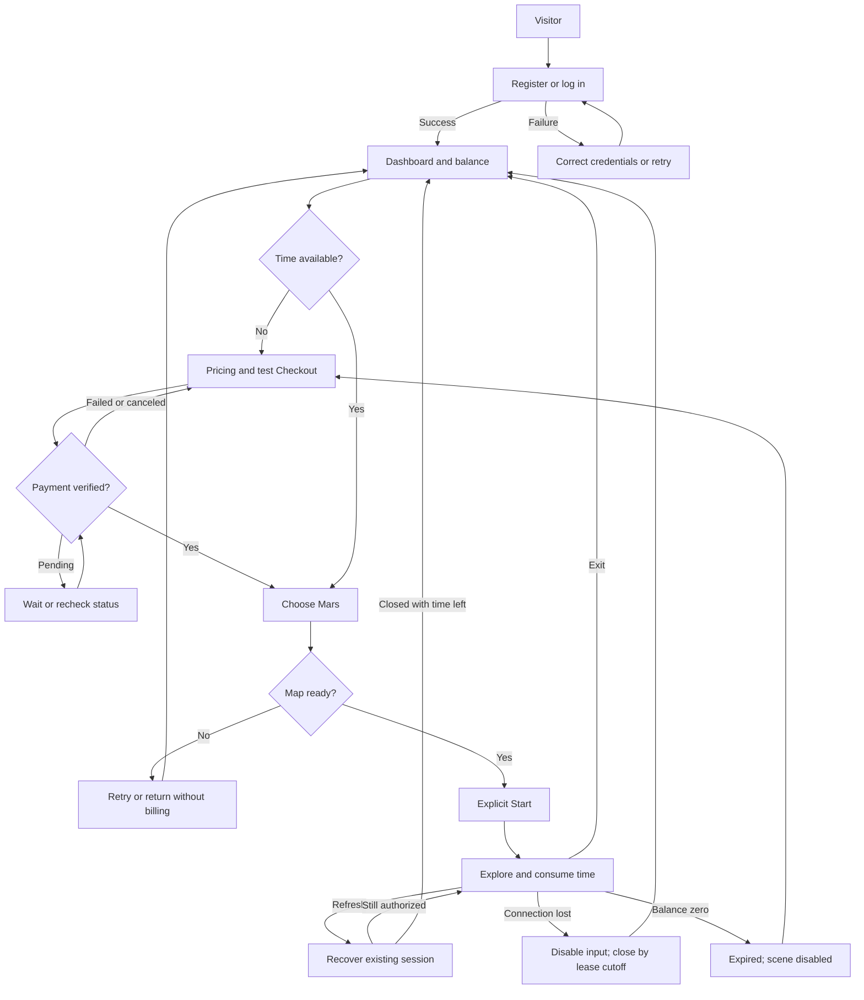
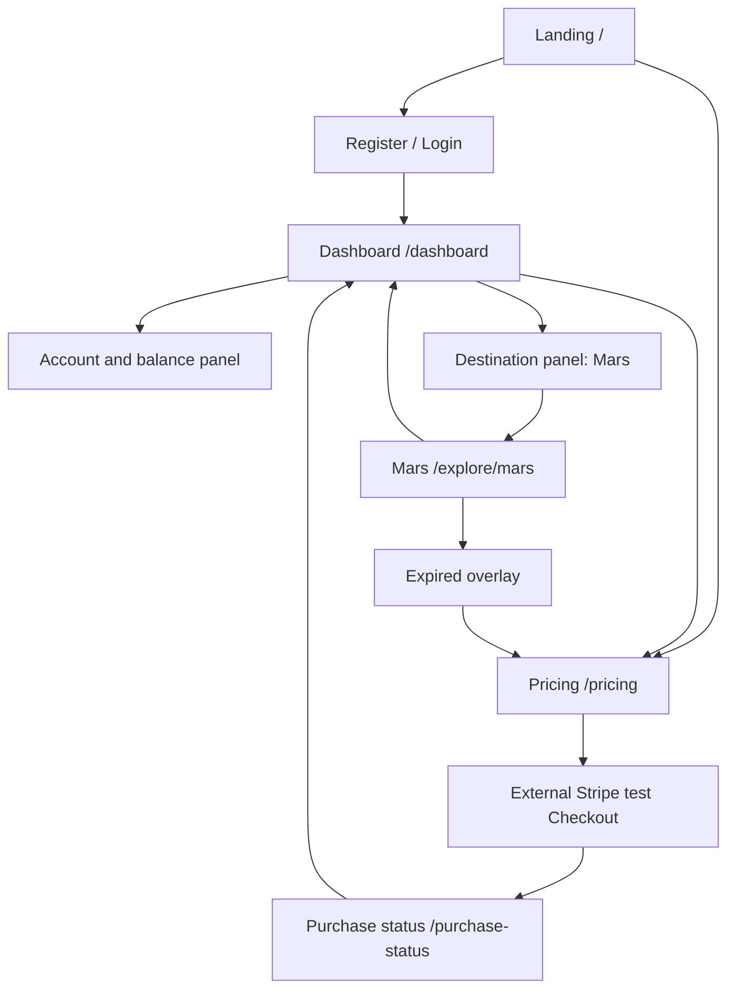
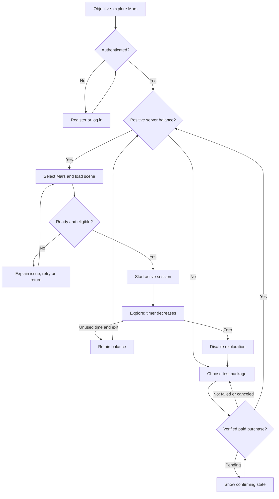

# LUNARA — Product Requirements Document

Version: 1.0 · Date: 25 October 2026 · Status: Draft for product approval

This document is the product source of truth for the Lumen 2.0 — Beyond 2030 hackathon prototype. It specifies intended behavior, not completed functionality. No application code, architecture, user research, or test results are claimed to exist.

**Decision labels:** **Confirmed** means supplied and approved by the team in the source brief. **Proposed** means a recommended default requiring team approval; it is used consistently throughout this draft so implementation can be planned. **Assumption** means unverified. **Future** means outside the MVP. The final approved decisions in the source brief supersede its earlier open questions.

## 1. Product Name

- **Name:** LUNARA — Explore Beyond Earth.
- **Tagline:** Explore distant worlds, one minute at a time.
- **Category:** Planetary Exploration as a Service.
- **Elevator pitch:** LUNARA demonstrates how people could buy time-limited access to future robotic planetary observation through a familiar web service.

LUNARA combines account access, prepaid exploration-time packages, verified test payments, a persistent time balance, and a first-person exploration experience. The hackathon customer buys simulated exploration time through Stripe Checkout in test mode, selects Mars, and navigates one imported 3D landscape using a keyboard and mouse until their balance expires.

**Current MVP:** a browser-rendered simulation with a virtual rover-camera perspective. No visible rover, live extraterrestrial imagery, real robot, or authentic Martian terrain is implied. **Future vision:** authorized access to deployed robotic observation systems, subject to partnerships, mission safety, communications, regulation, capacity, and commercial validation. Future physical control would need fundamentally different safeguards and operational design.

## 2. Vision

In a possible future beyond 2030, robotic explorers could support observation on the Moon, Mars, and other worlds. Individuals and organizations may want access without financing, launching, maintaining, or operating their own exploration hardware. Limited equipment and mission capacity could make shared observation windows valuable.

LUNARA proposes allocating that access through a time-based service: customers purchase an allowance, enter an approved exploration session, and receive clear information about its remaining duration. The platform would mediate identity, entitlement, scheduling, and mission-approved access. It would not grant unrestricted control over scientific hardware.

This fits Beyond 2030 by examining a potential service layer around humanity's expansion beyond Earth. The prototype demonstrates the commercial interaction and access accounting, while a simulated environment makes the experience understandable today.

The availability of commercial robots, customers' willingness to pay, usable observation capacity, rights to distribute imagery, and viable operating economics are **hypotheses**. The hackathon cannot establish market demand, mission feasibility, scientific usefulness, or a real robotics integration. Future interplanetary communications also preclude treating responsive local keyboard control as proof of feasible live Mars driving.

## 3. Goals — Project Product Goals

All numerical targets below are **proposed acceptance targets**, not measured achievements.

| Area | Goal | Measurement / completion condition |
| --- | --- | --- |
| Business demonstration | Explain prepaid access clearly | Demo viewer can identify what is purchased, how time is consumed, and that payment and exploration are simulated |
| UX | Complete the core journey without developer assistance | One fresh account completes registration → purchase → exploration → expiry → repurchase in rehearsal |
| Payment | Grant exactly the purchased allowance | A paid test Checkout grants its configured seconds once; duplicate delivery grants zero additional seconds |
| Accounting | Preserve a trustworthy balance | Refresh, repeated requests, concurrent starts, and client timer edits do not increase server balance |
| Immersion | Deliver one usable camera experience | Selected terrain loads; W/S movement, A/D turning, mouse look, and boundaries work on the demo laptop |
| Performance | Keep the demo responsive | Proposed targets: terrain ready within 15 seconds on the demo connection and approximately 30 FPS during the rehearsed route; measure on the actual machine |
| Expiration | End entitlement predictably | Server rejects activity at the exact cutoff; ordinary client disables interaction within 1 second of its locally predicted cutoff |
| Delivery | Finish within nine build hours | Deployed prototype, GitHub source, configuration instructions, and rehearsed five-minute pitch exist |
| Defense | Explain the important guarantees | Team can explain payment verification, duplicate protection, session ownership, and the limitations of a downloaded 3D scene |

### Priorities

| Priority | Features |
| --- | --- |
| **MUST HAVE** | Landing page with simulation disclosure; register/login; protected dashboard; Stripe test Checkout; verified, idempotent minute credit; persistent balance; Mars selection; one imported map; first-person keyboard/mouse controls; backend-authoritative sessions; continuously decreasing active time; exit/interruption handling; automatic expiry; repurchase; actionable failure states |
| **SHOULD HAVE** | Low-time warning; basic terrain following and collision refinement beyond the minimum safe bounded route; measured loading feedback; compact purchase history; reduced-motion preferences |
| **COULD HAVE** | Clearly simulated signal indicator; nonfunctional Coming Soon destinations; decorative planetary visuals |
| **OUT OF SCOPE** | Real payments; subscriptions implementation; real robots or transmissions; visible rover; phone controller; other playable worlds; whole planets; advanced physics; multiplayer; scheduling real missions; scientific tools; admin dashboard; AI features |

### Functional requirements register

Identifiers below are stable references for use cases, stories, tests, and subsequent architecture.

| ID | Requirement | Priority |
| --- | --- | --- |
| FR-01 | Present the service and explicitly disclose a simulated experience and test payments | MUST |
| FR-02 | Register, authenticate, log out, and enforce ownership on protected operations | MUST |
| FR-03 | Display a durable server-derived purchased-time balance and session status | MUST |
| FR-04 | Display a server-defined package catalog with duration, currency, and test price | MUST |
| FR-05 | Create Stripe test Checkout for an authenticated customer and a valid package | MUST |
| FR-06 | Verify paid status, test environment, purchase ownership, amount/currency, and package mapping before crediting; credit each purchase once atomically | MUST |
| FR-07 | Permit Mars selection; make any other destinations clearly unavailable | MUST |
| FR-08 | Load the selected licensed asset and show readiness before starting billable exploration | MUST |
| FR-09 | Start only with positive balance and maintain at most one active session per account | MUST |
| FR-10 | Provide bounded, near-surface first-person navigation: W/S move, A/D turn, mouse look, Escape release | MUST |
| FR-11 | Account for active elapsed time on the backend, including stationary time; reconcile without duplicate debit | MUST |
| FR-12 | Show server-aligned remaining time and disable normal interaction when authorization expires or cannot be confirmed | MUST |
| FR-13 | Exit, settle, retain unused time, and recover interruptions according to the proposed lifecycle below | MUST |
| FR-14 | Expire at zero, prevent negative balances, and offer purchase/resume | MUST |
| FR-15 | Handle authentication, payment, loading, network, and persistence failures with safe retries and no fabricated success | MUST |
| FR-16 | Support keyboard-operable standard UI, focus visibility, clear labels, and an uncharged compatibility fallback | MUST |
| FR-17 | Keep secrets on the server and provide minimal diagnostic records for payments and sessions | MUST |
| FR-18 | Display a low-time warning once per session when crossing 30 seconds, or immediately if starting below 30 seconds | SHOULD |
| FR-19 | Optionally show a labeled simulated signal indicator without delaying input or billing | COULD |

### Proposed session and billing policy

**Confirmed:** time decreases continuously while active, even while stationary. Backend authority and automatic expiration are mandatory. The following lifecycle details are **proposals requiring approval**, not changes to that decision.

1. **Unit and precision:** packages convert minutes to seconds (1 minute = 60 seconds). Keep exact elapsed duration at millisecond precision or equivalent; do not round each heartbeat or session upward. Display remaining time as `MM:SS` rounded upward while positive, and `00:00` at zero. No calendar expiry of unused time in the MVP.
2. **Before start:** authenticate, select Mars, load the map, validate compatibility, and show a Ready screen. Loading, checkout, and viewing the dashboard are not billable. Movement is locked until the backend accepts an explicit Start Exploration request.
3. **Start:** an accepted request creates one active session and records a server start timestamp. Billing starts at that timestamp, even if the response is lost. Repeated delivery of the same start request returns the original outcome; it never creates a second debit interval. Zero balance is rejected.
4. **Connection authorization:** proposed heartbeat every 5 seconds; each successful renewal authorizes a maximum 15-second lease from the server's receipt time, capped by the exhaustion time. Responses include enough server timing information for a display and local cutoff. These durations are configuration proposals, not approved infrastructure choices.
5. **Chargeable interval:** charge from accepted start until the earliest of server-accepted exit, lease expiry, or balance exhaustion. A renewal before lease expiry extends the interval. Settle elapsed time once, transactionally; repeated reads, renewals, and exits do not double-charge. Remaining balance always includes current unposted consumption.
6. **Exit:** an explicit Exit Session freezes movement immediately and asks the server to close the session. Billing stops when the server accepts exit, not at a client-supplied timestamp. On failure, show “Exit not confirmed; billing stops by the displayed connection cutoff.” Retry safely; an unload request is best effort only.
7. **Interruption:** on known network loss, failed authorization, or hidden page, disable controls and stop renewing. On a hidden page, attempt exit as well. If a request cannot reach the server, billing ends at the last accepted lease cutoff. The maximum tail is 15 seconds after the last renewal, never beyond the remaining balance. Disclose this before start. No automatic refunds or free reconnect allowance.
8. **Refresh and reconnection:** recover the same still-active session and its remaining time; refreshing does not pause or reset billing. After its lease expires, settle and close it as interrupted; require an explicit new Start after readiness. Time between closed sessions is not charged. No offline exploration entitlement.
9. **Pause and inactivity:** no separate pause state or movement-based billing. Escape only releases pointer lock and billing continues; say so visibly. Stationary time remains billable. To take a break, use Exit Session; unused time persists. A closed session can be restarted later, subject to available balance.
10. **Concurrent tabs/devices:** only one controlling connection may renew a session. Additional tabs show “Session already active” with read-only balance and an account-level End Session action. A refresh/reconnect may explicitly replace the controlling connection; issuing the replacement invalidates the previous connection. A stale controller cannot renew or continue authorized interaction. Simultaneous starts are serialized per account.
11. **Expiration:** at zero, the server closes the session as expired; further renewals and starts fail until a verified purchase adds credit. The ordinary client stops movement and covers or unmounts the interactive scene. New credit never silently reactivates an expired session.
12. **Top-ups:** MVP checkout is entered after ending exploration. A previously pending payment may still arrive while active: credit it once, preserve accrued consumption, and update authorization at the next valid reconciliation. If expiry wins the race, the new balance is retained but explicit restart is required.
13. **Errors/restarts:** persist sufficient timestamps and purchase/session records to recover after a backend restart. Database unavailability cannot produce a success response or extend a lease. Late requests after a cutoff cannot retroactively extend it.

**Examples:** A 60-second balance used for 20 seconds and then successfully exited leaves 40 seconds. Remaining stationary for those 20 seconds has the same result. With a last accepted heartbeat at second 10 and a 15-second lease, a lost connection can be billed through second 25; a 12-second total balance instead expires at second 12. Ending and retrying the same exit must produce the same settled balance.

**Security boundary:** a downloaded local 3D asset cannot be made impossible to inspect or run independently by someone modifying their browser. The enforceable MVP guarantee is server-side entitlement and accounting: frontend edits cannot mint credit, extend a server session, or obtain authorized renewal. Normal UI disables the scene at cutoff. Future real robotic access would require a protected command/video gateway and is outside this prototype.

## 4. User Type

Account balance states below are customer states, not separate permission roles.

| User type | Objective | Permissions | Primary interactions | Business value | MVP relevance |
| --- | --- | --- | --- | --- | --- |
| Visitor | Understand the offer | Public landing, pricing, authentication pages | Learn, inspect test packages, register | Acquisition | Required |
| Registered customer with zero balance | Obtain exploration access | Own dashboard and purchases; no active exploration | Buy time, view balance | Conversion | Required |
| Customer with purchased time | Explore and manage allowance | Start one owned session, navigate, exit, read own balance | Select Mars, start, monitor, exit | Core service use | Required |
| Customer whose session expired | Understand interruption and continue | Dashboard and purchase; scene disabled | Buy again, restart | Repeat purchase | Required |
| Operator | Diagnose failed demo operations | Restricted provider consoles and server logs; no public customer controls | Inspect payment/session outcomes | Reliability | Operational responsibility only; no admin UI |
| School / student segment | Guided space learning | Future group access would need separate design | Hypothetical classroom sessions | Potential educational demand | Persona only; ordinary individual account in MVP |
| Research segment | Inspect useful observations | No special rights in MVP | Hypothetical approved observation access | Potential institutional demand | Future; no scientific-grade claims |
| Space enthusiast segment | Experience distant worlds | Ordinary customer rights | Personal exploration | Potential consumer demand | Primary demo persona |

## 5. Team

Role placeholders do not assume individual skill levels. Confirm allocation at kickoff.

| Teammate | Ownership | Required coordination |
| --- | --- | --- |
| T1 — Frontend / UX | Landing, account screens, dashboard, pricing, HUD, failure copy | Agree UI states with T3/T4; integrate T2 scene |
| T2 — 3D experience | Inspect asset, scene loading, camera, controls, safe bounds, performance | Expose readiness and input enable/disable behavior to T1/T4 |
| T3 — Authentication / payments | Account flow, Stripe test Checkout, payment verification and credit path | Share account identity and transaction boundary with T4 |
| T4 — Session accounting | Authoritative balance, lifecycle, leases, concurrency, persistence | Own cross-cutting time invariants; review T3 credit behavior |
| T5 — Integration / quality / deployment | Early deployment, shared integration branch, acceptance evidence, demo rehearsal | Coordinate contract freeze, integration checks, blockers, release |

**Proposed nine-hour coordination plan:** 0:00–0:30 confirm proposals, asset viability, providers, and interface responsibilities; 0:30–2:00 deploy a skeleton and prove a thin authenticated path; 2:00–4:00 complete payment credit and basic scene independently; 4:00–6:00 integrate the paid session loop; 6:00–7:30 fix expiry, retry, concurrency, and failure tests; 7:30–8:30 rehearse and polish essential UX; 8:30–9:00 freeze and prepare delivery. If behind at hour 6, cut optional work immediately.

T5 coordinates integration, not all coding. T3 and T4 jointly review credit/debit atomicity. Each teammate owns explicit files or modules; shared changes require coordination. Use small commits and a shared state vocabulary. Claude Code output is reviewed and tested by its human owner. GitHub is the shared source; PyCharm is an available local development environment. Detailed implementation assignments belong in TASKS.md.

## 6. User Flow (References)

Happy path: Visitor → Register/Login → Dashboard → Pricing → Purchase Minutes → verified credit → Choose Mars → load/Ready → Start → Explore with decreasing time → Session Expires → Purchase More Time → restart.

Text alternative: authenticate before protected actions; choose pricing when the balance is empty and Mars when it is positive. Checkout return alone does not unlock exploration. Load the map before starting billing. During exploration, consume elapsed time regardless of movement. Exit retains unused time; refresh recovers existing accounting; loss of connectivity ends authorization by its cutoff; expiry leads to repurchase.

| Alternate path | Required outcome |
| --- | --- |
| Existing user | Login returns to dashboard with durable balance |
| Failed login | Clear error, no dashboard data or session access |
| Unauthorized URL/API access | Page asks for login; backend rejects unauthorized operation |
| Payment failed/canceled | No credit; return to pricing with retry |
| Payment pending after return | Show confirming state; recheck server purchase status |
| Insufficient balance | No billable session; offer purchase |
| Map load fails | No Start, no billing; retry or return |
| Leave page | Attempt exit; otherwise last lease limits billing tail |
| Refresh during exploration | Reuse/recover session without resetting allowance |
| Return later | Reconcile prior session; show retained balance; explicit restart |
| Expiry during interaction | Stop scene input, show zero and purchase CTA |

## 7. Use Cases

All session cases use the proposed policy in Section 3. Alternate flows and exceptions cover important MVP paths, not every conceivable failure.

### UC-01 — Create a user account

- **Actor:** Visitor. **Goal:** Obtain an individual customer account.
- **Preconditions:** Registration service available; visitor unauthenticated. **Trigger:** Select Create Account.
- **Main success flow:** 1. Visitor enters required identity credentials. 2. System validates them through the chosen authentication mechanism. 3. System creates a stable account identity and zero balance. 4. User completes any provider-required verification. 5. System authenticates and opens the dashboard.
- **Alternate flows:** Existing customer selects Login; provider-required verification remains pending without permitting protected access.
- **Exceptions/error handling:** Invalid data is explained inline; duplicate registration follows provider-safe messaging; provider failure offers retry without creating duplicate balances.
- **Postconditions:** Exactly one owned balance exists for the identity; registration alone grants no time.
- **Related requirements:** FR-02, FR-03, FR-15, FR-16.

### UC-02 — Log in and access the dashboard

- **Actor:** Registered customer. **Goal:** Access owned balance and actions.
- **Preconditions:** Account exists. **Trigger:** Submit login or open a protected page.
- **Main success flow:** 1. Customer authenticates. 2. Server validates identity. 3. System reconciles any previous session. 4. Dashboard shows effective remaining time and session status. 5. Customer chooses purchase, Mars, or logout.
- **Alternate flows:** Valid existing login goes directly to dashboard; still-active session offers recovery/end instead of a second session.
- **Exceptions/error handling:** Invalid credentials do not reveal account data; unavailable backend shows an error instead of a misleading zero balance; expired authentication requests login.
- **Postconditions:** Customer sees only their own data. Logout ends an active session when possible, otherwise its lease expires.
- **Related requirements:** FR-02, FR-03, FR-13, FR-15.

### UC-03 — View exploration pricing packages

- **Actor:** Visitor or customer. **Goal:** Understand time and test price.
- **Preconditions:** Catalog is configured. **Trigger:** Open Pricing.
- **Main success flow:** 1. System loads package durations and test prices. 2. User reads continuous active-session billing and simulation disclosure. 3. User selects a package. 4. Authenticated customer proceeds to Checkout; visitor first authenticates.
- **Alternate flows:** User returns to dashboard; valid selection is retained across login if convenient, otherwise selected again.
- **Exceptions/error handling:** Unavailable/stale package is disabled; catalog failure offers retry, not a fabricated price.
- **Postconditions:** No credit or debit has occurred.
- **Related requirements:** FR-01, FR-04, FR-05.

### UC-04 — Purchase exploration time

- **Actor:** Authenticated customer; Stripe test Checkout. **Goal:** Complete a test purchase.
- **Preconditions:** Valid package; no active exploration under normal navigation. **Trigger:** Buy Time.
- **Main success flow:** 1. Server validates identity and package. 2. Server records purchase intent and creates test Checkout using trusted catalog values. 3. Customer completes Checkout. 4. Customer returns to a status screen. 5. UI retrieves backend purchase state and waits for verified credit if necessary.
- **Alternate flows:** Customer cancels and returns to pricing; payment fails and may be retried; repeat clicks reuse a pending attempt where feasible rather than creating accidental duplicate Checkouts.
- **Exceptions/error handling:** Unavailable Stripe leaves balance unchanged; return URL tampering grants nothing; timeout displays unknown/pending and rechecks the same attempt.
- **Postconditions:** Purchase exists; paid time is granted only through UC-05. Two distinct genuinely paid Checkouts are separate purchases, not duplicate notifications.
- **Related requirements:** FR-04, FR-05, FR-06, FR-15.

### UC-05 — Verify payment and update purchased time balance

- **Actor:** Payment provider notification; backend verifier. **Goal:** Credit a genuine successful test purchase once.
- **Preconditions:** Server-created purchase references an account and package. **Trigger:** Verified payment notification or server-side reconciliation.
- **Main success flow:** 1. Backend validates notification authenticity or retrieves status through authenticated provider access. 2. It verifies paid status, test mode, expected Checkout, account binding, amount, currency, and package. 3. It atomically records successful credit and increases the account allowance by configured seconds. 4. UI reads the new status/balance.
- **Alternate flows:** Duplicate event or separate events for the same Checkout return an already-processed outcome; a delayed verified success after a canceled return may still credit the actual payment.
- **Exceptions/error handling:** Unpaid completion is not credited; invalid signature or mismatched values are rejected and logged; database failure leaves the purchase retryable with neither partial credit nor false success; out-of-order failure cannot reverse credited success.
- **Postconditions:** Exactly one credit per paid Checkout; no credit for failed/unpaid attempts.
- **Related requirements:** FR-03, FR-06, FR-17.

### UC-06 — Select Mars as the exploration destination

- **Actor:** Authenticated customer. **Goal:** Enter the supported experience.
- **Preconditions:** Dashboard available. **Trigger:** Choose Mars.
- **Main success flow:** 1. System shows Mars as a simulation. 2. Customer selects it. 3. Server checks balance/session state. 4. Positive balance permits the preparation screen.
- **Alternate flows:** Zero balance routes to pricing; other planets, if shown, are noninteractive Coming Soon cards.
- **Exceptions/error handling:** Unsupported destination requests are rejected; authentication loss requests login.
- **Postconditions:** Mars selected; billing has not started.
- **Related requirements:** FR-02, FR-03, FR-07, FR-08.

### UC-07 — Start an exploration session

- **Actor:** Customer with purchased time. **Goal:** Begin authorized interaction.
- **Preconditions:** Authenticated; Mars loaded and ready; positive effective balance; no other active controller. **Trigger:** Explicit Start Exploration.
- **Main success flow:** 1. User reads controls and billing notice. 2. Client requests start. 3. Server reconciles prior accounting, atomically checks eligibility, and opens a session. 4. Response supplies authoritative remaining time and authorization cutoff. 5. Client enables input and begins renewal/display updates.
- **Alternate flows:** Existing session offers recover/end; an identical retried start returns its existing result; failed pointer lock leaves accessible instructions and Exit, with billing status visible.
- **Exceptions/error handling:** Zero balance rejects start; persistence failure enables no input; lost start response invokes recovery, not a new independent start; if readiness is lost immediately after acceptance, stop input and request exit.
- **Postconditions:** At most one active session exists; billing starts at server acceptance, never during map loading.
- **Related requirements:** FR-08, FR-09, FR-11, FR-12, FR-15.

### UC-08 — Navigate the 3D terrain with keyboard and mouse

- **Actor:** Active explorer. **Goal:** Inspect the landscape.
- **Preconditions:** Loaded scene and current authorization. **Trigger:** Movement/look input.
- **Main success flow:** 1. User engages the scene. 2. W/S move forward/backward, A/D turn, and mouse changes look direction. 3. System keeps the camera near the surface and inside the validated traversable area. 4. HUD remains readable while elapsed time is consumed.
- **Alternate flows:** Escape releases pointer lock; an overlay states that time continues and offers Exit; stationary viewing remains billable.
- **Exceptions/error handling:** Boundary movement is clamped; rendering/context loss freezes input and requests exit; authorization cutoff disables normal interaction regardless of held keys.
- **Postconditions:** Camera position changes only inside supported bounds; no balance is created by movement or inactivity.
- **Related requirements:** FR-10, FR-11, FR-12, FR-13.

### UC-09 — Monitor remaining exploration time

- **Actor:** Active explorer. **Goal:** Know remaining purchased time.
- **Preconditions:** Active session. **Trigger:** Session starts or server reconciliation arrives.
- **Main success flow:** 1. Backend returns remaining time and timing reference. 2. UI extrapolates the countdown for display. 3. Server renewals reconcile it. 4. UI shows Active/Billing status and, if implemented, the low-time warning.
- **Alternate flows:** Another tab displays read-only server balance; legitimate credit arriving during activity is reconciled without resetting consumed time.
- **Exceptions/error handling:** Network uncertainty shows Connection Lost and disables input; browser clock changes or edited display variables cannot alter server accounting; no negative timer is displayed.
- **Postconditions:** Backend remains authoritative; display is an estimate between reconciliations.
- **Related requirements:** FR-03, FR-11, FR-12, FR-18.

### UC-10 — Pause, exit, or interrupt a session

- **Actor:** Explorer; browser/network. **Goal:** Stop or recover use while preserving unused time.
- **Preconditions:** Active or recently interrupted session. **Trigger:** Exit, navigation, hidden page, refresh, logout, or lost connection.
- **Main success flow:** 1. User selects Exit. 2. Client freezes input and releases pointer lock. 3. Server settles elapsed time and closes the session at acceptance. 4. Dashboard shows retained balance and an explicit restart action.
- **Alternate flows:** There is no separate pause; Escape does not stop billing. Refresh recovers the same unexpired session. Reconnection after cutoff shows settled balance and requires a new Start. New controlling connection invalidates the previous one.
- **Exceptions/error handling:** Lost exit request/closed tab uses the last lease cutoff; retrying exit does not debit twice; hidden pages attempt exit and stop renewal; a delayed heartbeat after closure cannot reopen a session.
- **Postconditions:** No billing beyond accepted exit/lease cutoff/exhaustion, whichever occurs first; unused balance persists.
- **Related requirements:** FR-09, FR-11, FR-12, FR-13, FR-15.

### UC-11 — Expire a session and disable exploration access

- **Actor:** Accounting service and explorer UI. **Goal:** Enforce the purchased allowance.
- **Preconditions:** Active session reaches zero. **Trigger:** Exhaustion cutoff.
- **Main success flow:** 1. Server entitlement expires at cutoff. 2. UI stops input and obscures/unmounts the interactive scene. 3. System displays Session Ended, zero remaining time, and Buy More Time. 4. Further authorization requests fail without new credit.
- **Alternate flows:** If a payment arrives after closure, balance increases but session remains closed until explicit restart.
- **Exceptions/error handling:** Lost connectivity does not extend access; replayed renewal cannot reopen an expired session; settlement never creates a negative balance.
- **Postconditions:** Session is expired, balance nonnegative, scene inaccessible through the supported application.
- **Related requirements:** FR-11, FR-12, FR-14.

### UC-12 — Purchase additional time and resume exploration

- **Actor:** Returning or expired customer. **Goal:** Continue exploring.
- **Preconditions:** Authenticated customer; previous session closed. **Trigger:** Buy More Time or Start Again.
- **Main success flow:** 1. Customer selects a package if needed. 2. UC-04/05 completes. 3. System adds verified seconds to retained balance. 4. Customer selects Mars and loads/prepares the scene. 5. Explicit Start creates a new session.
- **Alternate flows:** A customer with remaining time skips purchase; camera returns to the fixed safe spawn for the MVP, with position persistence optional and excluded from completion criteria.
- **Exceptions/error handling:** Pending payment does not unlock access with zero balance; failed purchase preserves previous balance; closed session identifiers cannot be reused to bypass a new eligibility check.
- **Postconditions:** A new authorized session consumes only available time.
- **Related requirements:** FR-03, FR-05, FR-06, FR-09, FR-14.

### UC-13 — Handle authentication, asset, network, and payment failures

- **Actor:** Customer and system. **Goal:** Recover without false credit or uncontrolled billing.
- **Preconditions:** A customer flow encounters a failure. **Trigger:** Error, timeout, or rejected authorization.
- **Main success flow:** 1. System identifies the failed stage. 2. UI shows a specific state and safe next action. 3. Protected interaction is disabled if authorization is uncertain. 4. Customer retries or returns to dashboard. 5. Backend reconciles existing records before continuing.
- **Alternate flows:** Asset failure before start costs no time; failure during activity requests exit; payment pending permits later status checks; lost authentication requires login before recovery.
- **Exceptions/error handling:** Persistence outage grants neither payment credit nor a new session without a committed result; unknown status stays unknown/pending; repeated retries preserve idempotency; diagnostics exclude secrets.
- **Postconditions:** Authoritative records remain consistent and the user has an understandable recovery path.
- **Related requirements:** FR-02, FR-06, FR-08, FR-12, FR-13, FR-15, FR-17.

### UC-14 — Reject concurrent or unauthorized exploration

- **Actor:** Customer using multiple tabs/devices; unauthenticated requester. **Goal:** Protect account ownership and single-session rules.
- **Preconditions:** A start, takeover, renewal, balance, or exit request occurs. **Trigger:** Protected request.
- **Main success flow:** 1. Backend validates account identity and resource ownership. 2. It reconciles account state. 3. Concurrent starts are serialized. 4. Only one eligible start/controller succeeds; other tabs receive a recover/end message.
- **Alternate flows:** Authorized explicit recovery replaces controller authorization; owner may end a session from dashboard.
- **Exceptions/error handling:** Another account's session ID is rejected; stale controller or duplicate requests cannot create time; frontend state/claimed duration is never trusted as credit or consumption authority.
- **Postconditions:** No overlapping independent billable sessions or unauthorized account access.
- **Related requirements:** FR-02, FR-09, FR-11, FR-13, FR-17.

## 8. User Stories

MVP backlog follows. Each acceptance criterion is an intended test, not a completed test.

| ID / actor | User story | Priority | Use cases | Acceptance criteria |
| --- | --- | --- | --- | --- |
| US-01 Visitor | As a visitor, I want a clear explanation so that I understand the service and simulation. | MUST | UC-03 | Given the landing page, when I read the offer, then simulated terrain and test payments are explicit and no live Mars feed is claimed. |
| US-02 Visitor | As a visitor, I want to register so that I can own purchased time. | MUST | UC-01 | Given valid credentials, when registration completes, then I have an owned zero balance; given invalid input, when submitted, then I see an error and no credit. |
| US-03 Customer | As a customer, I want secure login/logout so that only I access my account. | MUST | UC-02, UC-13 | Given valid login, when I enter, then I see my balance; given invalid/expired authentication, when I request protected data, then access fails; given logout while active, then exit is attempted and lease expiry limits any tail. |
| US-04 Customer | As a customer, I want persistent account information so that I know what time remains. | MUST | UC-02, UC-09 | Given a prior purchase/use, when I return or refresh, then server-reconciled balance is retained; given a server error, then the UI shows unavailable rather than zero. |
| US-05 Visitor/customer | As a prospective explorer, I want durations and test prices so that I can choose a package. | MUST | UC-03 | Given the catalog, when I view pricing, then each package shows time, currency, test price, and billing rule; unavailable packages cannot be bought. |
| US-06 Customer | As a customer, I want Stripe test Checkout so that I can complete the purchase journey safely. | MUST | UC-04 | Given a valid package, when Buy is selected, then test Checkout opens; given failed/canceled checkout, then no time is credited solely from browser return. |
| US-07 Customer | As a customer, I want verified purchases credited once so that my allowance is accurate. | MUST | UC-05 | Given one paid Checkout, when the same or different related notifications repeat, then one configured credit exists; given invalid/unpaid/mismatched notifications, then no credit occurs. |
| US-08 Customer | As a customer, I want payment status feedback so that I know whether I can explore. | MUST | UC-04, UC-05, UC-13 | Given delayed verification, when I return, then Confirming Payment remains visible and refresh rechecks the same purchase; when credit is committed, then dashboard reflects it. |
| US-09 Customer | As a customer, I want to select Mars so that I enter the supported experience. | MUST | UC-06 | Given a positive balance, when I choose Mars, then preparation opens; given zero, then pricing is offered; other destinations cannot start sessions. |
| US-10 Explorer | As an explorer, I want the map ready before billing so that loading does not consume my time. | MUST | UC-07, UC-13 | Given map loading or failure, when time passes, then no session debit occurs; Start is enabled only after readiness and eligibility. |
| US-11 Explorer | As an explorer, I want an authorized Start so that my purchased time governs access. | MUST | UC-07, UC-14 | Given positive time, when start succeeds, then one session begins at server acceptance; given simultaneous/retried starts, then no duplicate debit interval is created. |
| US-12 Explorer | As an explorer, I want keyboard movement and mouse look so that I can inspect the terrain. | MUST | UC-08 | Given current authorization, when W/S/A/D and mouse are used, then their specified actions work within safe bounds near the surface; Escape releases focus without claiming to pause billing. |
| US-13 Explorer | As an explorer, I want a reliable countdown so that I understand consumption. | MUST | UC-09 | Given an active stationary session, when 10 seconds elapse, then server consumption increases by 10 seconds subject only to earlier cutoff; client edits do not change it. |
| US-14 Explorer | As an explorer, I want Exit to retain unused time so that I can return later. | MUST | UC-10 | Given a 60-second allowance and server-accepted exit at 20 seconds, then 40 seconds remain; repeated exit has the same result. |
| US-15 Explorer | As an explorer, I want interruption recovery so that refresh or disconnection does not corrupt my balance. | MUST | UC-10, UC-13 | Given refresh before lease expiry, when recovered, then the same session accounting continues; given missed renewals, then billing ends by the lease cutoff and explicit restart is required afterward. |
| US-16 Customer | As a customer, I want one controlling session so that tabs cannot duplicate my allowance. | MUST | UC-14 | Given active control in one tab, when another starts, then it receives active-session feedback; given explicit takeover, then the previous controller cannot renew. |
| US-17 Explorer | As an explorer, I want expiration to be clear so that I know when paid access ends. | MUST | UC-11 | Given zero at cutoff, then input stops and purchase CTA appears; server renewals fail even if client time is changed; balance remains nonnegative. |
| US-18 Returning customer | As a returning customer, I want to buy more time so that I can restart exploration. | MUST | UC-12 | Given an expired session, when another purchase is verified, then its seconds are added once and explicit Start works; prior expired session does not reactivate automatically. |
| US-19 Customer | As a customer, I want useful errors so that I can recover safely. | MUST | UC-13 | Given asset/auth/network/payment failure, when it is detected, then the relevant retry/login/return action appears; no uncertain operation is presented as committed success. |
| US-20 Keyboard user | As a keyboard user, I want accessible controls so that I can use the standard website. | MUST | UC-01–04, UC-10, UC-13 | Given keyboard-only navigation, when traversing standard screens and exit modal, then focus is visible and actionable; unsupported 3D shows an uncharged explanatory fallback. |
| US-21 Operator | As an operator, I want minimal diagnostics so that I can explain failed demo operations. | MUST | UC-05, UC-13, UC-14 | Given a payment/session failure, when examining restricted logs, then purchase/session identifiers and outcomes are available without secrets or card data. |
| US-22 Explorer | As an explorer, I want a low-time warning so that expiry is less surprising. | SHOULD | UC-09 | Given a session crossing 30 seconds, when the threshold is crossed, then one visible warning appears without an obstructive modal. |
| US-23 Customer | As a customer, I want a compact purchase history so that I can review test credits. | SHOULD | UC-02, UC-05 | Given credited purchases, when history is viewed, then owned durations/statuses match recorded purchases. |
| US-24 Motion-sensitive explorer | As a motion-sensitive explorer, I want restrained movement effects so that navigation is more comfortable. | SHOULD | UC-08 | Given reduced-motion preference, when the experience loads, then decorative animation/head bob is absent and available sensitivity controls are explained. |
| US-25 Explorer | As an explorer, I want a simulated signal indicator so that the future communications concept is visible. | COULD | UC-08 | Given the optional indicator, when shown, then it says Simulated, never delays controls, and never affects billed time. |

## 9. UX / UI Design

The product should look like a coherent space-oriented SaaS service. Use a restrained dark interface, readable typography, clear package cards, and a prominent account balance. The 3D camera is the main visual experience, but paid entitlement and session state must remain understandable at all times. Avoid game scores, combat, inventory, and visual clutter that distract from time-based access.

### 9.1 User Personas

These are **hypothetical personas**, not research-validated users.

| Persona | Background | Motivation / main goal | Frustrations | Expected value | Typical interaction |
| --- | --- | --- | --- | --- | --- |
| Alex — Space enthusiast | Adult desktop user interested in space imagery | Experience the proposed access model and explore visually | Vague offers, unclear charges, confusing controls | A convincing simulation with transparent time accounting | Discover → test purchase → Mars → explore → exit or repurchase |
| Lina — Student explorer | Student evaluating a future technology concept | Understand how access to distant observation could work | Setup complexity, motion discomfort, inaccessible controls | Guided controls and honest explanation | Register → small test package → inspect terrain → watch timer expire |
| Sam — Research-oriented evaluator | Technically curious user assessing service credibility | Understand authorization, observation access, and constraints | Claims of scientific validity unsupported by data | A transparent prototype and defensible architecture | Read disclosures → buy test time → explore → evaluate limitations |

### 9.2 User Scenarios

**Alex:** discovers LUNARA through the pitch landing page, registers, purchases the smallest test package, waits for verified credit, chooses Mars, loads the terrain, starts, and navigates using the displayed controls. Alex watches the countdown, including while stationary. At zero the scene becomes unavailable, and Alex follows Buy More Time to another verified purchase and explicit restart.

**Lina:** opens LUNARA from a classroom demonstration, registers, completes a test purchase, selects Mars, and starts after the map loads. Lina uses short movements, observes the time display, then presses Escape to read instructions. The overlay explains that billing continues. Lina chooses Exit and later returns with retained time; after restarting and using the remainder, expiry leads to pricing.

**Sam:** encounters LUNARA during technical judging, reads the simulation disclosure, registers, purchases test minutes, selects Mars, and navigates. Sam refreshes during the countdown and checks that the allowance is not reset. Sam remains stationary until expiration and observes disabled access, then repurchases. The accompanying explanation makes no scientific or live-robot claims.

### 9.3 Scenario Maps

| Interaction point | Customer objective | Successful response | Branch / failure | Next connection |
| --- | --- | --- | --- | --- |
| Discover | Understand offer | Clear simulation + time proposition | Misunderstanding prevented by disclosure | Pricing or register |
| Authenticate | Establish ownership | Owned dashboard | Invalid login / verification pending | Retry or complete verification |
| Purchase | Obtain allowance | Verified seconds credited | Cancel, fail, pending, duplicate notification | Pricing, status check, or Mars |
| Prepare | See environment before charge | Map ready and Start visible | Missing/slow asset or unsupported browser | Retry or uncharged fallback |
| Explore | Observe landscape | Responsive camera and active countdown | Boundary, stationary viewing, Escape | Continue or Exit |
| Interrupt | Preserve predictable accounting | Reconcile/close by cutoff | Lost exit, refresh, hidden tab, stale controller | Recover or dashboard |
| Expire | Understand end of entitlement | Input disabled and clear CTA | Late payment races with expiry | Retained credit plus explicit restart |

### 9.4 Site Maps

**Proposed simplification:** merge account/balance and destination selection into Dashboard. Use an expiration overlay on the exploration page, not another full page. Purchase status can be a lightweight return page. Route names are proposals, not API contracts.

Register/login may share one component with separate modes. A dashboard account panel shows identity, remaining time, active-session status, and logout. Coming Soon destinations are optional. There is no admin route.

### 9.5 User Flow

| User objective | Product/business objective |
| --- | --- |
| Understand the simulation | Set accurate expectations and attract suitable interest |
| Register and buy time | Demonstrate attributable conversion through a test transaction |
| Start and navigate | Deliver the time-limited experience being demonstrated |
| Monitor and exit | Establish transparent consumption and retained entitlement |
| Repurchase | Demonstrate repeat access without inventing conversion evidence |

### 9.6 Wireframes

Structured low-fidelity layouts below are specifications; visual mock-ups have not been generated.

| Screen | Purpose and hierarchy | Navigation | Main content | Primary CTA | Feedback / errors |
| --- | --- | --- | --- | --- | --- |
| Landing | Brand → future proposition → honest MVP explanation | Logo, Pricing, Login | Hero planetary visual; short 3-step explanation; simulation label | Start Exploring | “Simulated exploration. Test payments only.” |
| Register / Login | Form title → labeled fields → action | Home, switch form mode | Minimal provider-required fields; no unnecessary profile setup | Create Account / Log In | Inline validation; verification prompt if required; recoverable service error |
| Dashboard | Remaining time → session state → Mars → purchase | Home, Pricing, Logout | Account summary; Mars card; active session recover/end controls | Explore Mars if positive; Buy Time if zero | Balance unavailable, active elsewhere, payment confirming |
| Pricing | Test-mode notice → package durations/prices → billing rule | Dashboard/Home | Compact package cards; active stationary billing and interruption-tail explanation | Buy [duration] | Checkout failure, unavailable package, login required |
| Purchase status | Status → next action | Dashboard, Pricing | Confirming, credited, failed/unpaid; purchased duration | Explore Mars after credit | Retry status check; cancellation message qualified as no verified credit yet |
| Mars Ready | Scene/loading state → controls → billing explanation | Back to dashboard | Terrain preview or blocked scene; safe Start action | Start Exploration | Asset load error; unsupported graphics; zero balance; active session elsewhere |
| Exploration | Large camera viewport → prominent timer/status → controls | Exit Session always accessible | Top HUD: Mars Simulation, remaining time, Active/Billing; bottom instructions | Exit Session | Escape overlay says billing continues; Connection Lost disables input; optional low-time warning |
| Session expired overlay | Ended state → remaining zero → next step | Dashboard | Scene covered; explanation of consumed allowance | Buy More Time | Payment pending must not imply restored authorization |
| Compatibility fallback | Explain unavailable 3D → preserve account access | Dashboard, Pricing | Static explanation/preview and device requirements; not an equivalent paid session | Return to Dashboard | “3D could not start. No exploration time was used.” only when no session started |

### 9.7 Mock-ups and Prototypes

**Proposed design direction:** midnight background `#0B1020`, raised panels `#151D30`, primary text `#F3F6FC`, muted text `#B5C0D6`, cyan action accent `#64D8F5`, Mars accent `#E58B66`. Validate actual text/background combinations before release; palette selection alone is not accessibility certification.

Use a readable system sans-serif stack and tabular numerals for the timer. Buttons should have clear verb labels, visible disabled/loading states, and sufficiently large targets. Use consistent panel spacing and restrained rounded corners. Planetary decoration must not be labeled actual mission imagery without provenance.

Loading shows an indeterminate state unless meaningful progress is available. Keep Start disabled until ready. The HUD uses text labels as well as color: Active — Billing, Connecting, Ended. Show time prominently without a full-screen countdown animation. An expiration modal receives keyboard focus and offers Buy More Time and Dashboard. Avoid autoplay audio, head bob, flashing warnings, and decorative camera shake.

Standard pages adapt to mobile. **Interactive exploration is desktop keyboard/mouse only for the MVP.** Mobile and unsupported devices receive a compatibility explanation before starting any session. Do not offer a phone controller. Graphics compatibility should be checked before encouraging a test purchase where practical.

### 9.8 Usability Testing Reports

**No tests have been conducted.** Proposed plan: during the final 90 minutes, ask two available people unfamiliar with the implementation, if available, to attempt the core flow on the demo device. If none are available, record an internal walkthrough as such, not user research.

| Task | Success condition | Likely friction |
| --- | --- | --- |
| Explain the offer from landing | Participant identifies simulated access and test payments | Mistaking terrain for a live Mars feed |
| Register and buy package | Completes without verbal navigation help | Authentication verification; checkout return delay |
| Start and move | Finds Start, W/S, A/D, mouse look | Expecting A/D strafing; pointer lock unfamiliarity |
| Stop spending time | Chooses Exit rather than assuming Escape pauses | Hidden continuous billing |
| Refresh / return | Understands retained balance and session recovery | Assuming reload resets timer |
| Reach expiry and buy again | Recognizes end of access and repurchase CTA | Obstructive modal or stale balance |

Checklist: record task completion, elapsed time, assistance, errors, and participant comments; inspect focus and labels; test Escape and Exit separately; verify no charge while loading; fix blockers first; rerun changed paths. Report actual observations only after execution.

### 9.9 Accessibility Requirements

Target practical WCAG 2.2 AA principles without claiming audited conformance. Standard pages require semantic headings, programmatic labels, keyboard operation, logical tab order, visible focus, and no focus obscured by sticky panels. Aim for at least 4.5:1 normal-text contrast and 3:1 large text and meaningful UI boundaries; verify the rendered combinations. Controls should meet the 24-by-24 CSS-pixel minimum target criterion where applicable, with larger targets preferred.

Errors must describe the problem in text and attach to the relevant field. Do not use color alone for payment or timer states. Announce major session transitions and the low-time warning accessibly; do not announce every second. Modal focus must be contained appropriately, then restored. Escape must release pointer lock so the user can reach Exit with the keyboard.

Use restrained motion by default and honor reduced-motion preferences for optional effects. The first-person scene remains visually demanding and is not a fully equivalent screen-reader exploration experience. Provide a non-billable static explanation/preview, accessible dashboard/balance, and a way to leave. Do not claim that this fallback provides the full immersive service. A guided accessible observation mode is future work.

## 10. Assumptions, Constraints, and Dependencies

### 10.1 Assumptions

| Item | Status | Validation needed |
| --- | --- | --- |
| Five people and nine development hours | Confirmed brief | Confirm attendance and allocation at kickoff |
| One existing terrain has been selected | Confirmed brief; bytes not inspected | Obtain exact file and dependencies |
| Terrain is GLB/GLTF | Assumption | Check format, scale, orientation, polygon count, textures, load time, and license |
| Terrain may stand in for Mars | Confirmed simulation concept | Label representation honestly; do not assert authentic geography |
| Suitable desktop/WebGL support | Assumption | Test actual demo laptop/browser early |
| Authentication service and Stripe test access | Dependency assumption | Confirm accounts, credentials, configuration, and callback reachability |
| Internet and deployment availability | Assumption | Rehearse on the intended network; maintain a runnable local build |
| Future commercial robotic capacity | Future hypothesis | Partnerships, safety, capacity, and infrastructure assessment |
| Demand for prepaid exploration | Market hypothesis | Future interviews and willingness-to-pay research |
| Illustrative prices and lease policy | Proposed | Team approval before architecture freeze |

### 10.2 Constraints

Nine hours; five people; one selected imported map; Mars only; no physical robot or real planetary transmission; no phone controller; desktop keyboard/mouse navigation; no visible rover or complex vehicle physics; limited integration and test time. Working software, source, and live demonstration are required. The pitch lasts five minutes followed by five minutes of technical questions. Backend authority for purchased time, session ownership, and payment credit is nonnegotiable. No real-money payment processing.

The demo must explain the future service without confusing simulation with delivered robotic access. Do not replace a failed Stripe integration with a fake payment success and still call the MVP complete. Do not use a frontend-only timer as a fallback for authoritative accounting.

### 10.3 Dependencies

Technology selections are pending architecture work; this table states capabilities, risks, and fallbacks rather than prescribing a stack.

| Dependency | Risk | Practical fallback / boundary |
| --- | --- | --- |
| Selected terrain asset and license | Missing, incompatible, too large, or unlicensed | Inspect immediately; simplify/convert the same licensed map and reduce textures; if unusable, escalate a replacement decision rather than silently claim completion |
| Textures and format support | Missing references or failed external fetches | Bundle valid dependencies; simplify materials within license; verify on deployed host |
| JavaScript 3D renderer | Integration/performance issues | Use the simplest supported camera/scene path; remove effects and restrict to a validated traversable area |
| Authentication provider | Configuration or verification blocks demo | Use a well-supported standard auth approach chosen early; pre-existing test account is a rehearsal backup, not proof of fresh registration |
| Database | Concurrent credit/debit or outage | Choose transactional persistence and ownership constraints; stop entitlement extension when writes cannot commit; no ephemeral-balance substitute |
| Stripe test Checkout | Credentials/callback delays | Prove early; use server-side status reconciliation if notification delivery is delayed, sharing the same idempotent credit operation; no client-only confirmation |
| Deployment environment | Asset limits, environment mismatch, downtime | Deploy skeleton early; test callbacks and asset paths; keep local runnable build, while disclosing any hosted-demo failure |
| GitHub repository | Conflicting changes or broken main branch | File ownership, small reviewed merges, known-good release commit |
| Claude Code workflow and PyCharm | Divergent generated assumptions or unavailable tooling | Shared PRD/contracts and human review; ordinary editor/manual implementation remains viable |
| Demo internet/browser | Slow loading, blocked graphics, lost connection | Preflight on demo device; supported alternate desktop; retain failure screens and explain actual limitation |

## A. MVP Scope and Feature Prioritization

| Tier | Scope | Cut/acceptance rule |
| --- | --- | --- |
| Essential for demo | Auth, Stripe verified test purchase, durable seconds, Mars selection, imported scene, keyboard/mouse, continuous active billing, exit/recovery, expiry, repurchase, honest labeling | All must work end to end; do not replace with cosmetic stubs |
| Important if time permits | Low-time warning, clearer load progress, refined terrain navigation, compact purchase history, motion preference controls | Add after accounting and main journey pass |
| Optional enhancements | Simulated communications indicator, Coming Soon destinations, decorative transitions | Remove first when behind; cannot delay input or pitch |
| Explicit exclusions | Extra maps/planets, rover model, phone control, vehicle physics, real robots/video, real charges, subscriptions implementation, admin dashboard, scientific analysis, advanced scheduling | Do not implement in nine-hour scope |

Minimum acceptable navigation is a safe bounded route/area on the selected map with a near-ground camera. Advanced collision handling is not necessary if inaccessible regions are reliably excluded. A generic flat scene substituted for the selected map does not satisfy the imported-map requirement without an explicit scope revision.

## B. Business Model Summary

The future customer would purchase an allocation of approved remote observation time, not ownership of robotic hardware. Time is a comprehensible way to allocate limited access, but whether it matches actual mission cost or user value remains unvalidated. Mission windows, safety controls, variable communications, and expensive infrastructure would materially change a real commercial offering.

In the MVP, customers complete test Checkout to receive prepaid simulated exploration seconds. A package adds a fixed duration to the same account balance. Active time is consumed whether moving or stationary; unused time is retained after exit. There is no recurring subscription or real financial transaction. The prototype validates the interaction and bookkeeping, not market demand or real-world unit economics.

**Illustrative test catalog — proposed only:**

| Package | Exploration time | Illustrative test price | Purpose |
| --- | --- | --- | --- |
| Demo Pass | 1 minute / 60 seconds | EUR 1.00 | Allows visible real-time expiry inside the five-minute pitch |
| Explorer | 5 minutes / 300 seconds | EUR 4.00 | Demonstrates package-to-time mapping |
| Horizon | 15 minutes / 900 seconds | EUR 10.00 | Demonstrates larger prepaid allowance |

All prices are test fixtures, not validated commercial prices. Currency, package labels, and amounts require approval/configuration. Do not accelerate the production accounting clock for the pitch: use the short package and actual elapsed time.

Likely future segments include enthusiasts, education, and institutions, but researchers would require provenance, tools, and data quality not supplied here. The prototype may reasonably be perceived as a paid 3D experience. Address this by explaining that the simulation demonstrates access orchestration for a hypothetical future service, while explicitly acknowledging that simulation alone does not validate willingness to pay for real robotic access. Do not use fake partnerships, invented scarcity, or unsupported savings claims.

### Proposed purchase status vocabulary

| State | Meaning | Balance effect |
| --- | --- | --- |
| Pending | Checkout created, status unknown, or payment not yet verified paid | None |
| Credited | Paid status verified and credit committed atomically | Exactly one package credit |
| Failed / unpaid | Verified attempt failed or remains unpaid; another attempt may be created | None |
| Checkout expired | Provider session expired without verified successful payment | None |

“Canceled return” is a UI event, not conclusive proof of payment failure. An actual later verified paid outcome must still be reconciled. Credited is terminal for the MVP credit process: duplicate or out-of-order failure events never remove credit. Refund/dispute administration is out of scope for test-only payments. Limit the demo to immediately confirmable test payment methods; do not promise delayed methods.

## C. Product Acceptance Criteria

MVP complete means every mandatory gate below passes on the intended deployed configuration. Record results, timestamps, device/browser, and build commit during implementation; this PRD does not claim execution.

| Gate | Required evidence |
| --- | --- |
| C-01 Fresh user journey | New user registers, buys a test package, receives verified seconds, chooses Mars, loads the actual selected map, starts, navigates, expires, purchases again, and explicitly restarts |
| C-02 Billing honesty | Map loading consumes zero; active stationary time consumes elapsed time; Escape does not pause; exit behavior and connection-tail notice match Section 3 |
| C-03 Paid credit | Correct package seconds credited; invalid signature, unpaid state, wrong environment, mismatched price/currency/package, and forged return URL grant no time |
| C-04 Idempotency | Repeated notification, two event IDs for one Checkout, status-reconciliation plus notification race, and retry after persistence failure produce one credit |
| C-05 Time persistence | Refresh, logout/login, return later, and backend restart preserve effective remaining time; late settlement debits the recorded cutoff, not restart time |
| C-06 Concurrency | Two concurrent starts cannot create independent sessions; takeover invalidates old controller; credit and debit racing do not lose updates |
| C-07 Authorization | Unauthenticated and cross-account balance/session/purchase access fail; zero balance cannot start; edited client time cannot extend server entitlement |
| C-08 Expiration | Server denies renewal at cutoff; ordinary UI disables movement/scene and shows zero without negative values; held keys cannot keep moving |
| C-09 Exit and disconnection | Repeated exit settles once; no heartbeat closes by the lease cutoff; refresh before cutoff recovers the same session; late renewals cannot reopen closed sessions |
| C-10 Rendering | Selected map and textures load on host; controls match instructions; camera stays in safe near-surface bounds; no rover model or extra world is required |
| C-11 Recovery | Asset/network/auth/payment/database failures have appropriate safe UI actions; no asset-load failure before start debits time; unknown payment is not success |
| C-12 Accessibility | Standard screens usable by keyboard; visible focus; labeled errors; readable timer; Escape releases pointer lock; unsupported 3D has an uncharged fallback |
| C-13 Operational readiness | Secrets absent from client/repository; restricted diagnostics available; setup instructions and source delivered; fresh deployment/configuration rehearsed |
| C-14 Product truth | Landing, pricing, and exploration identify simulation/test mode; no live Mars, real robot, validated market, or completed user research claims |

**Deterministic accounting checks:** 60 seconds minus 20 seconds of active time equals 40 seconds, including stationary use. A lost connection after renewal at t=10 with a 15-second lease ends billing at t=25 at latest. A 12-second remaining allowance ends at t=12 even if a lease would allow later. Duplicate settlement cannot change the result. A top-up concurrent with expiry either extends a still-authorized session on reconciliation or leaves a closed session with credit for restart; it never resurrects a closed session implicitly.

**Proposed five-minute pitch:** 0:00–0:40 future problem and simulation disclosure; 0:40–1:40 fresh login/registration and one-minute test purchase; 1:40–2:05 Mars readiness and explicit Start; 2:05–3:05 keyboard/mouse exploration, stationary billing explanation, and real-time expiry; 3:05–3:45 repurchase and explicit restart; 3:45–5:00 accounting guarantees, future constraints, and value hypothesis. Rehearse timing; prerecorded footage can document a fallback but cannot be presented as a live successful run. The full fresh-user acceptance test remains mandatory even if a rehearsed login is used during the pitch.

## D. Risks and Mitigation

| Risk | Impact / early indicator | Mitigation | Owner |
| --- | --- | --- | --- |
| Asset too heavy or unusable | No immersive demo; slow first load | Inspect in first 30 minutes; simplify same asset/materials; verify license and load on target machine | T2 |
| Complex terrain navigation | Falling through map or blocked progress | Restrict to validated area, clamp boundaries, use simple surface-height approach; drop advanced physics | T2 |
| Stripe integration delay | No end-to-end purchase | Prove test Checkout/verification early; reconcile server-side through same credit path; treat absence as incomplete MVP | T3 |
| Timer bypass / inconsistent debits | Invalid core value proposition | Server timestamps, durable intervals, transactional changes, idempotent settlement, concurrency tests | T4 |
| Authentication failure | No attributable balance or access control | Choose one standard auth path early; test fresh accounts and expired sessions | T3 |
| Lost connection billing surprises | Perceived unfairness | Disclose bounded 15-second proposed tail; visible exit acknowledgment; heartbeat cutoff; short test package | T1/T4 |
| Overstated client security | Team claims impossible DRM | Explain local asset limitation and server entitlement boundary; do not claim tamper-proof rendering | T4/T5 |
| Deployment failure | Live demonstration breaks | Deploy skeleton early; validate assets, secrets, callbacks, and actual network; keep known-good commit/local build | T5 |
| AI-assisted merge conflicts | Integration time lost | Shared requirements and state vocabulary; explicit file ownership; frequent small merges | All, coordinated by T5 |
| Excessive visual polish | Working loop unfinished | Freeze optional features until hour-6 integration gate passes | T1/T5 |
| Unvalidated market story | Weak commercial defense | Present hypotheses and proposed future validation rather than fabricated demand | T5 |
| Motion/compatibility limitations | Some users cannot participate | Modest motion, supported device notice, uncharged fallback, accessible standard UI | T1/T2 |
| Scope ambiguity | Different developers implement different billing | Approve proposals before architecture freeze; record changes in this source of truth | T5 with team |

## E. Architecture Handoff

This document defines product behavior only. After product approval, create:

1. **ARCHITECTURE.md:** software requirements specification, chosen stack, component responsibilities, data model, authoritative session/accounting design, rendering integration, and deployment. Prefer a small deployable application with clear internal responsibilities; no unjustified microservices.
2. **API_CONTRACT.md:** owned-resource access, authenticated operations, payloads, server timing fields, monetary/time units, lifecycle transitions, idempotency, concurrency, and error semantics. Specify recovery after ambiguous outcomes.
3. **TASKS.md:** five-person assignments, dependencies, integration order, acceptance checks, and exact Claude Code prompts grounded in the approved requirements.
4. **CLAUDE.md:** repository conventions, state vocabulary, security boundaries, environment handling, validation expectations, and instructions not to expand the scope.

### Confirmed requirements architecture must respect

- Prepaid minutes; continuously billed active sessions including stationary time; backend authority; no extra credit or server-authorized time from refresh, extra tabs, or frontend edits.
- Stripe Checkout **test mode**; verified paid status before credit; duplicate notifications cannot duplicate credit; failed/canceled unpaid attempts do not credit; no real charges.
- One selected imported landscape; Mars only; virtual first-person rover-camera view; keyboard/mouse controls; no visible rover, phone controller, extra maps, advanced physics, or real extraterrestrial integration.
- Automatic expiry and access denial at zero; durable remaining time; clear test/simulation disclosure.
- Optional simulated communications effect only; never delays controls, timer, payments, or pitch.
- Five people, nine hours, one complete demonstrable journey; no application code or subsequent architecture document until PRODUCT.md is approved.

### Proposed behavior to carry forward if approved

- Load-before-start; explicit accepted start timestamp; millisecond-equivalent accounting with seconds as the customer unit.
- Five-second renewal interval and 15-second maximum lease; billing ends at earliest accepted exit, lease expiry, or exhaustion.
- No separate pause; Escape releases pointer lock while billing continues; hidden page requests exit and stops renewal.
- One session and controlling connection per account; explicit recovery invalidates prior controller; server serializes starts and account mutations.
- Unused time retained without calendar expiry; fixed safe camera spawn on a new session; no saved-position requirement.
- Checkout reached after session exit; pending successful payments still reconciled correctly while active or after expiry.
- Dashboard combines account/balance and destination selection; expiry is an overlay; no admin UI.
- Proposed short one-minute test package supports honest real-time expiry in the pitch.

### Required technical answers in the next document

Define durable purchase identity, unique credit constraints, account ownership, timing records, transaction boundaries, and reconciliation after process restart. Explain how account reads include unposted active consumption, how delayed/stale requests are rejected, how controllers are replaced, and how balance/credit/expiry races are serialized. Specify test-payment verification and retries using the same idempotent credit operation across notification and status-reconciliation paths.

Explain renderer readiness, enable/disable boundaries, safe navigation area, and failure-to-exit behavior. Distinguish server entitlement protection from preventing a modified client from running downloaded assets independently. Select providers and versions only after availability and asset inspection; verify their current official integration documentation at implementation time. Define concrete tests from C-01–C-14 and measurement of performance targets.

### Open Decisions

| ID | Decision requiring approval or validation | Recommended default | Owner / latest decision point |
| --- | --- | --- | --- |
| OD-01 | Session interruption, pause, and controller lifecycle details | Section 3 policy, including 5-second renewal / 15-second tail, no pause, explicit takeover | Team / before architecture freeze |
| OD-02 | Test package durations, amounts, currency | 1/5/15 minutes at illustrative EUR 1/4/10 | Team / before Stripe catalog setup |
| OD-03 | Exact terrain file, license, scale, textures, traversable region | Inspect selected asset; assume GLB/GLTF only until confirmed | T2 / first 30 minutes |
| OD-04 | Auth provider, registration verification behavior, supported payment methods | One standard auth route; immediately confirmable test checkout | T3 / first 30 minutes |
| OD-05 | Stack, database, renderer, hosting, secret/config ownership | Simplest transactional deployment team can operate | T3/T4/T5 / architecture kickoff |
| OD-06 | Target browser/device, movement speed/look sensitivity, performance thresholds | Demo laptop first; bounded near-ground movement; measure 15-second load and approximately 30 FPS targets | T1/T2 / early integration |
| OD-07 | Role allocation and feature cutoff responsibility | Five-role table and T5 integration coordination | Team / kickoff |
| OD-08 | Non-expiring unused balance and fixed restart position | Retain unused time; restart from safe spawn | Team / product approval |

Continuous stationary billing, Stripe test Checkout, optional-only latency, and the single-map keyboard/mouse scope are **already approved and are not open decisions**. Approval of this PRD should resolve or explicitly defer its proposed defaults before technical documents are generated.
