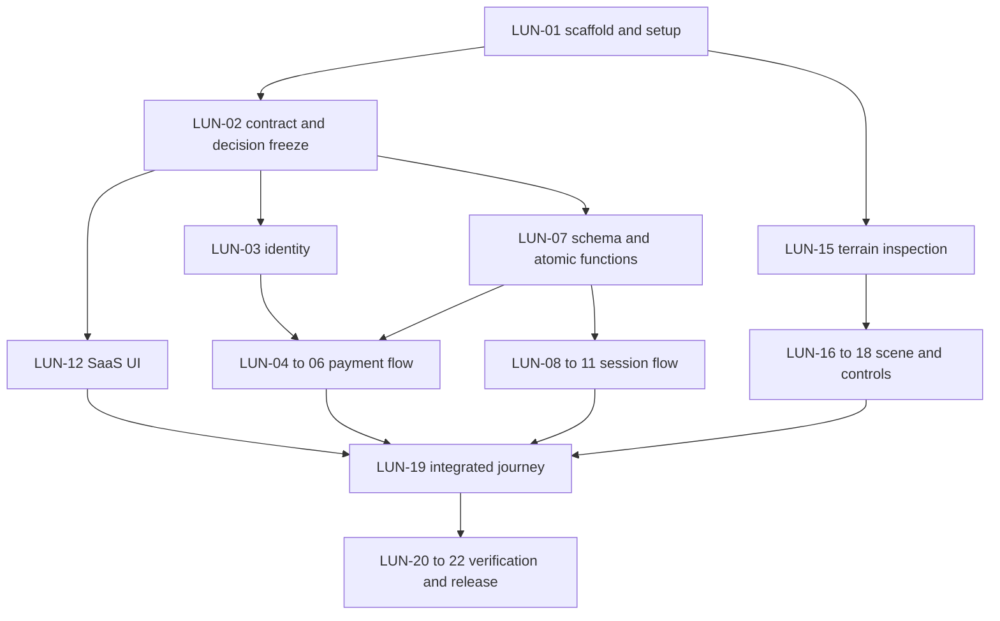

# LUNARA — Development Plan and Claude Code Task Prompts

Version 1.0 · 25 October 2026 · Five developers · Nine elapsed build hours

## 1. Readiness, source documents, and latest decisions

This is an implementation plan, not application code or a record of completed work. All tasks start NOT STARTED. Read `PRODUCT.md` v1.0 and `ARCHITECTURE.md` v1.0 in the repository. Their product story/use-case/acceptance identifiers and architecture FR/NFR/AT identifiers are retained below. The source PRD labels several defaults as proposed; the user's description of approved documents does not resolve those individually.

**API contract limitation:** a matching `API_CONTRACT.md` was not available when this plan was prepared. No endpoint shape below is claimed to come from an approved contract. Task LUN-02 must locate the team's existing contract, or have the lead define and freeze the missing contract from ARCHITECTURE §12 before dependent implementations are integrated. Independent visual and terrain work can proceed with isolated adapters. This deliverable does not silently create a competing API contract.

**Latest user correction:** controls are **Z forward, S backward, Q turn left, D turn right, mouse look**. Escape releases pointer lock and returns access to interface controls. Z/S/Q/D supersedes W/S/A/D in the earlier PRD/architecture. T5 must reconcile those source documents in LUN-02; do not let old prompts restore W/A. Q/D turn rather than strafe.

**Start ordering clarification:** opening the exploration route is preparation, not billable Start. Load/validate the scene first; explicit server-accepted Start begins billing. This resolves the user's journey wording (Start before loading) in favor of the PRD's explicit no-billing-during-preparation requirement. Refresh during an already active session is not a free pause.

**Terrain:** one already-selected environment. Working location from the preceding brief: `public/models/mars-terrain.glb`, browser URL `/models/mars-terrain.glb`. The latest brief does not provide a replacement path. Treat this as provisional until actual bytes, license, format, scale, textures, spawn, and traversal area are verified. No asset has been inspected for this plan. Do not claim it exists or generate a substitute map silently.

### Product invariant summary

LUNARA demonstrates prepaid access to a hypothetical future planetary-camera service through a local Mars simulation. Users register/login, buy a test package, receive verified credit, choose Mars, prepare the terrain, explicitly start, navigate while time decreases even when stationary, expire, and buy/restart. It is not live Martian imagery or a real robotic connection.

Keep: one playable Mars map; keyboard/mouse first-person camera; Stripe test Checkout; backend-controlled persistent time; verified once-only payment credit; one active session/account; automatic expiration; explicit exit and repurchase. Exclude visible rover/wheels, phone controller, real payments, real robotics, advanced physics, procedural planets, multiplayer, chatbot, and second playable map. A simulated signal indicator is optional decoration only.

Recommended stack from ARCHITECTURE: Next.js/React/TypeScript; Tailwind/shadcn where useful; Three.js/R3F/Drei; Supabase Auth and Supabase-hosted PostgreSQL; Next.js Route Handlers; Stripe test Checkout; Vercel; GitHub. Atomic balance/session changes belong in database transactions, with TypeScript orchestration. No alternate backend, queue, persistent timer worker, or WebSocket service is needed.

### Provisional policy register

| Item | Working baseline | Required resolution |
|---|---|---|
| Heartbeat/interruption | 5-second renewal, 15-second lease, no separate pause; hidden page stops renewal and attempts exit | Team confirms OD-01 in LUN-02; keep copy, SQL and tests aligned |
| Units | Integer milliseconds internally; minutes ×60,000; display rounded up to seconds | T3/T4 freeze serialized type and limits |
| Unused credit | Retained without calendar expiry; fixed safe spawn on new session | Confirm OD-08 |
| Test catalog | Illustrative 1/5/15 min at EUR 1/4/10; one-minute package supports live expiry | Confirm OD-02 and actual Stripe test Price mapping |
| Auth | Supabase email/password; verification follows configured project | Confirm callback/email behavior; no assumed auto-confirm |
| Dependencies | Compatible stable versions, one package-manager lockfile | T5 selects and records versions; no invented version claims |

## 2. Team allocation and file ownership

Assign actual people by experience at kickoff. Roles below are not assumptions that everyone can safely implement payments or SQL. Strongest transactional/backend developer should own T4; someone comfortable with Auth/provider setup should own T3. T1 is suitable for a teammate strongest in React/UI; T2 needs 3D/graphics debugging; T5 needs integration and deployment judgment. Pair T3/T4 on credit correctness and use T5 to unblock integration, not to absorb every unfinished feature.

| Role / branch | Primary owned files | Delivery responsibility | Reviewer |
|---|---|---|---|
| T1 SaaS UX · `feat/saas-ui` | Public/pricing/dashboard/purchase-status/explore page composition; `src/components/saas/`, `src/components/ui/` | Truthful SaaS journey, HUD/overlays, accessibility | T5; T4 for time states |
| T2 3D · `feat/mars-scene` | `src/components/exploration/`, `src/config/destinations.ts`, selected model, `docs/assets.md` | Asset verification, ready/error signals, Z/S/Q/D, safe ground/bounds | T5; T1 integration |
| T3 Auth/payments · `feat/auth-payments` | Login/register/callback; `src/server/auth/`, `src/server/payments/`, `src/lib/supabase/`; catalog/checkout/purchase/webhook routes | Verified account access and once-only test purchase flow | T4 credit review; T5 hosted flow |
| T4 Accounting · `feat/session-accounting` | `supabase/migrations/`, seed; account/session routes; `src/server/sessions/`, `src/server/db/`, `src/features/sessions/client/` | SQL invariants, controller lifecycle, session adapter | T3 security/payment interaction |
| T5 Integration · `chore/integration` | Root configuration/lockfile, app layout/global styles, CI, `.env.example`, shared contracts, source-document reconciliation, setup/demo/test evidence | Early deploy, contract freeze, merges, cross-module tests | Relevant module owner |

T1 can propose auth styling to T3 but does not independently rewrite auth pages. T4 owns schema changes including payment tables/functions; T3 supplies verification requirements and reviews them. T5 owns shared types; other roles request changes before using incompatible payloads. T2 owns asset bytes; no teammate converts/renames them without coordination. Explicit temporary file handoff is allowed when recorded in the PR/task log.

**Common files with one editor at a time:** package manifest, lockfile, Next/Tailwind config, layout/global CSS, shared types/validators, `.env.example`, auth proxy/middleware wiring, and migrations. No parallel package installs on a shared checkout. Developers use separate clones or worktrees, not different branches in the same working directory.

## 3. Dependency and nine-hour plan

Durations below are planning budgets, not measured productivity promises. Reserve roughly six hours of focused work per developer; use the rest for coordination, review, integration and repair. Shared pairing consumes both participants' capacity. T5's integration work is continuous.



| Elapsed time | Integration checkpoint | Evidence required | If behind |
|---|---|---|---|
| 0:00–0:30 | G0 ownership/setup | Roles, providers, source files, policy log, asset source located | Identify missing credentials/asset immediately |
| 0:30–1:00 | G1 contract freeze | Existing contract reconciled or lead-approved replacement; shared DTO skeleton | Continue UI/asset isolation; do not invent production endpoints independently |
| 1:00–2:00 | G2 early deployed skeleton | Stable HTTPS origin, auth/account, initial asset viability | Drop styling/refinement; fix setup |
| 2:00–4:00 | G3 independent vertical paths | One real paid test credit; session SQL tests; usable bounded scene | Drop optional history/warning/decoration |
| 4:00–6:00 | G4 integrated core | Buy → ready → start → move/count → expire → repurchase | One package/one safe region; all effort on mandatory loop |
| 6:00–7:30 | G5 failure/concurrency gates | Invalid payment, duplicate credit, cross-account, multiple tabs, refresh/disconnect verified | No new features; correctness defects block completion |
| 7:30–8:30 | G6 feature freeze/rehearsal | Fresh-user hosted journey and five-minute pitch rehearsal | Only release-blocking fixes, rerun affected tests |
| 8:30–9:00 | G7 release freeze/handoff | Known commit, setup/env instructions, asset credit, observed test results | State unresolved defects honestly; no fake-success shortcuts |

Critical path: source/contract agreement → identity/schema → payment credit and session lifecycle → UI/scene integration → deployed verification. Terrain readiness is a parallel critical dependency. A T2 prototype and T1 static UI can be built before server integration, but only with clearly isolated development fixtures that never grant release entitlement.

## 4. Task register

All tasks below are MUST unless explicitly optional. “Depends” means implementation/integration prerequisites; planning and isolated tests may start earlier. A budget is focused effort and may span several elapsed-time windows. Acceptance references use existing ARCHITECTURE AT tests and PRD C gates.

| ID | Owner / budget | Depends | Work and concrete output | Acceptance and evidence |
|---|---|---|---|---|
| LUN-01 | T5 / 45 min | None | Inspect existing repo; scaffold only missing Next.js TS structure; select compatible dependencies/one lockfile; define scripts; deploy skeleton; prepare env names | Clean install/typecheck/build; HTTPS landing reachable; no secrets committed; C-13 |
| LUN-02 | T5 with T3/T4 / 30 min | LUN-01 | Locate/freeze API_CONTRACT; reconcile Z/S/Q/D and provisional model path in docs; confirm policies/roles; publish shared DTO/error/schema boundary | Contract covers all interfaces in §5; owner approval recorded; no claimed approval of missing material |
| LUN-03 | T3 / 60 min | LUN-01/02 | Register/login/callback/SSR refresh; verified actor helper; route guards; safe logout; zero-account bootstrap coordinated with T4 | AT-01: fresh account zero; invalid/cross-account denied; confirmation behavior correct; C-07 |
| LUN-04 | T3 / 60 min | LUN-02/03/07 | Trusted catalog; reserve immutable purchase intent; Stripe test Checkout; stable creation key; bind/recover Checkout | AT-02: retries preserve identity, no client economics, active session directs to End; test Checkout opens |
| LUN-05 | T3 + T4 review / 75 min | LUN-04/07 | Raw-body webhook verification; retrieve paid Checkout/line items; complete test/owner/price validation; call atomic fulfillment | AT-03/04: invalid/unpaid/live/mismatch zero credit; valid exactly once including concurrent paths; C-03/04 |
| LUN-06 | T3 / 45 min | LUN-05 | Owned purchase status and explicit recheck sharing fulfillment; delayed/canceled/error behavior; bounded polling guidance | AT-04/11: forged return grants nothing, repeated recheck no extra credit; late success may credit; provider outage stays pending |
| LUN-07 | T4 / 90 min | LUN-02 | Accounts/packages/purchases/events/sessions schema, constraints/indexes/RLS/grants; account locking/reconciliation and atomic credit functions; seed reviewed catalog | AT-04/05/07 and grant inspection; one ACTIVE/account, nonnegative balance, rollback, no public privileged RPC |
| LUN-08 | T4 / 60 min | LUN-03/07 | Effective account/status reads; atomic eligible Start and replay; integer-ms accounting; no lease extension on status reads | AT-05/06: 60−20=40; repeated settlement zero; positive balance/Mars check; lost Start same session |
| LUN-09 | T4 / 60 min | LUN-08 | Heartbeat sequence/generation; explicit CAS takeover; controller stop vs owner End; effective expiry | AT-07/09: stale/late calls fail; takeover winner unique; old delayed stop cannot close new controller |
| LUN-10 | T4 / 60 min | LUN-09 | Client session adapter, monotonic timer, one in-flight renewal, stale-response filter, visibility/error freezes, recovery | AT-08/09: manipulated local clock grants nothing; refresh preserves use; hidden page attempts exit; held keys stop via scene interface |
| LUN-11 | T4 with T3 / 60 min | LUN-05/09/10 | Critical unit/real DB race tests; top-up vs expiry; restart persistence; fix transaction issues | AT-04–09 recorded; credit/debit conservation; no terminal revival; repeat with actual DB functions |
| LUN-12 | T1 / 90 min | LUN-02 | Truthful landing, pricing, dashboard skeleton; shared accessible UI; actual catalog/account DTO wiring as available | Simulation/test labels; server price/duration; unavailable differs from zero; keyboard navigation; C-12/14 |
| LUN-13 | T1 / 75 min | LUN-06/12 | Purchase status UI, dashboard balance, Mars selection; pending/failure/recheck controls; safe logout integration | Real provider result shown, no redirect-based credit; zero balance offers pricing; C-01/11 |
| LUN-14 | T1 / 90 min | LUN-10/13/18 | Explore composition, Ready/Start, HUD, Escape/Exit, reconnect/conflict and expired overlays, repurchase | Map ready before billable Start; active stationary notice; Exit accessible; correct focus/errors; C-02/08/09/12 |
| LUN-15 | T2 / 45 min | Asset available | Inspect chosen asset/license/dependencies; verify proposed path; document size/format/hash/scale/ground/spawn/source/attribution | Real bytes load; rights permit required use/distribution; no assumed geometry; blocker recorded if absent; C-10/14 |
| LUN-16 | T2 / 60 min | LUN-01/15 | Client-only loader, manifest, readiness/error contract, loading/fallback, cleanup; deployed asset path | No browser globals on server; missing texture/GLB/context errors handled; no session created by scene; AT-10/11 |
| LUN-17 | T2 / 90 min | LUN-16 | Z/S translation and Q/D yaw turning, mouse look/pitch limits, pointer lock, near-ground raycast/proxy, bounds/safe route | Tested AZERTY labels/behavior; no Q/D strafe; Escape unlock; no holes/cliff escape on route; AT-10 |
| LUN-18 | T2 / 60 min | LUN-10/17 | Enforce inputEnabled and cutoff transitions; clear keys; context-loss notification; measure loading/FPS; simplify if needed | Held input cannot move normal client after revoke; unsupported graphics uncharged; actual machine measurements recorded |
| LUN-19 | T5 with owners / 90 min | LUN-06/10/14/18 | Merge end-to-end vertical slice; resolve DTO/config/route issues with owners; actual hosted purchase/scene loop | G4 actual buy/start/expire/repurchase works; mocks absent from release entitlement path; AT-15 rehearsal |
| LUN-20 | T5 coordinates / 60 min | LUN-11/19 | Execute cross-account, duplicate/failed payment, concurrent tabs, dropped response, refresh/reconnect and asset failure matrix | Mandatory AT-01–14 observed; record PASS/FAIL/BLOCKED with commit and IDs; fix before C-01 signoff |
| LUN-21 | T5 + owners / 45 min | LUN-20 | Release audit: config/secrets/grants/cache headers/asset credits; fresh build/deploy; setup and demo runbook | AT-13/14, documented env names/migrations/test Prices/callbacks; fresh-user flow reproducible |
| LUN-22 | All, T5 coordinates / 45 min | LUN-21 | Timed live rehearsal and final freeze; assign presenter; spare verified account/network/last-good deployment | AT-15 and C-01–14 evidence, no real charge, exact known commit; disclose failed gates |
| LUN-23 | T1/T2 / spare time only | G5 green | Optional low-time warning, owned purchase history, reduced-motion refinement, labeled signal indicator | Each optional feature tested; signal has no effect on controls/billing; drop immediately if core regresses |

Time estimates do not guarantee delivery. T4 has approximately 6.5 hours of assigned focused accounting/test work and is the likely bottleneck; T3 pairs on credit tests and T5 handles test orchestration. T1/T2 reserve unused time for integration/debugging, not extra scope. T5 should not independently implement every module's fixes.

### Task completion record

For every completed task, record: task ID; owner; branch/commit; files changed; assumptions/contract revision; tests actually run and results; blocked or untested cases; environment/config actions still needed; next dependent task. Keep brief entries in `docs/progress.md` or PR descriptions, as chosen by T5. “Code written” is not DONE. A task is DONE only when its acceptance evidence passes, review concerns are resolved, and the integration branch contains the change.

## 5. Contracts to freeze before dependent integration

This inventory is taken from ARCHITECTURE §12, not an unseen approved API contract. T5 resolves names, exact shapes/status codes/limits and examples in LUN-02. Do not embed alternative schema definitions in each team's code.

| Boundary | Required agreement | Owners |
|---|---|---|
| Auth | Verified actor, cookie refresh, registration confirmation, callback allowlist, logout stop behavior | T3/T5 |
| Catalog/Checkout | Package identifiers/economics; purchase request key; purchase status; provider binding; pending recovery | T3/T4/T1 |
| Credit RPC | Frozen duration/amount/currency/owner; verified provider facts; once-only purchase guard; account lock order | T3/T4 |
| Account/session DTO | ms units/serialization; serverNow; balance; session/status; lease/authorization cutoff; revision/generation; no secret hash | T4/T5 |
| Session requests | Start key; controller token; heartbeat sequence; takeover expected generation/key; separate controller stop and owner End | T4/T1 |
| Errors/cache/CSRF | Stable codes, 401/404/conflict/validation/unavailable semantics, no-store, same-origin mutation protection | T3/T4/T5 |
| Scene | `onReady`, `onError`, explicit enabled state, model manifest, context-loss/unmount behavior; no network accounting inside scene | T2/T4/T1 |
| Release config | Public vs server-only env; stable origins; test Price IDs; migrations and grants; asset URL | T3/T4/T5 |

Unresolved interface choices block only dependent wiring; they do not justify five agents guessing independently. A contract change must be reviewed by affected owners, merged centrally, and applied consistently before integration resumes.

## 6. Asset instructions for the whole team

1. T2 obtains the selected model and original license/source. A filename alone does not establish compatibility or permission.
2. If verified as a self-contained GLB, put it at the agreed repository path, provisionally `public/models/mars-terrain.glb`. Do not merely rename OBJ/USDZ to `.glb`. If external textures/decoders are required, include permitted dependencies and preserve paths.
3. In the browser, Next.js public assets use `/models/mars-terrain.glb`, not `/public/models/mars-terrain.glb`. Put the URL, transform, spawn and boundaries in the single manifest; avoid five independent hardcoded paths.
4. T2 records source URL/license/attribution, actual filename, bytes/hash, format, required extensions/textures, axis/scale transform, bounding box, spawn/ground and safe route in `docs/assets.md`. Do not invent measurements.
5. Verify the final deployed URL returns actual model bytes, not a Git LFS pointer, 404 page, or login page. T5 checks hosting/repository size limits before choosing a delivery method. If too large, optimize the same asset within its license or coordinate an external static origin; update manifest/deployment docs together.
6. The renderer loads before new billable Start. Missing/unusable asset blocks Start and is reported explicitly. A development placeholder may support isolated work, but cannot pass final selected-terrain acceptance.

Keyboard implementation choice: the requirement names literal Z/S/Q/D. Use layout-aware `KeyboardEvent.key` normalized to lowercase for these letters, document the choice, and test on the actual AZERTY keyboard. Ignore navigation shortcuts while an editable UI element has focus. Do not silently map `KeyZ`/`KeyQ` physical positions as though they always match displayed labels. If the team later wants physical-key mapping or QWERTY alternatives, treat it as an explicit reviewed enhancement. Clear pressed keys on blur, unlock, hide, error and authorization loss.

## 7. GitHub workflow and integration rules

Use `main` for the known demonstrable release and `integration` as T5's merge target. Create the five role branches from the same checkpoint. If an existing repository uses another workflow, preserve it and document the equivalent roles rather than rebuilding history.

Each developer works in a separate clone/worktree and checks status before edits. Start from a clean checkpoint without overwriting unrelated work. Commit small logical changes with task IDs, for example `LUN-09: fence heartbeat and stop by controller generation`. Stage explicit owned paths; do not blindly stage all files or commit `.env` secrets/assets without license review.

Open small PRs into integration. PR text states task, behavior, affected contracts, tests/results, config/migrations, and remaining limits. Require T4 review for transaction/schema changes and T3 review for authentication/payment verification. T5 merges in dependency order: scaffold/contracts → auth/schema → payment/session core → scene/UI integration → test/fix/release. Scene-only and static UI PRs can merge earlier if isolated and build-safe.

Synchronize with integration after relevant shared changes; coordinate migration numbering to avoid collisions. Prefer merging integration into already shared feature branches rather than force-pushing rewritten history. Never reset someone else's branch, delete their changes, force-push protected/shared branches, or automatically resolve a conflict by selecting all of one side. Let the owner resolve semantic conflicts and rerun affected tests.

Shared scripts proposed for LUN-01: `dev`, `lint`, `typecheck`, `test`, `test:integration`, `test:e2e`, `build`. T5 defines their real commands according to the selected tooling; agents must inspect package.json and not claim nonexistent commands passed. Use one package manager/lockfile. PyCharm is an editor/terminal environment; it does not replace Node, provider setup, or Git review.

Release gate: green mandatory tests/build, reviewed configuration, deployment smoke, correct asset and known commit. Tag a release only after T5's explicit release decision. Do not let each agent independently deploy or apply production migrations. Here “production deployment” remains a hackathon application using Stripe test mode.

## 8. Copy-paste-ready Claude Code prompts

Each block is a separate prompt for a fresh Claude Code session in the assigned developer's clone/worktree. Role/team labels are intentional placeholders for people, not unresolved implementation instructions. Prompts authorize work within the role's owned files, with contract-dependent behavior blocked until LUN-02 is frozen. They are instructions for future coding; this document-generation task has not executed them.

### Prompt A — T5: kickoff, contracts, scaffold and early deployment (LUN-01/02)

```text
You are T5, LUNARA's integration lead. Work on chore/integration in a separate clone/worktree. Read CLAUDE.md, PRODUCT.md, ARCHITECTURE.md, TASKS.md and any existing API_CONTRACT.md before editing. Inspect the repository and preserve existing work. Do not assume it is empty.

Execute LUN-01 and LUN-02 from TASKS.md. First report the actual repository state, source-document conflicts, provider/asset blockers and ownership. Latest controls are literal Z forward, S backward, Q turn left, D turn right, mouse look, Escape unlock. Reconcile stale W/S/A/D references in source documents. Prepare/load the scene before a new server-accepted billable Start. The model path public/models/mars-terrain.glb is provisional until T2 verifies it.

Locate the team's actual API_CONTRACT.md. If missing, explicitly report it and prepare a proposed contract from ARCHITECTURE §12 for lead review; do not claim it was supplied or approved. Freeze the actor, catalog/purchase, balance/session, controller, error/CSRF/cache, renderer and SQL boundaries with T3/T4 and affected owners. Record confirmed vs still-proposed billing/catalog policies. Do not silently choose incompatible endpoints on their behalf.

Own root scaffolding, dependency selection, lockfile, shared contracts, layout/global config, .env.example and build/CI scripts. Select compatible stable dependencies using current official docs and repository evidence. Define real lint/typecheck/test/integration/e2e/build commands. Scaffold only missing parts and make a minimal early deployment through the team's authorized account/configuration; if access is unavailable, complete local preparation and report the specific action needed. Never expose secrets or use live Stripe keys.

Do not implement teammates' payment/session/scene modules or reset their work. Publish a shared checkpoint and interfaces before dependent work. Run available checks and record actual results, not assumed success. Finish with task status, files/commit, contract status, tests, blockers and next assignments. No application feature is complete merely because a scaffold deploys.
```

### Prompt B — T1: SaaS pages, purchase states, HUD and accessible journey (LUN-12/13/14)

```text
You are T1, LUNARA's frontend/UX owner. Use feat/saas-ui in your own clone/worktree. Read CLAUDE.md, PRODUCT.md, ARCHITECTURE.md, API_CONTRACT.md and TASKS.md. If the API contract is absent/unfrozen, build only isolated presentation against documented development adapters and report the missing dependency; do not invent production endpoint shapes.

Implement LUN-12, LUN-13 and LUN-14. Own landing/pricing/dashboard/purchase-status/explore composition and components/saas and components/ui. T3 owns auth behavior/pages; propose styling changes to that owner. T4 owns the session client adapter and accounting; T2 owns canvas/navigation. Ask T5 to coordinate shared layout/styles/dependencies rather than editing those files concurrently.

Build a truthful space-themed SaaS: simulation and Stripe test labels, real catalog durations/prices, persistent effective balance, Mars only, useful pending/error states, Ready/Start, active billing HUD, Escape overlay, accessible Exit, connection lost/recover, active-elsewhere/takeover, expiry and Buy More. Use literal Z/S/Q/D instructions; Q/D turn, not strafe. Escape does not pause billing. Load the actual scene before new billable Start. Only the T4 adapter may enable navigation from committed current authorization; a success redirect, local balance, or asset readiness alone is insufficient.

Wire real owned purchase status/recheck and account/session DTOs after contract freeze. Distinguish unavailable from zero, pending from credited, and unconfirmed exit from stopped. Never credit time or send client-calculated elapsed time. Preserve explicit restart after terminal expiry and new credit. Do not create a duplicate heartbeat loop in pages/components.

Provide keyboard-operable forms/actions, labels, visible focus and major-state announcements without speaking every timer tick. Escape must let users reach Exit. Handle unsupported graphics without starting billing. Keep optional history/warnings/decoration out until mandatory integration passes.

Verify AT-08/11/12/14 as applicable and participate in AT-15 with real services. Record mocked versus real tests separately. End with LUN task status, owned files, actual commands/results, unresolved integration needs, and a small reviewable commit/PR summary. Do not touch backend grants, SQL or payment verification.
```

### Prompt C — T2: verify selected terrain and build AZERTY first-person scene (LUN-15/16/17/18)

```text
You are T2, LUNARA's 3D owner. Use feat/mars-scene in a separate clone/worktree. Read CLAUDE.md, PRODUCT.md, ARCHITECTURE.md, TASKS.md and the frozen scene contract in API_CONTRACT.md/shared types. Latest controls override old docs: literal Z forward, S backward, Q turn left, D turn right, mouse look, Escape releases pointer lock. Use KeyboardEvent.key consistently for these literal labels and test the actual keyboard. Q/D are yaw, not strafing.

Execute LUN-15 through LUN-18. Own components/exploration, config/destinations.ts, the selected asset and docs/assets.md. First inspect the actual supplied landscape. Proposed path is public/models/mars-terrain.glb and browser URL /models/mars-terrain.glb; confirm bytes before using it. Verify source/license/redistribution and attribution, format, size, texture/decoder dependencies, orientation/scale, ground, bounds and spawn. If missing/unusable/unlicensed, report the exact blocker and continue only independent scene wiring; do not generate a new map or claim a placeholder meets acceptance.

Build client-only R3F/Three rendering with loader/error boundaries, readiness after valid ground/spawn/render, cleanup and unsupported-device fallback. The scene must never start a billable session itself. It receives authoritative inputEnabled from T4's adapter and emits ready/error/context-loss signals. T1 composes HUD/pages.

Implement first-person camera near terrain, delta-based movement, pitch limit, safe fixed spawn, downward ground sampling or simplified ground proxy, and a bounded validated traversable region. Reject steps with no safe ground or outside bounds; handle obstacles with simple exclusion regions where needed. No rover, vehicle physics, jump/free-flight or procedural planet. Clear keys and stop movement on authorization loss, blur, hide, pointer unlock or error, including when Z is held at expiry. Escape unlocks without claiming to stop billing; explicit Exit belongs to the session UI.

Measure actual deployed cold load and a 60-second route on the demo laptop. Treat 15-second load and about 30 FPS as targets, not achieved facts. Simplify the same licensed asset/lighting/region if needed. Coordinate dependencies/storage changes with T5. Verify deployed bytes are not a Git LFS pointer. Test AT-10/11 and the scene portion of AT-08/12; document actual observations, asset facts, files, blockers and task status. Never alter balances, provider auth, or payment code.
```

### Prompt D — T3: verified identity and Stripe test payment pipeline (LUN-03/04/05/06)

```text
You are T3, LUNARA's authentication/payment owner. Work on feat/auth-payments in a separate clone/worktree. Read CLAUDE.md, PRODUCT.md, ARCHITECTURE.md, TASKS.md and the actual frozen API_CONTRACT.md. Do not invent the contract if absent; coordinate LUN-02 with T5/T4. Execute LUN-03 through LUN-06 within your ownership paths.

Implement provider-supported Supabase email/password/SSR authentication, confirmation/callback/refresh behavior, server-verified actor identity and owned-resource checks. Never trust an unverified cookie user object. Coordinate idempotent zero-balance bootstrap with T4. Logout freezes/stops active control when possible and otherwise relies on the disclosed lease cutoff. Protect each handler independently; use configured CSRF/origin defenses for cookie mutations and no-store private responses.

Implement the trusted catalog and authenticated Stripe Checkout in test mode only. Reserve immutable owned purchase economics through T4's SQL boundary; use stable request/provider idempotency keys; recover creation timeouts without a new accidental purchase. Never accept amount/duration/user/return URL as authoritative from the browser. Normal Checkout requires ending active exploration first. All URLs and test Price mappings come from trusted configuration.

Verify raw-body webhook signatures before trusting events. Retrieve Checkout and line items server-side; require paid, test mode, correct owned intent and Checkout binding, expected Price/quantity/currency/total. Call T4's atomic fulfillment function; never chain independent balance/status updates. Event-ID deduplication and purchase-level once-only credit are both required. Share this same verifier/fulfillment path with authenticated owned payment recheck. Return success only after commit; transient failures remain retryable. Duplicate or out-of-order events cannot duplicate/reverse credit. Canceled browser return is not proof of provider failure; return URL alone grants nothing.

Implement owned status/pending/recheck states for T1. Card entry stays in Stripe-hosted test Checkout; no real charges or manual-credit success shortcut. Keep secrets server-only and logs sanitized. T4 owns migrations/functions; request changes and review their atomic credit implementation rather than editing schema concurrently.

Run AT-01–04 and payment failure portions of AT-11/13. Include real provider test purchase and real-DB notification/recheck race evidence, not mocks alone. Report actual commands/results, test environment, remaining setup, files, task status and reviewable commit. Do not display keys, cookies or raw sensitive webhook payloads in output.
```

### Prompt E — T4: atomic accounting, controllers and session adapter (LUN-07/08/09/10/11)

```text
You are T4, LUNARA's accounting owner. Work on feat/session-accounting in a separate clone/worktree. Read CLAUDE.md, PRODUCT.md, ARCHITECTURE.md especially §3.3/3.4/5.4/5.5, TASKS.md and frozen API_CONTRACT.md. Resolve absent/conflicting contracts with T5/T3 before production integration. Execute LUN-07 through LUN-11. Own migrations/seed, account/session handlers, server sessions/db and features/sessions/client. Do not rewrite T3's verifier or T2's scene.

Implement integer-ms persistent accounting using account-row locks and short atomic PostgreSQL functions. Lock order and timestamps must follow the architecture: sample DB time after acquiring the account lock. Schema constraints include nonnegative balance, unique paid Checkout binding, unique start request per owner and partial unique ACTIVE session per account. Enable RLS and restrict table/function grants; privileged keys remain server-only and server/function ownership checks still apply.

Use the defined reconciliation: A=accountedThrough, B=settled balance, L=raw lease, N=DB time at least A; E=A+B; C=min(L,E); T=min(N,C); debit max(0,T-A) exactly once. Persist through T; close at C when N reaches it, EXPIRED if E<=L otherwise INTERRUPTED. Closed sessions never reopen. No per-heartbeat rounding, browser elapsed inputs, persistent in-memory timers or expiry worker dependency. Status reads reconcile without renewing.

Implement Start with positive balance/Mars/readiness-integrated explicit action, durable request identity and no duplicate session on lost response. Apply controller hash/generation, monotone heartbeat sequence with no lease extension on replay, explicit CAS takeover, stale-controller rejection and separate current-controller stop versus owner End. Old delayed stop cannot terminate a replacement controller. Terminal requests return truthful final state and cannot revive access. Adopt proposed 5s renewal/15s lease only consistently with LUN-02 decision log.

Implement the common atomic credit function with T3: settle existing use first, add frozen verified duration once under purchase lock, record credit/event atomically, no silent resurrection after expiry, no lease renewal from purchase credit. T3 is responsible for provider verification before invocation.

Build the sole session client adapter: one in-flight heartbeat, monotonic display estimate, conservative cutoff, stale-response fencing, no local credit authority; freeze on visibility/network/auth/graphics uncertainty; explicit recovery; unconfirmed exit copy; ordinary input disabled by deadline. Scene loads before a new billable Start. A refresh during an accepted session does not reset/pause billing.

Write meaningful arithmetic tests and real-DB concurrency/rollback tests (AT-04–09). Include 60s minus 20s, subsecond repeated settlement, 12s exhaustion, late reconciliation, lost start/stop response, simultaneous starts/takeovers, old generation/sequence replay, credit vs debit/expiry and backend restart. No public test clock/reset/credit endpoint. Finish with task status, migrations and deployment needs, actual tests/results, files/commit, unresolved defects and integration handoff to T1/T2/T3/T5.
```

### Prompt F — T5: integrated QA, release and live demonstration (LUN-19/20/21/22)

```text
You are T5, LUNARA's integration/release lead. Read all five repository documents, current progress/PRs and frozen contract. Execute LUN-19 through LUN-22 on the integration workflow in TASKS.md. Preserve teammates' changes, merge reviewed dependency-ready branches, and assign semantic fixes to owners. Do not resolve conflicts by discarding one entire side.

Verify actual wiring from Supabase auth to PostgreSQL, Stripe test Checkout/verified once-only credit, effective account state, terrain readiness, explicit Start, T4 session adapter, T2 Z/S/Q/D scene, HUD/Exit, expiry and repurchase. Ensure placeholder/demo adapters cannot authorize the released application. The selected model and required attribution must be present and usable at the deployed URL.

Run the actual project scripts defined in package.json and record command/results against the release commit. Execute ARCHITECTURE AT-01–15 and PRD C-01–14, prioritizing cross-account denial, invalid/unpaid/live/mismatched payment, duplicate and concurrent fulfillment, simultaneous starts/takeovers, stale controllers, reload/dropped requests/disconnection, held-key expiry, asset/context failures and secrets/grants/cache checks. Distinguish unit/mocked, real DB, provider and manual browser evidence. Never claim unrun tests passed.

Complete a fresh deployed journey: Register → Login → Buy a short genuine Stripe test package → verified balance → Choose Mars → load/Ready → explicit Start → Z/S/Q/D/mouse exploration and stationary countdown → actual expiry → Buy More → explicit restart → Exit. Do not speed the billing clock or manually credit the demo. Confirm no real-money transactions.

Document exact env names, callbacks/webhook setup, reviewed migrations/catalog, asset source/license, test data and run/recovery instructions without secrets. Rehearse the five-minute pitch, retain last-good commit/deployment and a documented spare account. At 7.5h feature freeze, cut optional work and fix only blockers. Promote/tag only on the agreed release decision. If a provider/asset/correctness blocker remains, identify the failed gate and present it honestly; a recording is not a live success. Finish with release commit, observed gate matrix, limitations and handoff.
```

### Prompt G — owner-scoped repair after a failed gate

```text
Read CLAUDE.md, TASKS.md, the frozen API_CONTRACT.md, and the failing test/log supplied with this request. Identify the violated invariant, owning LUN task, and the smallest fix within your assigned files. Reproduce the failure before changing behavior where practical. Do not weaken authorization, payment validation, accounting precision, controller fencing or acceptance tests to make the demo pass. Do not introduce manual credit, client-only time, or hidden mock success.

If the fix requires another owner's/shared files or contract change, describe the exact coordinated change and proceed with independent safe work while the owner handles it. Preserve unrelated edits. Implement the focused fix, rerun the failing test and affected integration path, and report actual evidence plus remaining uncertainty. Do not perform unrelated refactoring or broad dependency upgrades during feature freeze.
```

## 9. Acceptance and test evidence

Required gates are the existing PRD C-01–C-14 and ARCHITECTURE AT-01–AT-15. Latest Z/S/Q/D overrides old key labels in AT-10. The plan does not claim any application test has executed.

| Area | Minimum reproducible checks | Release consequence |
|---|---|---|
| Identity | Fresh zero account, invalid/expired auth, cross-account session/purchase/balance, direct privileged RPC denial | Any unauthorized access blocks release |
| Payment | Genuine paid test Checkout; invalid signature/unpaid/live/wrong economics; same/different event replay; webhook/recheck race; failed transaction retry | Any false/duplicate credit blocks release |
| Time | 60−20=40 stationary too; subsecond repeated reads; lease cutoff; negative prevention; later process recovery | Any extra debit/credit or unbounded tail blocks release |
| Concurrency | Two starts, same-start retry, two takeovers, stale/duplicate heartbeat, delayed old stop, top-up at expiry | No overlapping sessions or terminal revival |
| Scene | Actual licensed model, deployed textures, valid spawn/safe route, Z/S/Q/D/mouse/Escape, held-key expiry | Placeholder/missing rights/unusable navigation blocks completion |
| UX/failures | Pending≠success, unavailable≠zero, readiness before Start, Exit/hidden/network/context loss, keyboard focus | Uncontrolled billing or trapped Exit blocks release |
| Operations | Locked build, grants, sanitized logs, server-only secrets, no-store account responses, correct callbacks/test endpoint | Exposed secret/live payments block release |

Record for each: ID, expected result, observed result, PASS/FAIL/BLOCKED/NOT RUN, date, tester, build commit, environment/browser, sanitized request/event/session references, and linked defect if failed. Use consenting demo accounts. SQL fixtures are permitted only in isolated tests; they do not substitute for provider purchase evidence. Deterministic clocks belong in private tests, not runtime API inputs.

## 10. Scope cuts, blockers and final handoff

Cut optional signal, decorative destinations, elaborate postprocessing, history, warnings and extra package variety before sacrificing correctness. Limit the same terrain to a safe region if collisions are expensive. Keep transparent billing, test-only verified payments, persistent atomic accounting, one controller, expiry, explicit exit/recovery and basic accessible UI.

If asset/license or provider access is missing, complete independent work and record the exact blocker. Do not silently replace the chosen map, remove signature verification, weaken RLS, assume credentials, or count mock payments as completion. A pending contract blocks dependent integration, not this planning deliverable or independent scaffold/UI/asset inspection.

At handoff provide source commit, working deployment URL when actually deployed, setup/configuration instructions, tested asset provenance, observed acceptance matrix, known limits, and presenter runbook. Do not claim production readiness or legal certification. The application's normal client enforces expiry, but downloaded geometry can be rendered by a modified client; the enforceable security guarantee is server-owned balances and entitlement.
